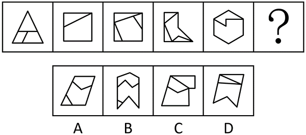

# 数量规律-面的细化（最大面的边数构成等差数列）

考点：[[20-考点/判断推理/图形推理/数量规律-面的细化（最大面的边数构成等差数列）|图形推理 / 数量规律-面的细化（最大面的边数构成等差数列）]]

**问法模型**：一组图+问号求规律 → 元素不同、属性无规律时数数量；整体面数无规律则细化到'最大面边数'递增

## 推理链
1. 第1步：题干五幅图元素组成不同，先看属性（对称、曲直、封闭），均无明显属性规律，转向数量规律
2. 第2步：五幅图均被内部线条分割成多个封闭区域（分割明显），优先数整体面个数，但各图面数量无递增递减规律
3. 第3步：换'面的细化'角度——每幅图都存在一个明显最大的面，逐图数其边数：图1三角形3边、图2正方形4边、图3五边形5边、图4六边形6边、图5七边形7边
4. 第4步：最大面边数依次为3、4、5、6、7，构成等差递增数列，故？处图形最大面应为8边形
5. 第5步：逐项数最大面边数验证：A项最大面为4~5边、B项最大面为8边、C项约6边、D项约5~6边，仅B满足8边

**最快解法**：⚡ 最大面边数法：逐图锁定最大封闭区域并数边，得3、4、5、6、7的等差规律，直接找最大面为8边形的选项，秒选B并排除A/C/D

## 易错点
- ⚠ 只数整体面个数，发现无规律后误判'无数量规律'而转投属性类
- ⚠ 想不到'最大面边数'这一面的细化考法，卡在面数量层面
- ⚠ 数最大面边数时数错：漏数被内部线条截断形成的边，或把外框整段误算多边

## 母题抽象
> 🧩 当题干图形分割明显、但整体面个数无规律时，转向'面的细化'——找出每幅图的最大面（或最小面）数其边数，验证是否构成等差递增数列

**同类特征**：元素组成不同、无明显属性规律、图形分割明显（多个封闭区域）、整体面数量无规律、每图存在一个最大面、最大面边数3→7等差递增

## 相关题
- [[10-真题/判断推理/图形推理/10297262 数量规律-面的形状种类（封闭面种类数分组）|10297262]]（浙江 2025，相关度3）
- [[10-真题/判断推理/图形推理/10204454 数量规律-部分数（黑白球连通区域数做和）|10204454]]（甘肃 2024，相关度2）
- [[10-真题/判断推理/图形推理/10297050 数量规律-特殊计数（线条穿过小白球的数量）|10297050]]（天津 2025，相关度2）
- [[10-真题/判断推理/图形推理/10297314 数量规律-交点数（曲直交点）|10297314]]（浙江 2025，相关度2）
- [[10-真题/判断推理/图形推理/11454020 数量规律-小元素按行排布（每行个数自上而下递增1）|11454020]]（选调 2024，相关度2）

---

### 题干

从所给的四个选项中，选择最合适的一个填入问号处，使之呈现一定的规律性：

### 选项
- A. A
- B. B　✅
- C. C
- D. D

### 官方解析
元素组成不同，且无明显属性规律，考虑数量规律。题干图形分割明显，优先考虑面数量，但整体数面无规律。继续观察发现，题干图形均存在最大面，且最大面的边数依次为3、4、5、6、7，故？处图形最大面的边数应为8，只有B项符合。
故正确答案为B。

### 给定材料
（无）
