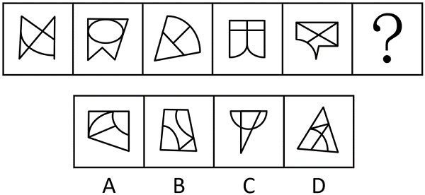

# 数量规律-交点数（曲直交点）

考点：[[20-考点/判断推理/图形推理/数量规律-交点数（曲直交点）|图形推理 / 数量规律-交点数（曲直交点）]]

**问法模型**：'选择最合适的一个填入问号处使之呈现规律性'且图形曲直混搭 → 属性规律（对称/开闭/曲直性）无一致结论时，转向数量规律，优先数曲直交点

## 推理链
1. 第1步：观察题干五幅图，均由直线和曲线共同构成，且曲线与直线出现明显相交（如图1曲线穿过三角形边、图3扇形内曲线与直边相交）
2. 第2步：元素组成不同，先验证属性规律——对称性、封闭性、曲直性均无法统一区分五幅图，故考虑数量规律
3. 第3步：由于'直线和曲线出现明显相交'，锁定细分考点为曲直交点数，逐图清点：题干五幅图的曲直交点数均为3，呈常数规律
4. 第4步：依规律，问号处图形的曲直交点数应为3
5. 第5步：逐项清点选项曲直交点：A、B、C的曲直交点数均不为3，予以排除
6. 第6步：D项三角形与内部曲线的曲直交点数为3，与题干常数规律吻合，故选D

**最快解法**：⚡ 规律口诀'曲直相交数曲直交点'+排除法：题干五图曲直交点恒为3，快速清点四个选项，只有D为3，直接锁定

## 易错点
- ⚠ 把交点总数（含直线与直线的交点）当作统计对象，混入直直交点导致规律错乱
- ⚠ 漏数或重数切点、端点处的曲直接触，导致每图计数偏差
- ⚠ 先入为主去数面数量或线数量，忽略'曲直明显相交'这一提示曲直交点的特征信号

## 母题抽象
> 🧩 当题干图形均为'直线+曲线'组合且二者明显相交、属性规律找不到一致方向时，用'数曲直交点'的方法，验证其是否为常数或等差规律并据此排除选项

**同类特征**：曲直组合图形、曲线与直线明显相交、元素组成不同、属性规律不明显、曲直交点数恒为3、五图连续序列推问号

## 相关题
- [[10-真题/判断推理/图形推理/12019740 数量规律-交点数（曲直交点）|12019740]]（浙江 2026，相关度4）
- [[10-真题/判断推理/图形推理/10297314 数量规律-交点数（曲直交点）|10297314]]（浙江 2025，相关度3）
- [[10-真题/判断推理/图形推理/12100997 数量规律-交点数（曲直交点）|12100997]]（江苏 2025，相关度3）
- [[10-真题/判断推理/图形推理/5510176 数量规律-交点数（曲直交点）|5510176]]（湖北 2023，相关度3）
- [[10-真题/判断推理/图形推理/2172360 数量规律-笔画数（奇点数法，两笔画规律）|2172360]]（江苏 2018，相关度2）

---

### 题干

从所给的四个选项中，选择最合适的一个填入问号处，使之呈现一定的规律性：

### 选项
- A. A
- B. B
- C. C
- D. D　✅

### 官方解析
元素组成不同，且无明显属性规律，考虑数量规律。观察发现，题干图形均由直线和曲线构成，且直线和曲线出现明显相交，考虑曲直交点数。题干图形的曲直交点数均为3，故？处图形的曲直交点数应为3，只有D项符合。
故正确答案为D。

### 给定材料
（无）
