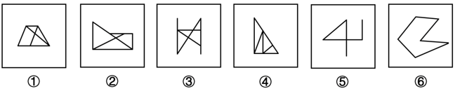
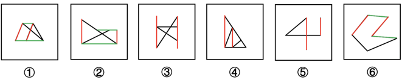

# 数量规律-平行线组数（两组平行线 vs 一组平行线）

考点：[[20-考点/判断推理/图形推理/数量规律-平行线组数（两组平行线 vs 一组平行线）|图形推理 / 数量规律-平行线组数（两组平行线 vs 一组平行线）]]

**问法模型**：六个图形分为两类，每类各有共同规律 → 分组分类题：元素组成不同且无属性规律时，转向数量规律，本题聚焦'平行线组数'差异分组

## 推理链
1. 第1步：观察六图，元素组成各不相同，先试对称、封闭、曲直等属性规律均无明显一致特征
2. 第2步：发现六图均由直线构成，先整体数直线总数，但各图直线数无分组规律
3. 第3步：换角度观察线条间的位置关系，发现各图都存在成对的平行线
4. 第4步：逐图清点平行线组数：图①②⑥均含两组平行线（如图①梯形对边平行加内部线段构成另一组），图③④⑤均只含一组平行线（如图③两条竖线平行，图④外侧竖边与内部竖线平行，图⑤两条竖线平行）
5. 第5步：按'两组平行线'与'一组平行线'分为两类：①②⑥一组，③④⑤一组
6. 第6步：对照选项，①②⑥/③④⑤对应B项，与官方答案一致

**最快解法**：⚡ 平行线计数法：整体数直线无规律后，立刻改数每个图形中平行线的'组数'——①②⑥各两组、③④⑤各一组，直接锁定B

## 易错点
- ⚠ 整体数直线总数无规律时轻易放弃数量规律，未转向线条间的平行关系
- ⚠ 漏数图形内部线段与外框构成的隐含平行线（如图④内部竖线与外侧竖边平行、图⑥凹多边形内部隐含的平行对边），导致组数数错
- ⚠ 把'平行线组数'误当作'交点数/角数'等其他数量考点，误入其他分组方向

## 母题抽象
> 🧩 当分组分类题图形均为直线构成、整体线数无规律时，改数'平行线组数'验证分组：两组平行线归一类、一组平行线归另一类

**同类特征**：六个图形均由直线构成、元素组成不同且无属性规律、每个图形都含成对平行线、平行线组数存在两组/一组的差异、分组分类问法（六图分两类）

## 相关题
- [[10-真题/判断推理/图形推理/10204622 图形推理-数量规律-笔画数（一笔画判定）|10204622]]（辽宁 2024，相关度1）
- [[10-真题/判断推理/图形推理/11367773 数量规律-一笔画（奇点数）+面的形状（三角形面个数）双规律|11367773]]（江苏 2025，相关度1）
- [[10-真题/判断推理/图形推理/12019817 数量规律-面的细化（面的形状：所有面均为四边形）|12019817]]（浙江 2026，相关度1）
- [[10-真题/判断推理/图形推理/13504266 数量规律-交点数（曲直交点数量+交点形态交替规律）|13504266]]（云南 2025，相关度1）
- [[10-真题/判断推理/图形推理/13504600 数量规律-多边形元素边数递减（等差数列）|13504600]]（辽宁 2025，相关度1）

---

### 题干

把下面的六个图形分为两类，使每一类图形都有各自的共同特征或规律，分类正确的一项是：

### 选项
- A. ①④⑤，②③⑥
- B. ①②⑥，③④⑤　✅
- C. ①⑤⑥，②③④
- D. ①③④，②⑤⑥

### 官方解析

本题为分组分类题目。元素组成不同，且无明显属性规律，考虑数量规律。观察发现，题干图形均由直线构成，考虑直线数，但整体数直线没有规律。继续观察发现，题干存在成对的平行线，考虑平行线，发现图①②⑥中均含有两组平行线，图③④⑤中均含有一组平行线，即图①②⑥为一组，图③④⑤为一组。

故正确答案为B。

### 给定材料
（无）
