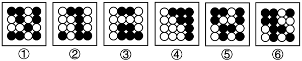

# 数量规律-黑球个数（分组分类）

考点：[[20-考点/判断推理/图形推理/数量规律-黑球个数（分组分类）|图形推理 / 数量规律-黑球个数（分组分类）]]

**问法模型**：'把六个图形分为两类，使每一类都有各自的共同特征或规律' → 分组分类模型：属性规律不通时转数量规律，对统一元素逐图计数后按数量归组

## 推理链
1. 第1步：六个图形均为4×4共16个圆圈的黑白填充网格，元素组成不同，且各图黑球位置无平移、旋转等位置规律
2. 第2步：对称、封闭、曲直等属性规律不明显，按'属性不通找数量'转向数量规律，以黑球个数作为计数对象
3. 第3步：逐一清点各图黑球：图①⑤⑥中黑球数量均为9，图②③④中黑球数量均为7
4. 第4步：按黑球个数为9或7分成两组：①⑤⑥一组，②③④一组，与选项D一致

**最快解法**：⚡ 数量规律-直接数数：只数黑球不数白球，得①⑤⑥=9个、②③④=7个，按'9个 vs 7个'归组，直接锁定D

## 易错点
- ⚠ 看到黑白球先去想对称、连通等形状规律，忽略最基础的'数黑球个数'数量规律
- ⚠ 数黑球时漏数被白球隔开或位于边角位置的黑球，计数错误导致无法整齐分组
- ⚠ 黑白球总数固定为16，若改数白球须统一标准（①⑤⑥白球7个、②③④白球9个，分组结果不变），口径不一致会排错选项

## 母题抽象
> 🧩 当分组分类题图形元素组成不同且无明显属性规律时，优先对特征元素（黑球/黑块/交点等）逐图计数，按数量相同者归为一类

**同类特征**：六图分组分类问法、4×4黑白圆圈网格、元素组成不同、无属性规律、数黑球个数、9与7两组数量差

## 相关题
- [[10-真题/判断推理/图形推理/12019740 数量规律-交点数（曲直交点）|12019740]]（浙江 2026，相关度2）
- [[10-真题/判断推理/图形推理/12536392 数量规律-黑色区域面积（宫格面积折算）|12536392]]（四川 2024，相关度2）
- [[10-真题/判断推理/图形推理/13504389 图形推理-笔画数（奇点数定一笔画-多笔画）|13504389]]（云南 2025，相关度2）
- [[10-真题/判断推理/图形推理/1797382 数量规律-部分数（不相连独立元素计数）|1797382]]（山东 2016，相关度2）
- [[10-真题/判断推理/图形推理/2033324 数量规律-面数量（等差数列）|2033324]]（河南 2016，相关度2）

---

### 题干

把下面的六个图形分为两类，使每一类图形都有各自的共同特征或规律，分类正确的一项是：

### 选项
- A. ①②③，④⑤⑥
- B. ①③④，②⑤⑥
- C. ①④⑥，②③⑤
- D. ①⑤⑥，②③④　✅

### 官方解析
本题为分组分类题目。图形元素组成不同，且无明显属性规律，考虑数量规律。观察发现，图①⑤⑥中的黑球数量均为9，图②③④中的黑球数量均为7，即图①⑤⑥为一组，图②③④为一组。
故正确答案为D。

### 给定材料
（无）
