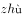

# 单定义-多要件分级匹配（关键词定位）

考点：[[20-考点/判断推理/定义判断/单定义-多要件分级匹配（关键词定位）|定义判断 / 单定义-多要件分级匹配（关键词定位）]]

**问法模型**：题干给出三级汉字分级的定义，问哪组'字—级别'分配最有可能正确 → 对每组三个字分别提取'使用频率+使用领域'要件，与各级定义逐一对应，全对才选

## 推理链
1. 第1步：提取定义要件——一级字是'常用字'，满足'基础教育和文化普及'的基本用字需要；二级字'使用度仅次于一级字'，满足'出版印刷、辞书编纂和信息处理'的一般用字需要；三级字是'姓氏人名、地名、科学技术术语和中小学语文教材文言文用字'中未进一、二级字表的'较通用的字'，满足'专门领域'的用字需要
2. 第2步：确立判断顺序——先看该字是否为日常常用字（一级），再看是否为书面语、辞书印刷用字（二级），最后看是否主要出现在人名、地名、术语等专门领域（三级），按使用度递降排位
3. 第3步：A项——'秀'为常用字属一级无误，但'砫'是地名用字应属三级而非二级，'闸'（水闸、闸门）是常用字应属一级而非三级，组内两字错位，排除
4. 第4步：B项——'甩'为日常常用动作字，符合'基础教育和文化普及'属一级；'偻'（伛偻）为书面用语，符合'出版印刷、辞书编纂和信息处理'的一般需要属二级；'昄'组词'昄大'为地名，符合三级字'地名用字'要件，三项全对，当选
5. 第5步：C项——'坋'主要用于地名（另读指尘埃、撒粉末），符合三级字'地名用字'要件，却被放在一级字位，排除
6. 第6步：D项——'焘'意为覆盖、常用于正式书面表达，符合二级字'出版印刷、辞书编纂'要件而非一级；且'泻'（腹泻、流泻）为常用字不应属二级，排除

**最快解法**：⚡ 排除法+关键词定位：先拿自己最有把握的常用字验证（'甩''秀''闸''泻'均为常用字应属一级），发现选项级别明显错位即整组排除，剩余B项再用'昄=地名用字属三级''偻=书面语属二级'复核确认

## 易错点
- ⚠ 误以为生僻字一律归三级，忽略二级字也包含'偻、焘'这类较生僻的书面/辞书用字
- ⚠ 只验证组内一两个熟悉的字就下结论（如A项见'秀'为一级正确即误选），忽略每组三个字须全部符合定义
- ⚠ 对多音多义字（坋、砫）只按熟悉的读音义项判断级别，忽略其地名用字身份应属三级

## 母题抽象
> 🧩 当题干出现按'使用频率/使用领域'将对象分为多级的定义时，用'常用→书面一般→人名地名术语专门领域'三档定位法逐项核对，组内任一对象错位即整组排除

**同类特征**：三级字表分级定义、使用度递降（常用→一般→专门）、常用字-基础教育文化普及、出版印刷辞书编纂信息处理、姓氏人名地名科技术语文言文用字、问'最有可能正确'的分组匹配

## 相关题
（暂无）

---

### 题干
《通用规范汉字表》将收录的汉字分为三个等级：一级字为常用字，主要满足基础教育和文化普及的基本用字需要；二级字的使用度仅次于一级字，主要满足出版印刷、辞书编纂和信息处理等方面的一般用字需要；三级字是姓氏人名、地名、科学技术术语和中小学语文教材文言文用字中未进入一、二级字表的较通用的字，主要满足信息化时代与大众生活密切相关的专门领域的用字需要。
根据上述定义，下列汉字分级最有可能正确的是：

### 选项
- A. 一级字：秀；二级字：砫；三级字：闸
- B. 一级字：甩；二级字：偻；三级字：昄　✅
- C. 一级字：坋；二级字：苓；三级字：蒄
- D. 一级字：焘；二级字：泻；三级字：兀

### 官方解析

第一步：找出定义关键词。

一级字：“常用字”、“主要满足基础教育和文化普及的基本用字需要”；

二级字：“主要满足出版印刷、辞书编纂和信息处理等方面的一般用字需要”；

三级字：“姓氏人名、地名、科学技术术语和中小学语文教材文言文用字中未进入一、二级字表的较通用的字”、“主要满足信息化时代与大众生活密切相关的专门领域的用字需要”。

第二步：逐一分析选项。

A项：“秀”为常用字，符合“主要满足基础教育和文化普及的基本用字需要”，为一级字；“砫”读（），为地名用字，符合“姓氏人名、地名、科学技术术语和中小学语文教材文言文用字中未进入一、二级字表的较通用的字”，为三级字，该项汉字分级不正确，排除；

B项：“甩”为常用字，符合“主要满足基础教育和文化普及的基本用字需要”，为一级字；“偻”可以指身体弯曲，为书面用语，符合“主要满足出版印刷、辞书编纂和信息处理等方面的一般用字需要”，为二级字；“昄”读（），表示大的意思，组词为“昄大”时表示地名，符合“姓氏人名、地名、科学技术术语和中小学语文教材文言文用字中未进入一、二级字表的较通用的字”，为三级字，该项汉字分级正确，当选；

C项：“坋”读作（）时用于地名，读作坋（）时指尘埃、撒粉末，符合“姓氏人名、地名、科学技术术语和中小学语文教材文言文用字中未进入一、二级字表的较通用的字”，为三级字，该项汉字分级不正确，排除；

D项：“焘”读作（或），意为覆盖，常用于正式的书面表达，符合“主要满足出版印刷、辞书编纂和信息处理等方面的一般用字需要”，为二级字，该项汉字分级不正确，排除。

故正确答案为B。

### 给定材料
（无）
