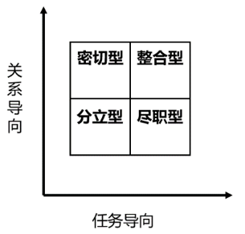

# 单定义-要素对应（图表坐标定位型）

考点：[[20-考点/判断推理/定义判断/单定义-要素对应（图表坐标定位型）|定义判断 / 单定义-要素对应（图表坐标定位型）]]

**问法模型**：'根据上述定义，某管理人员属于哪种领导方式'→提取定义中的坐标维度关键词，将情境取值映射到图中方格定位

## 推理链
1. 第1步：提取定义关键词'横坐标与纵坐标分别表示对生产的关心程度和对人的关心程度'，对应图中横轴'任务导向'、纵轴'关系导向'
2. 第2步：读取图中四象限分布：左上'密切型'（低任务高关系）、右上'整合型'（高任务高关系）、左下'分立型'（低任务低关系）、右下'尽职型'（高任务低关系）
3. 第3步：题干情境'对工作极为关心'→任务导向（横坐标）取最大值；'不关心员工的需求'→关系导向（纵坐标）取最小值
4. 第4步：横坐标最大+纵坐标最小定位到图中右下方格
5. 第5步：右下方格标注为'尽职型'，与D项吻合，排除A密切型（左上）、B整合型（右上）、C分立型（左下）

**最快解法**：⚡ 坐标定位法：抓住'极为关心工作→横轴取最大，不关心员工→纵轴取最小'，直接定位图中右下角方格读出'尽职型'选D

## 易错点
- ⚠ 未将图中'任务导向/关系导向'与定义中'关心生产/关心人'完成同义转换，误认关心人对应横轴
- ⚠ 凭语感误选'密切型'，忽略图中'密切型'实为低任务高关系区域
- ⚠ 误选'分立型'，未注意分立型是双低（低任务低关系），而题干任务关心极高

## 母题抽象
> 🧩 当定义判断题干附坐标图/方格图并问情境归属时，先把情境的两个变量按坐标轴方向取最大或最小，再读出所定位区域的名称即可作答

**同类特征**：管理方格图、横坐标对生产的关心程度、纵坐标对人的关心程度、对工作极为关心、不关心员工的需求、图表型定义判断

## 相关题
（暂无）

---

### 题干

有学者用下列管理方格图表示管理人员对生产的关心程度和对人的关心程度，横坐标与纵坐标分别表示对生产的关心程度和对人的关心程度。每个方格表示的是关心生产和关心人这两个基本因素以不同程度相结合的一种领导方式。

根据上述定义，如果一个管理人员对工作极为关心，但不关心员工的需求，其领导方式属于：

### 选项
- A. 密切型
- B. 整合型
- C. 分立型
- D. 尽职型　✅

### 官方解析
第一步：找出定义关键词。
“横坐标与纵坐标分别表示对生产的关心程度和对人的关心程度”、“每个方格表示的是关心生产和关心人这两个基本因素以不同程度相结合的一种领导方式”。
第二步：分析并匹配选项。
提问方式为“如果一个管理人员对工作极为关心，但不关心员工的需求，其领导方式属于”，故根据定义关键词进行分析并匹配即可。根据“每个方格表示的是关心生产和关心人这两个基本因素以不同程度相结合的一种领导方式”，可知需要匹配横纵坐标；根据“横坐标表示对生产的关心程度”以及该管理人员“对工作极为关心”，可知横坐标取方格的最大值；根据“纵坐标表示对人的关心程度”以及该管理人员“不关心员工的需求”，可知纵坐标取方格的最小值，此时横纵坐标定位的方格为尽职型。
故正确答案为D。

### 给定材料
（无）
