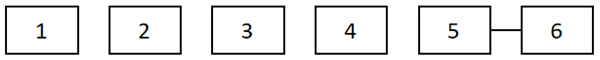

# 单定义-要素对应（分段编码逐位匹配）

考点：[[20-考点/判断推理/定义判断/单定义-要素对应（分段编码逐位匹配）|定义判断 / 单定义-要素对应（分段编码逐位匹配）]]

**问法模型**：给出分段命名规则+具体型号编码，问'下列说法错误的是'（选非题）→ 按位置模板逐段切分编码，与定义要素一一对应，找出对应错误的选项

## 推理链
1. 第1步：从题干提取命名规则六要素：1工作压力（仅无枪身适用，有枪身空缺）—2穿孔性能（BH=大孔径射孔弹）—3药型罩开口直径（mm）—4主炸药类型—5单发装药量（g）—6产品改进型号；图中6个方框依次标1~6，且5、6两框间有连线，提示实际型号中第5、6段连写为'33-1'形式
2. 第2步：用拆段对应法将'BH36RDX33-1'按'压力|性能|直径|炸药|药量-改进'模板逐段切分
3. 第3步：切分结果——开头无压力数值→第1段空缺→有枪身射孔弹；BH→第2段大孔径射孔弹；36→第3段药型罩开口直径36mm；RDX→第4段主炸药类型RDX；33→第5段单发装药量33克；-1→第6段产品改进型号
4. 第4步：逐项对照——A'大孔径射孔弹'与BH对应正确；B'主炸药类型为RD'与RDX不符，属拆段错位；C'有枪身射孔弹'与第1段空缺对应正确；D'装药量33克'与第5段对应正确
5. 第5步：本题为选非题，仅B说法错误，与官方答案一致

**最快解法**：⚡ 拆段对应法（六段模板切分）：BH36RDX33-1→BH(大孔径)|36(直径)|RDX(炸药)|33-1(药量-改进)，开头无压力段即有枪身；炸药段是RDX而非RD，选非直接锁定B

## 易错点
- ⚠ 把主炸药段'RDX'错误拆成'RD'+'X'或将X并入下一段，误认为'B主炸药类型为RD'说法正确而错选
- ⚠ 忽略'有枪身射孔弹此项（工作压力）空缺'的反向信息，因型号中无压力数值而误判为无枪身
- ⚠ 选非题惯性思维，看到A/C/D与定义相符顺手选走，漏看题干问'错误的是'

## 母题抽象
> 🧩 当题干出现'分段编码命名规则+一个具体编码实例'时，先按规则段位把编码逐段切分对应，再逐项核对说法，选非题锁定对应错误项

**同类特征**：分段编号命名说明（1~6逐位定义）、字母数字混合编码如BH36RDX33-1、含'某项空缺'的隐含分类信息、选非问法'说法错误的是'、图中方框连线提示相邻段连写

## 相关题
（暂无）

---

### 题干

射孔弹按弹体承压结构分为有枪身射孔弹和无枪身射孔弹。射孔弹型号命名表示方法如下所示：

说明：1—射孔弹的工作压力（无枪身射孔弹适用，有枪身射孔弹此项空缺），单位为兆帕（MPa）；2—射孔弹穿孔性能，用DP表示深穿透射孔弹，用BH表示大孔径射孔弹，用GH表示大孔径深穿透射孔弹，用EH表示等孔径射孔弹；3—药型罩开口直径，单位为毫米（mm）；4—主炸药类型；5—射孔弹单发装药量，单位为克（g）；6—产品改进型号。

根据上述定义，对于型号为BH36RDX33-1的射孔弹，下列说法错误的是：

### 选项
- A. 为大孔径射孔弹
- B. 主炸药类型为RD　✅
- C. 为有枪身射孔弹
- D. 单发装药量为33克

### 官方解析
第一步：找出定义关键词。
1：“射孔弹的工作压力（无枪身射孔弹适用，有枪身射孔弹此项空缺）”；
2：“射孔弹穿孔性能，用DP表示深穿透射孔弹，用BH表示大孔径射孔弹，用GH表示大孔径深穿透射孔弹，用EH表示等孔径射孔弹”；
3：“药型罩开口直径”；
4：“主炸药类型”；
5：“射孔弹单发装药量”；
6：“产品改进型号”。
第二步：逐一分析选项。
A项：该射孔弹型号为BH36RDX33-1，BH符合“2”中的“用BH表示大孔径射孔弹”，符合定义，排除；
B项：该射孔弹型号为BH36RDX33-1，BH符合“2”中的“用BH表示大孔径射孔弹”，36则对应“3”中的“药型罩开口直径”，故RDX对应“4”中的“主炸药类型”，所以该射孔弹的主炸药类型为RDX，不符合定义，当选；
C项：该射孔弹型号为BH36RDX33-1，开头直接用BH表示大孔径射孔弹，说明该射孔弹无工作压力，符合“1”中的“有枪身射孔弹此项空缺”，所以该射孔弹为有枪身射孔弹，符合定义，排除；
D项：该射孔弹型号为BH36RDX33-1，结合上述选项分析，33对应“5”中的“射孔弹单发装药量”，符合定义，排除。
本题为选非题，故正确答案为B。

### 给定材料
（无）
