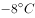
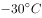

# 单定义-关键词匹配（主体'生物'+核心限定'生理适应过程'）

考点：[[20-考点/判断推理/定义判断/单定义-关键词匹配（主体'生物'+核心限定'生理适应过程'）|定义判断 / 单定义-关键词匹配（主体'生物'+核心限定'生理适应过程'）]]

**问法模型**：'根据定义，下列体现顺应的是'→拆解定义要点（主体：生物；条件：环境改变或迁入新环境；结果：生理适应过程），逐项比对排除

## 推理链
1. 第1步：拆解定义三要素——主体为'生物'，触发条件为'环境发生改变或当生物迁入新环境'，核心结果为'对所在环境条件产生的生理适应过程'
2. 第2步：以'生理适应'为最强排他关键词，将'动作变化''态度变化''方法变化'等非生理层面的改变先行排除
3. 第3步：A项松树随季节（环境改变）耐寒力发生变化，是生物在生理指标上的适应，主体、条件、结果全部命中
4. 第4步：B项苍蝇'不停地摆头决定方向'是动作/行为反应，非生理适应过程
5. 第5步：C项小王'更加勤奋'是学习态度的改变，不属于生理层面适应
6. 第6步：D项小李'采用新的方式与他人交流'是方法改变，且触发源是培训而非环境改变或迁入新环境；故仅A符合定义，当选

**最快解法**：⚡ 关键词法——先抓定义中'生理'二字作一票排除：A项'耐寒力变化'是典型生理指标改变直接命中；B'摆头'是动作、C'勤奋'是态度、D'方式'是方法，均非生理改变，秒排

## 易错点
- ⚠ 忽视'生理'限定，误把B项苍蝇对强光的摆头反应当作'适应'，混淆行为反应与生理适应
- ⚠ 纠结'人也是生物'而误选C/D，未识别其变化发生在态度、方法层面而非生理层面
- ⚠ 忽略触发条件限定，D项的变化源于'培训'而非'环境改变或迁入新环境'，属于双重不符

## 母题抽象
> 🧩 当定义含'主体限定+性质限定核心词（如生理/心理/物理）'时，先锁定限定词作最强排除标准，再验证触发条件（如'环境改变或迁入新环境'）是否满足

**同类特征**：单定义判断、主体限定为'生物'、核心词'生理适应过程'、触发条件'环境改变/迁入新环境'、问'下列体现的是'、干扰项为行为/态度/方法类改变

## 相关题
- [[10-真题/判断推理/定义判断/10297114 单定义-要素对应（主体+目的+对象）|10297114]]（天津 2025，相关度1）
- [[10-真题/判断推理/定义判断/10297337 单定义-要件对照（条件+结果双要件匹配）|10297337]]（浙江 2025，相关度1）
- [[10-真题/判断推理/定义判断/10297431 单定义-要件对应排除（心理学概念：过程要件+结果要件）|10297431]]（四川 2025，相关度1）
- [[10-真题/判断推理/定义判断/11367802 单定义-关键词要件比对（灰度认知）|11367802]]（江苏 2025，相关度1）
- [[10-真题/判断推理/定义判断/11367803 单定义-多要件逐项核对|11367803]]（江苏 2025，相关度1）

---

### 题干
顺应是指当环境发生改变或当生物迁入新环境时，生物对所在环境条件产生的生理适应过程。
根据上述定义，下列体现顺应的是（    ）。

### 选项
- A. 
松树冬季的耐寒力由夏季的变为
　✅
- B. 
某些苍蝇由暗处飞到强光下，会不停地摆头决定方向

- C. 
小王转学进入新的学校学习，他更加勤奋了

- D. 
参加沟通技巧培训后，小李采用新的方式与他人交流

### 官方解析
第一步：找出定义关键词。
“生物”、“生理适应过程”。
第二步：逐一分析选项。
A项：松树冬季的耐寒力的改变是生理适应，符合“生理适应过程”，符合定义，当选；
B项：苍蝇不停地摆头，属于动作变化，不符合“生理适应过程”，不符合定义，排除；
C项：小王勤奋，属于对待学习的态度，不符合“生理适应过程”，不符合定义，排除；
D项：小李改变交流方式，属于方法的改变，不符合“生理适应过程”，不符合定义，排除。
故正确答案为A。

### 给定材料
（无）
