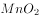
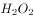
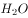
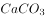
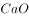
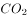
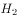

# 单定义-要件判断（选非题·定义关键信息比对）

考点：[[20-考点/判断推理/定义判断/单定义-要件判断（选非题·定义关键信息比对）|定义判断 / 单定义-要件判断（选非题·定义关键信息比对）]]

**问法模型**：「根据上述定义，下列不属于自发反应的是」→ 选非题：先拆解定义核心要件（①给定条件下不需外加能量即可自动进行；②过程中可外加能量，但其目的必须是「维持给定条件」而非「改变给定条件」），再比较各选项外加能量的功能属性，锁定「改变条件」的选项

## 推理链
1. 第1步：提取定义要点——自发反应=「在给定条件下不需要外加能量就能自动进行」；并允许过程中有外加能量，但该能量「目的不是改变'给定条件'，而是维持'给定条件'」
2. 第2步：转化判题标准——选非题要找「外加能量改变了给定条件（即能量是反应发生的驱动源，撤去能量反应立刻停止）」的选项
3. 第3步：A项以某物质「作催化剂加入…发生催化反应」，催化剂仅起加速作用，不改变反应的给定条件，外加能量属「维持条件」→ 符合定义
4. 第4步：B项在「100kPa条件下…加热到900℃分解」，加热旨在达到并维持分解所需的给定条件，倾向于「维持条件」→ 倾向符合定义
5. 第5步：D项「植物在光照条件下发生光合作用」，光照为给定条件下的能量供给，属「维持条件」→ 倾向符合定义
6. 第6步：C项「在通电的情况下产生…和…」，「通电」无法自然形成、一旦断电反应立刻停止，外加电能是反应发生的先决条件，属「改变给定条件」→ 一定不符合定义
7. 第7步：比较排除——B、D存在模糊空间，而C不符合定义的程度最高且确定，故不属于自发反应的是C

**最快解法**：⚡ 关键词比较法：圈出四个选项的外加能量（催化剂/加热/通电/光照），逐一追问「撤去该能量，反应还能否在给定条件下自动进行」——催化剂只是加速、加热和光照只是维持条件，唯独「通电」一断反应立停、电能是反应驱动源，直接锁定C

## 易错点
- ⚠ 只盯「不需要外加能量」字面，见D需光照、B需加热就误选，忽略定义明确允许过程中存在「维持给定条件」式的外加能量
- ⚠ 用化学学科常识（如高温分解是否吸热、光合作用机理）另立标准质疑答案，违背「定义判断以题干定义为唯一判断依据」的原则
- ⚠ 忽略「维持给定条件」与「改变给定条件」这一关键区分维度，见四个选项都需外加能量便无从下手或全判为符合定义

## 母题抽象
> 🧩 当定义采用「不需外加能量即可自动进行，但过程中可外加能量以维持给定条件」的双层表述且题目为选非时，比较各选项外加能量的功能属性：凡能量是反应驱动源、撤去即停的（如通电）→ 不符合定义；能量仅起加速或维持条件作用的 → 符合定义

**同类特征**：化学情境单定义判断、自发反应、给定条件、外加能量：维持条件vs改变条件、选非题（不属于）、程度比较排除法

## 相关题
- [[10-真题/判断推理/定义判断/10297105 单定义-多要件匹配（选非题：共同目的要件'证明功效'）|10297105]]（天津 2025，相关度1）
- [[10-真题/判断推理/定义判断/10297427 单定义-否定提问（选非题）-要件比对|10297427]]（四川 2025，相关度1）
- [[10-真题/判断推理/定义判断/10975251 单定义-多要件核对（选非题）|10975251]]（江苏 2024，相关度1）
- [[10-真题/判断推理/定义判断/10975256 单定义-选非题（要件否定：相邻两代人）|10975256]]（江苏 2024，相关度1）
- [[10-真题/判断推理/定义判断/11367798 单定义-选非题（多要件匹配与主体-手段偷换辨析）|11367798]]（江苏 2025，相关度1）

---

### 题干
化学中的自发反应是指在给定条件下不需要外加能量就能自动进行的反应。在自发反应过程中有可能需要外加能量，但外加能量的目的不是改变“给定条件”，而是维持“给定条件”。
根据上述定义，下列不属于自发反应的是：

### 选项
- A. 
作催化剂加入中，发生催化反应，产生和

- B. 
100kPa条件下，将加热到900℃，分解生成和

- C. 
在通电的情况下产生和
　✅
- D. 
植物在光照条件下发生光合作用

### 官方解析
A选项中的催化剂，B选项中的加热，C选项中的通电，D选项中的光合作用，都是外加能量，要想选一个不属于“自发反应”的选项，根据题干，需要判定哪一个外加能量属于改变条件，而非维持条件。比较四个外加能量，催化剂是用来加速催化的，而光合、加热和通电相比，只有“通电”是无法自然形成的，相比较而言更属于改变条件的范畴。
本题为选非题，故正确答案为C。
注：从化学常识角度而言，其实B项的加热，D项的光合作用在某些情况下也属于非自发反应，但是通电一定不属于自发反应，只要通电停止，反应也会立刻停止。也就是说，BD有可能符合定义，也有可能不符合定义，但是C一定不符合定义，故相比较而言，正确答案也是C选项。

### 给定材料
（无）
