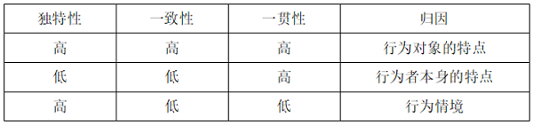

# 单定义-多要点组合匹配（三维归因图表对照）

考点：[[20-考点/判断推理/定义判断/单定义-多要点组合匹配（三维归因图表对照）|定义判断 / 单定义-多要点组合匹配（三维归因图表对照）]]

**问法模型**：题干给出'独特性/一致性/一贯性'三要素定义及'要素高低组合→归因维度'图表，问'王某当日的行为应归因于'→先从图表抄录归因规则，再逐句比对题干事实判定三要素高低，按组合行匹配结论

## 推理链
1. 第1步：读图提取归因规则表：独特性低+一致性低+一贯性高→行为者本身的特点；独特性高+一致性高+一贯性高→行为对象的特点；独特性高+一致性低+一贯性低→行为情境
2. 第2步：题干'王某经常在工作分配上与他人争吵'，即该行为'在多数情况下一直如此'而非特殊行为→独特性低
3. 第3步：'王某的其他同事都未曾就工作分配问题与张经理发生争吵'，即其行为'与其他行为者不一致'→一致性低
4. 第4步：'王某在其他场合多次就工作分配问题与张经理发生争吵'，即对行为对象张经理'一贯如此'而非偶然为之→一贯性高
5. 第5步：三维组合为'低-低-高'，对照图表第二行，归因于'行为者本身的特点'
6. 第6步：与选项对照，'行为者本身的特点'对应B项

**最快解法**：⚡ 图表对照法：先锁定图中'独特性低、一致性低、一贯性高→行为者本身的特点'一行，再用关键词定位题干三个事实（'经常与他人争吵'→独特性低；'其他同事都未曾'→一致性低；'其他场合多次'→一贯性高），组合匹配直接选B

## 易错点
- ⚠ 把'经常与他人争吵'误解为行为特殊（独特性高），实际'在多数情况下一直如此'对应独特性低
- ⚠ 混淆独特性与一贯性：独特性看该行为是否特殊/普遍，一贯性看对同一对象（张经理）是否反复如此；'在其他场合多次与张经理争吵'是贯性高的依据，不是独特性信息
- ⚠ 若把'多次争吵'误判为一贯性低，会套入'高-低-低→行为情境'一行而误选C

## 母题抽象
> 🧩 当定义以'多要素高低组合→结论'的图表形式给出时，先抄录图表规则作为判据，再从题干逐句提取每个要素的高/低档位，按组合行唯一匹配得出答案

**同类特征**：三维归因、独特性/一致性/一贯性三要素定义、图表给出'要素组合→归因维度'对应规则、问'应归因于'哪一维度、题干事实逐条对应各要素、单定义多要点匹配型定义判断

## 相关题
（暂无）

---

### 题干

对于行为者的某种行为，其基本信息有三条：（1）独特性，指行为者的这种行为是特殊的，还是在多数情况下一直如此；（2）一致性，指行为者的这种行为是否与其他行为者相一致；（3）一贯性，指行为者对行为对象的这种行为一贯如此，还是偶然为之。所谓三维归因是指根据行为者的上述行为信息，可将其行为原因归因于如下图所示的三个维度：

一日，王某就工作分配问题与张经理发生争吵，通过分析发现，王某经常在工作分配上与他人争吵，王某的其他同事都未曾就工作分配问题与张经理发生争吵，王某在其他场合多次就工作分配问题与张经理发生争吵。

根据上述定义，王某当日的行为应归因于（    ）。

### 选项
- A. 行为对象的特点
- B. 行为者本身的特点　✅
- C. 行为情境
- D. 无法确定

### 官方解析
第一步：找出定义关键词。
“独特性：行为者的这种行为是特殊的，还是在多数情况下一直如此”、“一致性：行为者的这种行为是否与其他行为者相一致”、“一贯性：行为者对行为对象的这种行为一贯如此，还是偶然为之”。
第二步：分析并匹配选项。
根据“王某就工作分配问题与张经理发生争吵”，且“王某经常在工作分配上与他人争吵”，说明王某与他人争吵的行为，符合“在多数情况下一直如此”，属于独特性低；根据“王某的其他同事都未曾就工作分配问题与张经理发生争吵”，说明王某与他人争吵的行为，符合“行为者的这种行为与其他行为者不一致”，属于一致性低；根据“王某在其他场合多次就工作分配问题与张经理发生争吵”，说明王某与他人争吵的行为，符合“行为者对行为对象的这种行为一贯如此”，属于一贯性高；因此王某与他人争吵的行为属于独特性低、一致性低、一贯性高，应归因于行为者本身的特点，对应B项。
故正确答案为B。

### 给定材料
（无）
