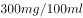

# 单定义-要素对应（多要件验证：主体+行为+比例-最小侵害）

考点：[[20-考点/判断推理/定义判断/单定义-要素对应（多要件验证：主体+行为+比例-最小侵害）|定义判断 / 单定义-要素对应（多要件验证：主体+行为+比例/最小侵害）]]

**问法模型**：问'下列选项符合行政比例原则的是'→ 提取定义核心要件（行政主体、行政行为、兼顾目标与权益、不利影响最小化），逐项对照验证

## 推理链
1. 第1步：提取定义要点——①主体是'行政主体'；②实施的是'行政行为'；③'兼顾行政目标的实现和相对人权益的保护'；④不利影响'限制在尽可能小的范围和限度内'、'保持二者处于适度的比例'，即'最小侵害+过罚相当'
2. 第2步：方法为关键词定位+多要件逐项对照，重点核查'处罚/措施是否只针对违法必要部分、未附加额外不利'
3. 第3步：A项摆地摊无证经营被'罚款5万元'，处罚畸重，未将不利影响限于最小限度，不符合'适度比例'，排除
4. 第4步：B项仅'责令拆除加盖的二层楼房'，即只处理违法部分（批准的三层不受影响），行政目标（纠正违建）实现的同时将不利影响压到最小，完全契合定义要件③④，当选
5. 第5步：C项'处3个月拘役、缓刑一年'属刑事判决（刑罚），主体与行为均非'行政主体的行政行为'，不符合要件①②，排除
6. 第6步：D项互殴致轻微伤'罚款500元并拘留15天'属常规治安处罚，只是正常处罚，未体现对相对人权益的最小化保护考量，不符合定义，排除

**最快解法**：⚡ 关键词法+'最小侵害'口诀：抓定义中'尽可能小的范围和限度'，直接找'只处理违法部分、未追加额外处罚'的选项——B只拆违建二层即秒选；再用排除法验证：A罚款5万过重、C是刑法范畴、D系常规处罚，均排除

## 易错点
- ⚠ 误选C：醉驾'判三缓一'看似从宽处理像'比例原则'，但拘役缓刑属刑事处罚，不是行政行为，忽略了'行政主体+行政行为'这一主体要件
- ⚠ 误排B：见'责令拆除'就认为是处罚而排除，未注意其仅拆除违法加盖部分、对合法三层不作处理，恰是'最小侵害'的典型体现
- ⚠ 漏看A的失衡：只确认'无证经营该罚'就认可A，未发现罚款5万元与摆地摊情节明显不成比例，违背'适度比例'要件

## 母题抽象
> 🧩 当定义出现'兼顾……与……'、'尽可能小的范围和限度'、'适度比例'等最小侵害特征词时，用要件对照法，优先选'处理范围最窄、只针对违法/必要部分、无额外不利措施'的选项，并先用主体/领域要件（如行政vs刑事）快速排除干扰项

**同类特征**：行政比例原则、兼顾行政目标与相对人权益、不利影响限制在尽可能小的范围和限度、适度比例、责令拆除违法加盖部分、单定义选是题

## 相关题
- [[10-真题/判断推理/定义判断/1789588 单定义-多要件排除（主体-对象-功能比对）|1789588]]（江苏 2016，相关度1）
- [[10-真题/判断推理/定义判断/1789600 单定义-要素对应（多要件匹配）|1789600]]（江苏 2016，相关度1）
- [[10-真题/判断推理/定义判断/1797954 单定义-要件对照（间接型定义：自身不实施+教唆-帮助-诱导他人）|1797954]]（山东 2016，相关度1）
- [[10-真题/判断推理/定义判断/18643638 单定义-要件对应（成因要件：多重特征差异形成隐性分界线＋结果要件：子群体冲突或协同障碍）|18643638]]（天津 2026，相关度1）
- [[10-真题/判断推理/定义判断/2049926 单定义-要件对应（信源可信性+时间推移+传播效果转变）|2049926]]（山东 2017，相关度1）

---

### 题干
行政比例原则是指行政主体实施行政行为应兼顾行政目标的实现和相对人权益的保护，如果初始行政目标可能对相对人权益造成某种不利影响，应使这种不利影响限制在尽可能小的范围和限度内，保持二者处于适度的比例。
根据上述定义，下列选项符合行政比例原则的是：

### 选项
- A. 
王某因在商业区摆地摊，被城市管理部门以无证经营为由罚款5万元

- B. 
谭某在批准建设的三层楼房上加盖二层，被责令拆除加盖的二层楼房
　✅
- C. 
马某醉酒驾车，酒精含量为，被处3个月拘役、缓刑一年

- D. 
张某和李某互殴，张某将李某打成轻微伤，被处罚款500元并拘留15天

### 官方解析
第一步：找到关键词。
“行政主体”、“行政行为”、“兼顾行政目标的实现和相对人权益的保护”。
第二步：逐一分析选项。
A项：城市管理部门以无证经营为由对王某罚款5万元属于正当行政行为，没有体现出对王某权益的保护，不符合定义，排除；
B项：谭某在批准建设的三层楼房上加盖二层属于违法行为，但只是被责令拆除违法加盖的楼层而未涉及其他有损谭某利益的处罚，最大限度地保护了行政相对人的权益，符合行政比例原则，当选；
C项：马某醉驾被判拘役、缓刑，属于刑法范畴不属于行政法范畴，无法体现行政比例原则，排除；
D项：张某和李某互殴，被处罚500元并拘留15天属于正当行政行为，没有体现出对二人的权益保护，不符合定义，排除。
故正确答案为B。

### 给定材料
（无）

> [!warning] 疑点（官方解析可能有误，待人工复核）
> 官方解析称A项罚款5万元'属于正当行政行为'，该表述略有不妥：摆地摊被罚5万元本身即明显过罚失衡，正是违背比例之所在；排除A的正确理由应是'处罚与行为不成比例'而非'正当但无权益保护'。此为解析表述瑕疵，不影响答案B的正确性
