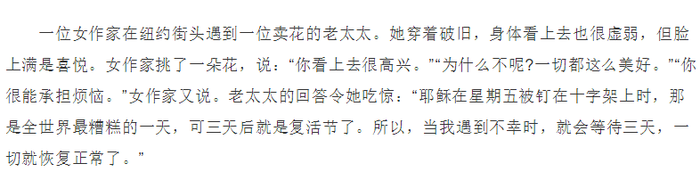

# 单定义-要素对应（多要件链条匹配）

考点：[[20-考点/判断推理/定义判断/单定义-要素对应（多要件链条匹配）|定义判断 / 单定义-要素对应（多要件链条匹配）]]

**问法模型**：题干给出'唯有先…才会…'的条件式单定义，问'下列选项涉及该定义的是'→ 拆解定义要件，逐项核对是否全部满足，缺一即排除

## 推理链
1. 第1步：从题干提取定义三要件：①强迫自己面对最坏的情况；②在精神上先接受它；③处在可以集中精力解决问题的地位（三要件为先后相继的链条，缺一不可）
2. 第2步：所用方法为关键词定位+逐项排除，重点核对每个选项是否同时具备'面对—接受—解决问题'三个环节
3. 第3步：A项：商人欠下大笔债务、心灰意冷想在农村度过余生，对应①面对最坏情况和②精神上接受；在瓜农鼓励下最终重新崛起，对应③集中精力解决问题，三要件齐备
4. 第4步：B项：A君'学习当鸵鸟，不看股票'是逃避而非面对，且只是回避炒股事实，缺①面对和②精神上接受，排除
5. 第5步：C项：老太太'心怀喜悦'体现了②精神上接受，但通篇只是心态乐观，没有任何解决问题之举，缺③集中精力解决问题，排除
6. 第6步：D项：阿Q臆想'被儿子打了'来自我麻痹，是扭曲事实的精神胜利法，既未①面对被打的事实，也未②在精神上真正接受，排除
7. 第7步：只有A项完整呈现'面对最坏→精神接受→解决问题'的链条，故选A

**最快解法**：⚡ 关键词法+尾项筛查：定义要件尾部是'集中精力解决问题'，先扫四个选项中真正出现'解决问题并改变结果'的只有A项（重新崛起），再回验A项前段符合'面对+接受'即可锁定

## 易错点
- ⚠ B项'后来想通了'易被误读为精神上接受，实则是鸵鸟心态、不看股票，属于逃避而非面对
- ⚠ C项老太太符合'精神上接受'这一要件，易因部分符合而误选，忽略定义要求三要件缺一不可、其缺少'解决问题'环节
- ⚠ D项'心满意足、俨然胜利'表面像积极心理调适，实为自我麻醉，没有'面对最坏情况'这一前提

## 母题抽象
> 🧩 当题干出现'唯有先做X（面对/接受），才会Y（解决问题）'的多要件条件式定义时，把定义拆成有先后顺序的要件链条，逐项核对每一环节是否都出现，缺任何一环即排除，勿因'部分符合'而误选

**同类特征**：唯有…才会…（条件式定义表述）、面对最坏的情况、精神上先接受、集中精力解决问题、心理调适/心态类行为辨析、问'涉及该定义的是'

## 相关题
（暂无）

---

### 题干
卡瑞尔公式是指唯有强迫自己面对最坏的情况，在精神上先接受它以后，才会使我们处在一个可以集中精力解决问题的地位上。
根据上述定义，下列选项涉及卡瑞尔公式的是：

### 选项
- A. 一个商人因经营不善而欠下一大笔债务，心灰意冷地来到亲戚的农庄，想在此度过余生，却在瓜农的鼓励下，最终重新崛起　✅
- B. A君炒股被套十分苦闷，后来想通了，学习当鸵鸟，不看股票，专心工作。几年后，他的事业取得成功
- C. 一个卖花老太太衣着破旧却满是喜悦，她说：“耶稣星期五被钉在十字架上死去，可三天后不就是复活节了吗？所以我总是心怀喜悦。”
- D. 阿Q与小D打架吃亏，心想：“我总算被儿子打了，现在这世界真不像样，儿子居然打起老子来了。”于是他心满意足，俨然胜利似的

### 官方解析

第一步：找到关键词。

关键词为“面对最坏的情况”、“精神上接受”、“集中精力解决问题”。

第二步：逐一分析选项。

A项：商人欠下债务心灰意冷，想恬静的过完余生，符合“面对最坏的情况”，在瓜农的帮助下重新崛起，符合“集中精力解决问题”，是卡瑞尔公式，符合定义，当选；

B项：股票被套，鸵鸟心态，不愿意面对炒股的失败，是没有在精神上接受这样的失败，不符合关键词“精神上接受”，因此不是卡瑞尔公式，不符合定义，排除；

C项：老太太衣着破旧，虽然如此，但是她并不认为这是坏事，很积极乐观，心怀喜悦，符合关键词“精神上接受”，但是并没有涉及到解决问题，不符合“集中精力解决问题”，不符合定义，排除；

D项：阿Q是自己臆想小D是自己的儿子，通过这样来麻痹自己不去面对被打的事实，没有从精神上接受被打的事实，不符合关键词“精神上接受”，因此不是卡瑞尔公式，不符合定义，排除。

注意：C项完整的例子应该如下，老太太认为只要等待三天，一切就会恢复正常，但是这其中并没有体现出她主动集中精力解决问题，所以错误。

A项是该定义中的例子，但出现了积极解决问题的结果，更符合定义。

故正确答案为A。

### 给定材料
（无）
