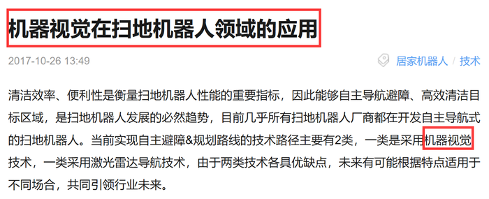

# 单定义-多要件对应（方式+目的）

考点：[[20-考点/判断推理/定义判断/单定义-多要件对应（方式+目的）|定义判断 / 单定义-多要件对应（方式+目的）]]

**问法模型**：'根据定义，下列选项涉及机器视觉的是'→ 提取定义的方式要件（光学装置+非接触传感器+自动接收和处理图像）与目的要件（获得信息/控制机器人运动），逐项比对排除

## 推理链
1. 第1步：拆解定义要件——方式：'通过光学的装置和非接触的传感器'+'自动地接收和处理一个真实物体的图像'；目的：'获得所需信息或用于控制机器人运动'
2. 第2步：注意方式要件中'接收'与'处理'是并列动作，必须同时体现，仅'接收（拍摄）'图像而未处理的不够贴切
3. 第3步：A项摄像头暗光拍摄对应'光学装置'，'发现'灰尘并'发出警报'对应'自动接收和处理图像'+'获得信息'，要件全部落实
4. 第4步：B项靠'定位系统、导航系统'工作，无光学装置接收图像，排除；C项'捕捉到超声波'接收的是声波而非'真实物体的图像'，排除
5. 第5步：D项有'拍摄装置'符合光学装置，但'拍摄到许多珍贵图像'只体现'接收'，未体现'处理'，与定义的贴切度不及A项
6. 第6步：本题系争议题，官方倾向答案为A，与要件比对结论一致，故选A

**最快解法**：⚡ 要件排除法：锁定'光学装置+接收+处理'三要素，B无光学装置、C无图像（是超声波）、D只拍未处理，排除后剩A

## 易错点
- ⚠ D项'拍摄装置'迷惑性强，容易忽略定义要求'接收和处理'两个动作，D仅'接收（拍摄）'缺'处理'环节，属于要件缺位
- ⚠ B项'车载智能设备'的'智能'表象易误判，其工作介质是定位/导航信号而非视觉图像
- ⚠ C项'捕捉超声波'易与'传感器'混淆，需辨析传感器接收的对象必须是'图像'而非声波

## 母题抽象
> 🧩 当定义的方式要件含'接收和处理'等并列动词、且选项多为科技设备情境时，逐项核对每个动词是否落实，只完成部分动作（如仅拍摄未处理）的选项排除

**同类特征**：光学的装置、非接触的传感器、自动地接收和处理、真实物体的图像、获得所需信息、单定义判断-多要件比对

## 相关题
（暂无）

---

### 题干
机器视觉，是指通过光学的装置和非接触的传感器自动地接收和处理一个真实物体的图像，以获得所需信息或用于控制机器人运动的装置。
根据上述定义，下列选项涉及机器视觉的是：

### 选项
- A. 扁平化的摄像头通过暗光拍摄，发现沙发底部灰尘很多，向主人发出需要清洗的红色警报　✅
- B. 车载智能设备在路上通过定位系统、导航系统等语音提醒司机行车路线、各路段车速限制及前方天气情况等
- C. 新型眼镜在主人探险进入黑暗洞穴后捕捉到大量蝙蝠发出的超声波，立刻启动了面部保护模式
- D. 带有拍摄装置的迷你智能机器人进入考古人员难以到达的墓穴深处，拍摄到许多珍贵图像

### 官方解析

第一步：找出定义关键词。

方式：“通过光学的装置和非接触的传感器”、“自动地接收和处理真实物体的图像”。

目的：“获得信息”、“控制机器人运动”。

第二步：逐一分析选项。

A项：通过摄像头暗光拍摄，符合关键词“通过光学的装置和非接触的传感器”，发现灰尘并汇报，符合关键词“自动地接收和处理真实物体的图像”和“获得信息”，符合定义，保留；

B项：通过定位系统、导航系统等不符合关键词“通过光学的装置和非接触的传感器”，不符合定义，排除；

C项：新型眼镜接收到蝙蝠发出的超声波，不符合关键词“自动地接收和处理真实物体的图像”，不符合定义，排除；

D项：带有拍摄装置的迷你智能机器人符合关键词“通过光学的装置和非接触的传感器”，拍摄到许多珍贵图像，符合关键词“自动地接收真实物体的图像”和“获得信息”，符合定义，保留。

<b>【备注】</b>

本题属于争议题，根据以下两点原因，我们粉笔给出的倾向性答案为A。

首先题干定义的方式为“接收和处理”，A项的“发现灰尘并汇报”符合“接收和处理”，但D项的“拍摄到许多珍贵图像”，更倾向于“接收真实物体的图像”，而非“接收和处理”，D项没有A项与定义更加贴切。

其次，我们通过查找原文，如下图所示，A项就是我们常说的“扫地机器人”，它是运用了机器视觉的。

故正确答案为A。 

### 给定材料
（无）

> [!warning] 疑点（官方解析可能有误，待人工复核）
> 官方解析第二步将D项判为'符合定义，保留'，但备注又以D缺'处理'环节为由排除D，解析内部对D是否符合定义的表述存在张力；严格而言D可能字面符合定义，本题实为争议题，最终倾向A（扫地机器人情境）的理由成立，但不排除命题人原意指向D

<!-- CODEX-ANSWER-REVIEW:BEGIN -->
### 本次独立复核

**复核状态：** `resolved`（答案与解析已核定）

**计分答案：** A（可计分）

**复核解析：**

【编辑修订版】A的摄像头自动采集沙发底部真实图像、识别灰尘并发出清洗警报，符合图像接收和处理并获取信息。B靠定位导航，C接收超声波，均不处理真实物体图像。修订后的D明确只拍照并原样存档，不作自动识别、分析、信息提取或运动控制，因此不符合定义。选A。

**修订选项：**

A. 扁平化摄像头在暗光下拍摄并发现沙发底部灰尘，自动向主人发出清洗警报
B. 车载智能设备通过定位、导航系统语音提醒路线、限速及天气
C. 新型眼镜捕捉蝙蝠发出的超声波后启动面部保护模式
D. 带有拍摄装置的迷你智能机器人拍摄并原样存档墓穴图像，不自动识别、分析或提取信息，也不据此控制运动

**相关信息：**

机器视觉—需要光学采集、自动处理真实物体图像并获取信息或控制运动；编辑澄清D只有采集、没有处理。

**题源依据：** [固定版本原题](https://github.com/Mentat-Uran/kaogongzhentizhengliu/blob/84ab93d4b64b61d897bece8a1c0a5bab06b4feb2/10-%E7%9C%9F%E9%A2%98/%E5%88%A4%E6%96%AD%E6%8E%A8%E7%90%86/%E5%AE%9A%E4%B9%89%E5%88%A4%E6%96%AD/2049508%20%E5%8D%95%E5%AE%9A%E4%B9%89-%E5%A4%9A%E8%A6%81%E4%BB%B6%E5%AF%B9%E5%BA%94%EF%BC%88%E6%96%B9%E5%BC%8F%2B%E7%9B%AE%E7%9A%84%EF%BC%89.md)；固定内容 commit `84ab93d4b64b61d897bece8a1c0a5bab06b4feb2`，Markdown blob `9bc6b46ce7dfe913ef7db3ae8309db33fe16ae7d`。
<!-- CODEX-ANSWER-REVIEW:END -->
