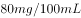

# 单定义-要件辨析（危险状态与实害结果的区分）

考点：[[20-考点/判断推理/定义判断/单定义-要件辨析（危险状态与实害结果的区分）|定义判断 / 单定义-要件辨析（危险状态与实害结果的区分）]]

**问法模型**：“根据定义，以下属于危险犯的是”→提取定义核心要件（以法定危险状态为既遂标志、不以有形实害结果为标准），逐项要件匹配排除

## 推理链
1. 第1步：从题干提取定义要点——①危害行为造成“法律规定的危险状态”；②该危险状态是“既遂标志”；③“不以造成物质性的和有形的犯罪结果为标准”
2. 第2步：所用规则——要件匹配法，核心是区分“危险状态”（行为本身即具备法定危险）与“实害结果”（物质性、有形损害）
3. 第3步：A项猥亵儿童以“有形的犯罪结果”为标准，B项商业诈骗以“造成物质性的犯罪结果”为标准，均不符合“不以有形结果为标准”的要件，排除
4. 第4步：C项诬告陷害以“使他人受刑事追究”这一有形结果为标准，同样不符合，排除
5. 第5步：D项醉酒驾驶，只要实施醉酒驾车行为即具备法定危险状态，无需产生物质性、有形犯罪结果即可作为既遂标志，与定义要件完全吻合

**最快解法**：⚡ 关键词法——抓“危险状态≠实害结果”，直接找“行为一实施即构成危险、无需出事也既遂”的选项；D项酒驾一旦发生即处危险状态，锁定D

## 易错点
- ⚠ 误认为醉驾只有撞人、出事故才构成犯罪，忽视危险犯“无需实害结果即既遂”的核心特征
- ⚠ 把C项诬告陷害的“意图使他人受刑事追究”误当成“危险状态”，实际该选项以有形结果为标准
- ⚠ 混淆危险犯、行为犯、结果犯的划分标准，只看表面罪名而不对照定义要件

## 母题抽象
> 🧩 当定义题干强调“以某种状态为既遂标志、不以物质性/有形结果为标准”时，用要件匹配法，验证选项属于“行为即状态”还是“须有实害结果”

**同类特征**：以危险状态作为既遂标志、不以物质性有形结果为标准、法定客观危险状态的具备、属于…的是（选是型问法）、选项均为具体罪名或行为

## 相关题
（暂无）

---

### 题干
危险犯，指行为人实施的危害行为造成法律规定的危险状态作为既遂标志的犯罪。这类犯罪不是以造成物质性的和有形的犯罪结果为标准，而以法定的客观危险状态的具备为标志。
根据上述定义，以下属于危险犯的是：

### 选项
- A. 猥亵儿童
- B. 商业诈骗
- C. 诬告陷害
- D. 醉酒驾驶　✅

### 官方解析

第一步：找到定义关键词。

“以造成法律规定的危险状态作为既遂标志”“不以造成物质性和有形的犯罪结果为标准”

第二步：逐一分析选项。

A项：猥亵儿童是指以刺激或满足欲求为目的，对儿童实施淫秽行为。它是以“有形的犯罪结果”为标准的，不符合定义，排除；

B项：商业诈骗是指一些以欺诈、瞒骗或违反信用为手法的非法行为，而此等行为则不以威胁或实际行使武力或暴力以达致目的。是以“造成物质性的犯罪结果”为标准，不符合定义，排除；

C项：诬告陷害是指捏造事实，作虚假告发，意图陷害他人，使他人受刑事追究的行为。使他人受刑事追究是一种“有形的犯罪结果”，不符合定义，排除；

D项：醉酒驾驶是指车辆驾驶人员血液中的酒精含量大于或者等于的驾驶行为。只要是醉酒驾驶了车辆，就是一种危险状态，无需产生“物质性和有形的犯罪结果”，可以作为既遂标志，符合定义，当选。

故正确答案为D。

### 给定材料
（无）
