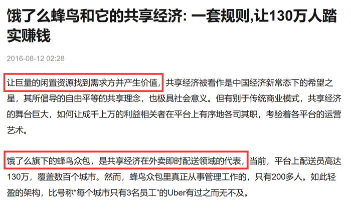
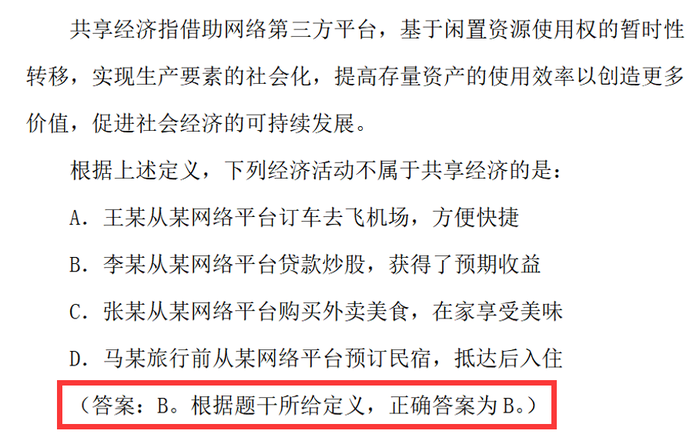

# 单定义-多要件对照（选非题，目的-价值要件排除）

考点：[[20-考点/判断推理/定义判断/单定义-多要件对照（选非题，目的-价值要件排除）|定义判断 / 单定义-多要件对照（选非题，目的/价值要件排除）]]

**问法模型**：题干问'下列经济活动不属于共享经济的是'→选非题模型：拆解定义的方式要件与目的要件，逐项对照，要件全符的排除，违背任一要件（尤其是目的/合法性要件）的当选

## 推理链
1. 第1步：从定义提取要件——方式要件'借助网络第三方平台'、核心机制'闲置资源使用权的暂时性转移'、结果/目的要件'提高存量资产的使用效率''促进社会经济的可持续发展'
2. 第2步：确认本题为选非题，采用要件对照排除法：三要件均符合的选项排除，违背任一要件的选项当选
3. 第3步：A项'从某网络平台订车去飞机场'，车辆使用权经网络第三方平台暂时性转移给王某，方式、机制、目的均符合，排除
4. 第4步：C项'从某网络平台预定民宿'，民宿使用权暂时性转移给马某，盘活闲置房源，三要件均符合，排除
5. 第5步：D项'从某网络平台购买外卖美食'，符合'借助网络第三方平台'，外卖平台整合线下闲散劳动力（闲置资源）共同获得经济红利，符合定义，排除
6. 第6步：B项'从某网络平台贷款炒股'，虽契合'网络第三方平台'，但互联网贷款资金炒股属监管禁止的违规用途，不能'促进社会经济的可持续发展'，违背目的要件，当选

**最快解法**：⚡ 目的要件排除法（价值判断先行）：定义末句'促进社会经济的可持续发展'是价值/合法性要件，先扫选项找违规行为——B项'贷款炒股'是监管明令禁止的资金用途，直接锁定当选，A/C/D无需细究

## 易错点
- ⚠ B项的贷款也涉及资金'使用权暂时性转移'，且形式上符合'网络第三方平台'，易误判其符合方式要件而漏选
- ⚠ 忽略定义末尾目的要件'促进社会经济的可持续发展'的排除功能，只机械对照方式要件
- ⚠ D项'购买外卖'看似普通消费而非共享闲置资源，易误选D；需理解外卖平台整合闲散劳动力同样属于共享经济模式

## 母题抽象
> 🧩 当定义由'方式要件+核心机制+目的/价值要件'构成且问'不属于'时，优先扫描选项中违规、违法或与主流价值相悖的行为，用目的/合法性要件一票排除

**同类特征**：共享经济、网络第三方平台、闲置资源使用权的暂时性转移、提高存量资产使用效率、促进社会经济的可持续发展、选非题

## 相关题
- [[10-真题/资料分析/综合/250219 综合分析选非题（图表数据可推断性判断）|250219]]（深圳市考 2008，相关度1）
- [[10-真题/资料分析/综合/10297333 综合分析选非题（同比增速逐年比较+年均增长量+比重百分点还原）|10297333]]（浙江 2025，相关度1）
- [[10-真题/资料分析/综合/14355349 综合分析-选非题（增长率计算比较+人均值计算）|14355349]]（浙江 2024，相关度1）
- [[10-真题/资料分析/综合/17097816 综合判断·选非题（增长率与增长量偷换）|17097816]]（山西 2024，相关度1）
- [[10-真题/资料分析/综合/2052088 综合分析-选非题（趋势判断+增速排序+增长量比较+增长率计算逐项核对）|2052088]]（吉林 2017，相关度1）

---

### 题干
共享经济指借助网络第三方平台，基于闲置资源使用权的暂时性转移，实现生产要素的社会化，提高存量资产的使用效率以创造更多价值，促进社会经济的可持续发展。
根据上述定义，下列经济活动不属于共享经济的是：

### 选项
- A. 王某从某网络平台订车去飞机场，方便快捷
- B. 李某从某网络平台贷款炒股，获得了预期收益　✅
- C. 马某旅行前从某网络平台预定民宿，抵达后入住
- D. 张某从某网络平台购买外卖美食，在家享受美味

### 官方解析

第一步：找出定义关键词。

方式：“借助网络第三方平台”、“闲置资源使用权暂时性转移”。

目的：“促进社会经济的可持续发展”。

第二步：逐一分析选项。

A项：王某从网络平台订车去机场，通过网络第三方平台让车辆的使用权暂时性转移给王某，符合定义，排除；

B项：网络贷款炒股, 符合“借助网络第三方平台”，贷款也符合关键词“闲置资源使用权暂时性转移”，但如下图所示，银保监会规定互联网贷款资金不得用于股票，若违反即违规行为，违反社会主义主流价值观，故不符合定义关键词“促进社会经济的可持续发展”，不符合定义，当选；

C项：马某从网络平台预定民宿，通过网络第三方平台让民宿的使用权暂时性转移给马某，符合定义，排除；

D项：在网上订购美食，符合“借助网络第三方平台”，由外卖员送货到家，外卖员送货也符合定义关键词“闲置资源使用权暂时性转移”，另外，典型的外卖平台有饿了么、美团等等，这些都是共享经济模式下的知名企业，如下图所示，它们整合线下的闲散劳动力，共同获得经济红利，符合定义，排除。

本题为选非题，故正确答案为B。

附注：下图为2020安徽省考判断推理大纲中，明确给出标准答案的原题，因此本题答案为B项。

### 给定材料
（无）

> [!warning] 疑点（官方解析可能有误，待人工复核）
> 官方解析排除B项的核心论据是'银保监会禁止互联网贷款资金用于炒股'这一外部监管规定，已超出定义文本本身；且D项将'外卖员送货'解释为'闲置资源使用权暂时性转移'论证略显牵强。但答案已经2020安徽省考大纲确认为B，结论无碍，仅提示该题对目的要件的依赖度较高。

<!-- CODEX-ANSWER-REVIEW:BEGIN -->
### 本次独立复核

**复核状态：** `resolved`（答案与解析已核定）

**计分答案：** B（可计分）

**复核解析：**

【编辑修订版】共享经济要求平台促成闲置资源使用权的暂时转移。A为平台提供车辆出行服务，C为短期入住民宿，修订后的D为共享闲置家庭厨房的临时供餐服务，均使闲置资源得到使用。B是互联网贷款资金用于炒股，属于资金借贷和证券投资，不是闲置生产/生活资源使用权的暂时转移，故不属于共享经济。

**修订选项：**

A. A. 王某通过网络平台预约车辆去机场，暂时使用车辆出行服务
B. B. 李某通过网络平台取得贷款用于炒股，获得预期收益
C. C. 马某旅行前通过网络平台预订民宿并短期入住
D. D. 网络平台将有空闲产能的家庭厨房临时提供给消费者使用，由家庭厨师制作餐食

**相关信息：**

共享经济的判定需检查平台中介、闲置资源以及使用权暂时转移；线上交易本身不等于共享经济。

**题源依据：** [固定版本原题](https://github.com/Mentat-Uran/kaogongzhentizhengliu/blob/84ab93d4b64b61d897bece8a1c0a5bab06b4feb2/10-%E7%9C%9F%E9%A2%98/%E5%88%A4%E6%96%AD%E6%8E%A8%E7%90%86/%E5%AE%9A%E4%B9%89%E5%88%A4%E6%96%AD/2049960%20%E5%8D%95%E5%AE%9A%E4%B9%89-%E5%A4%9A%E8%A6%81%E4%BB%B6%E5%AF%B9%E7%85%A7%EF%BC%88%E9%80%89%E9%9D%9E%E9%A2%98%EF%BC%8C%E7%9B%AE%E7%9A%84-%E4%BB%B7%E5%80%BC%E8%A6%81%E4%BB%B6%E6%8E%92%E9%99%A4%EF%BC%89.md)；固定内容 commit `84ab93d4b64b61d897bece8a1c0a5bab06b4feb2`，Markdown blob `1f3df6f19b94050d732d1dcb2ea4e20f1ec63981`。
<!-- CODEX-ANSWER-REVIEW:END -->
