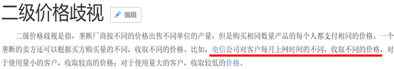

# 单定义-要件辨析（选非题）

考点：[[20-考点/判断推理/定义判断/单定义-要件辨析（选非题）|定义判断 / 单定义-要件辨析（选非题）]]

**问法模型**：'下列企业的行为与实施三级价格歧视无关的是'→选非题：先提炼定义核心要件，再逐项对照找'不符合/无关'的选项

## 推理链
1. 第1步：提取定义要件——①'同一商品或相似的商品'；②定价依据是'不同市场上顾客的需求量对价格变动的反应程度的差别'（即不同市场群体需求弹性不同）；③'实施不同的价格，以攫取更多的利益'
2. 第2步：明确选非问法，需选与定义'无关'的选项；核心校验点为'定价依据'——是按'人群/市场对价格变动的敏感度'定价，还是按其他标准（如用量）定价
3. 第3步：A项'对农村户口的客户有更大的优惠'——按客户群体（农村客户对价格变动更敏感）差别定价以激发购买欲望，符合要件②③，排除
4. 第4步：B项'特等座、一等座和二等座'——针对'经济能力好/一般'等对价格变动反应不同的群体实施不同价格，官方认定符合定义，排除
5. 第5步：C项'成人票、儿童票、老人票和学生票'——学生等群体'对价格变动更为敏感'而实施优惠票价以激发旅游欲望，符合要件②③，排除
6. 第6步：D项'根据客户每月上网时间的不同，采取不同的资费标准'——定价依据是'上网时间（消费量）'而非'对价格变动反应程度的差别'，属按用量分档定价的二级价格歧视典型，不符合定义，当选

**最快解法**：⚡ 关键词定位法：抓'定价依据'这一核心要件——三级价格歧视按'不同市场/人群对价格变动的敏感度'差别定价；A（农村户口群体）、B（不同消费能力群体）、C（成人/学生等群体）均按人群定价，唯D按'上网时间'即用量定价，直接锁定D

## 易错点
- ⚠ 忽略'选非'问法，误把符合定义的A/B/C当成答案
- ⚠ 混淆二级与三级价格歧视：二级按消费量/版本分档（如D按上网时间定资费），三级按不同市场人群的需求弹性差别定价
- ⚠ 对B项'不同座位等级'是否属'同一/相似商品'过度纠结，辨析失度反而误选B

## 母题抽象
> 🧩 当定义题描述'依据某种差别实施不同价格/待遇'且为选非问法时，先提炼'差别依据'这一核心要件，再用'各选项的差别依据是否等于定义核心依据'逐项排除；落选项常为近似概念的典型案例（如按用量分档的二级价格歧视）

**同类特征**：三级价格歧视、同一商品或相似的商品、需求量对价格变动的反应程度的差别、实施不同的价格、以攫取更多的利益、选非问法（'无关的是'）

## 相关题
（暂无）

---

### 题干
三级价格歧视即对于同一商品或相似的商品，垄断厂商根据不同市场上顾客的需求量对价格变动的反应程度的差别，而实施不同的价格，以攫取更多的利益。
根据上述定义，下列企业的行为与实施三级价格歧视无关的是：

### 选项
- A. 某房地产企业对农村户口的客户有更大的优惠
- B. 高铁设置了特等座、一等座和二等座
- C. 大多数旅游景点设置了成人票、儿童票、老人票和学生票
- D. 电信公司根据客户每月上网时间的不同，采取不同的资费标准　✅

### 官方解析

第一步：找出定义关键词。

“根据不同市场上顾客的需求量对价格变动的反应程度的差别”、“实施不同的价格，以攫取更多的利益”。

第二步：逐一分析选项。

A项：对不同顾客实施不同价格，是因为与非农村户口相比，农村户口可能相对来说对价格变动更为敏感，对这部分的人群实施优惠，可以激发他们购买的欲望，各个群体的钱均能赚到，以攫取更多的利益，符合定义，排除；

B项：对不同座位实施不同价格，是因为对于一些经济能力比较好的人群来说，他们对特等座的价格并不敏感，而对于另外一部分经济能力一般的人群来说，觉得特等座太贵，一等或二等座就可以了，所以对于价格变动反应不同的群体实施了不同的价格，各个群体的钱均能赚到，符合定义，排除；

C项：对不同顾客实施不同价格，是因为与成人相比，学生可能相对来说对价格变动更为敏感，对这部分的人群实施优惠，可以激发他们旅游的欲望，各个群体的钱均能赚到，以攫取更多的利益，符合定义，排除；

D项：实施不同价格的原因是因为上网时间不同，而非对价格变动反应程度的差别，不符合定义，当选。

此题为选非题，故正确答案为D。

注：如下图所示，D项是二级价格歧视的典型案例。

### 给定材料
（无）

> [!warning] 疑点（官方解析可能有误，待人工复核）
> B项三种座位等级严格看属不同规格服务，更接近二级歧视的'版本划分'；官方以'不同群体对价格变动的反应不同'解释为三级歧视，论证稍显牵强，但不影响正确答案为D的结论

<!-- CODEX-ANSWER-REVIEW:BEGIN -->
### 本次独立复核

**复核状态：** `resolved`（答案与解析已核定）

**计分答案：** D（可计分）

**复核解析：**

【编辑修订版】三级价格歧视要求同一或相似商品按不同顾客群体的价格弹性差异实行不同价格。修订后的B明确同一班次、同一等级的相同座位对成人与学生按不同价格收费；A、C也为按群体区分价格。D按每月上网时长（用量）设置资费，按消费数量/用量制定价格菜单，不是按市场群体价格弹性划分，故选D。

**修订选项：**

A. 某房地产企业对农村户口客户提供更大优惠
B. 某高铁运营企业对同一班次、同一等级的相同座位，按成人原价、学生优惠价分别收费，以适应两类旅客不同的价格敏感度
C. 旅游景点按成人、儿童、老人和学生群体分别设置门票价格
D. 电信公司根据客户每月上网时间的不同，采取不同资费标准

**相关信息：**

经济学—三级价格歧视按不同市场群体的价格弹性差别定价；按购买量/使用量设套餐属于另一类价格菜单。

**题源依据：** [固定版本原题](https://github.com/Mentat-Uran/kaogongzhentizhengliu/blob/84ab93d4b64b61d897bece8a1c0a5bab06b4feb2/10-%E7%9C%9F%E9%A2%98/%E5%88%A4%E6%96%AD%E6%8E%A8%E7%90%86/%E5%AE%9A%E4%B9%89%E5%88%A4%E6%96%AD/2051646%20%E5%8D%95%E5%AE%9A%E4%B9%89-%E8%A6%81%E4%BB%B6%E8%BE%A8%E6%9E%90%EF%BC%88%E9%80%89%E9%9D%9E%E9%A2%98%EF%BC%89.md)；固定内容 commit `84ab93d4b64b61d897bece8a1c0a5bab06b4feb2`，Markdown blob `f6f1a833d762429d0d0e14c713fc5d2bbfcbe27f`。
<!-- CODEX-ANSWER-REVIEW:END -->
