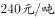
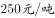
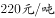

# 单定义-关键信息比对（超率累进税率：以相对比率划分级距+超额部分按高一级税率）

考点：[[20-考点/判断推理/定义判断/单定义-关键信息比对（超率累进税率：以相对比率划分级距+超额部分按高一级税率）|定义判断 / 单定义-关键信息比对（超率累进税率：以相对比率划分级距+超额部分按高一级税率）]]

**问法模型**：“根据上述定义，下列各项中按照超率累进税率征税的是”→选是型定义判断：提取定义核心要件，逐项对照排除不符合项

## 推理链
1. 第1步：提取定义要点①以征税对象数额的相对比率（如产值利润率、销售利润率、成本利润率等）划分征税级距；②相对比例每超过一个级距，仅对“超过的部分”按高一级税率计算征税。
2. 第2步：解题方法为要件比对法：备选项必须同时满足“级距按相对比例（率）划分”和“超出部分适用更高税率（累进结构）”两个要件，缺一即排除。
3. 第3步：A项以“土地增值额超过扣除项目金额的相对比例”为级距（未超过该比例的部分适用一档税率，超过该比例、未更高比例的部分适用更高税率），且明确“对超过的部分”按高一级税率征税，两要件均满足，符合定义。
4. 第4步：B项按“所得额未满300元”“所得额在万元以上”等绝对金额划分级距并配不同税率，级距依据是绝对数额而非相对比率，属于按金额累进，缺少“相对比率”要件，不符合定义。
5. 第5步：C项是按企业类型（一般企业、小型微利企业、高新技术企业）分别适用不同税率，属差别/优惠税率，既无相对比例级距也无累进结构，不符合定义。
6. 第6步：D项是按酒的种类（白酒、黄酒、啤酒）规定不同税率，属不同征税对象的差别税率，同样无相对比例级距与累进征税，不符合定义。
7. 第7步：只有A项同时满足“相对比率划分级距+对超出部分按高一级税率征税”的全部要件，故正确答案为A。

**最快解法**：⚡ 关键词法：抓定义中“相对比率划分级距”“对超过的部分按高一级税率”两个硬要件。A项“土地增值额超过扣除项目金额…的部分”税率更高，直接命中；B项按金额分级、C/D项按对象种类定率，一票排除。

## 易错点
- ⚠ 把“存在多种不同税率”误判为超率累进：C、D只是对不同对象/商品规定差别税率，既无级距也无累进结构。
- ⚠ B项迷惑性强：同为税率递增结构，但以“所得额300元/万元以上”等绝对金额划分级距，属于按金额的累进，缺“相对比率（率）”这一核心要件。
- ⚠ 忽略“仅对超过的部分”按高一级税率征税：超率累进要求只对超出级距部分适用高档税率，而非全额适用高档税率。

## 母题抽象
> 🧩 当定义包含“以…的相对比率/比例划分级距，超过部分按高一级税率征税”时，先核对级距依据是“相对比例”还是“绝对金额/对象类别”，再核对是否“仅对超出部分”适用高档税率，两要件同时满足才判定符合。

**同类特征**：超率累进税率、相对比率划分征税级距、超过的部分按高一级税率、产值利润率/销售利润率等相对指标、土地增值税以增值额超过扣除项目金额的比例分级、定义判断选是题

## 相关题
- [[10-真题/判断推理/定义判断/19283902 单定义-多级别（层级）定义辨析|19283902]]（国考 2025，相关度1）
- [[10-真题/判断推理/定义判断/2043700 单定义-多要件关键词匹配（谣言+集体无意识+恐慌蔓延，缺一不可）|2043700]]（江苏 2017，相关度1）
- [[10-真题/判断推理/定义判断/5102236 多定义-成对定义辨析（合子前-合子后隔离）|5102236]]（浙江 2022，相关度1）

---

### 题干
超率累进税率是指以征税对象数额的相对比率（如产值利润率、资金利润率、销售利润率、成本利润率等）划分征税级距，分别规定相应的差别税率，相对比例每超过一个级距的，对超过的部分就按高一级的税率计算征税。
根据上述定义，下列各项中按照超率累进税率征税的是：

### 选项
- A. 
我国法律规定，土地增值额未超过扣除项目金额的部分，土地增值税税率为；超过扣除项目金额、未超过的部分，税率为
　✅
- B. 
我国建国初期征收工商所得税税率分为21级，所得额未满300元的税率为；所得额在万元以上的税率为

- C. 
我国企业所得税的税率为。符合条件的小型微利企业，按的税率征收企业所得税；国家需要重点扶持的高新技术企业，按的税率征收企业所得税

- D. 
我国法律规定，白酒消费税税率为，黄酒消费税税率为，啤酒消费税税率为

### 官方解析

第一步：找出定义关键词。 “征税对象数额的相对比率划分征税级距”、“相对比例每超过一个级距的，对超过的部分就按高一级的税率计算征税”。 第二步：逐一分析选项。 A项：土地增值额未超过扣除项目金额的部分，按照一个税率进行征税，而超过的部分，在超过且未超过的，有更高的税率，符合“相对比例每超过一个级距的，对超过的部分就按高一级的税率计算征税”，符合定义，当选； B项：只是不同的金额，有不同的税率，但是并不符合定义中所说的超过一个级别的部分是另外一个税率，不符合定义，排除； C项：只是规定了不同对象的企业所得税是多少，不符合“征税对象数额的相对比率划分征税级距”，不符合定义，排除； D项：只是规定了不同种类的酒的不同税率，不符合“征税对象数额的相对比率划分征税级距”，不符合定义，排除。 故正确答案为A。  

### 给定材料
（无）
