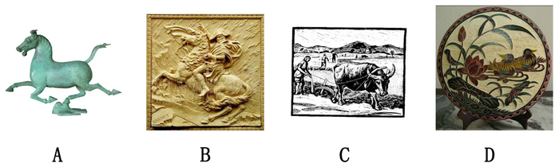

# 单定义-关键词定位（多要件逐一核对选图）

考点：[[20-考点/判断推理/定义判断/单定义-关键词定位（多要件逐一核对选图）|定义判断 / 单定义-关键词定位（多要件逐一核对选图）]]

**问法模型**：题干给出'圆雕'的定义（多个限定要件），问四幅图中哪幅属于圆雕 → 拆解定义核心要件，逐项与图形对照排除

## 推理链
1. 第1步：提取定义三要件——①'不附着在任何背景上'；②'可以从各个角度欣赏'；③'立体的雕塑'，三者须同时满足
2. 第2步：解题方法——关键词要件法+排除法，将每幅图与三要件逐一比对
3. 第3步：A项为独立的奔马铜像，悬空立于支架，四面均可观看，属立体雕塑，满足①②③
4. 第4步：B项骑马人物依附于方形底板（浮雕），背面无法欣赏，不满足①②，排除
5. 第5步：C项木刻版画是附着于纸面的平面图像，非立体雕塑，不满足②③，排除
6. 第6步：D项挂盘图案附着盘面背景，属平面装饰，非立体雕塑，不满足①②③，排除
7. 第7步：只有A项同时满足全部要件，故正确答案为A

**最快解法**：⚡ 关键词要件法+排除法：先锁定'不附着背景、可各角度欣赏、立体雕塑'三要件，一眼识别B（浮雕）、C（版画）、D（挂盘）均附着背景或非立体，排除后直接选A

## 易错点
- ⚠ 只关注'雕塑'二字而忽略'立体的'限定，误把浮雕B当圆雕
- ⚠ 忽略'可以从各个角度欣赏'这一要件，未检查作品背面/四周是否可看
- ⚠ 图形型定义判断凭整体感觉选'最像雕塑'的项，未逐项核对定义要件

## 母题抽象
> 🧩 当题干给出含多个限定要件的定义并要求对图片/实物判断是否符合时，先拆出全部核心要件，再用排除法逐项核对，任一要件不满足即排除

**同类特征**：单定义判断、定义含多重要件、不附着在任何背景上、可以从各个角度欣赏、立体的雕塑、选项为图形而非文字

## 相关题
- [[10-真题/判断推理/定义判断/10297114 单定义-要素对应（主体+目的+对象）|10297114]]（天津 2025，相关度1）
- [[10-真题/判断推理/定义判断/10297337 单定义-要件对照（条件+结果双要件匹配）|10297337]]（浙江 2025，相关度1）
- [[10-真题/判断推理/定义判断/10297431 单定义-要件对应排除（心理学概念：过程要件+结果要件）|10297431]]（四川 2025，相关度1）
- [[10-真题/判断推理/定义判断/11367802 单定义-关键词要件比对（灰度认知）|11367802]]（江苏 2025，相关度1）
- [[10-真题/判断推理/定义判断/11367803 单定义-多要件逐项核对|11367803]]（江苏 2025，相关度1）

---

### 题干

圆雕，是指不附着在任何背景上、可以从各个角度欣赏的立体的雕塑。其手法与形式多种多样，有写实性的与装饰性的，也有具体的与抽象的，着色的与非着色的等。根据上述定义，下图所示雕塑作品中，属于圆雕的是（  ）。

### 选项
- A. A　✅
- B. B
- C. C
- D. D

### 官方解析
第一步：找出定义关键词。
“不附着在任何背景上”、“可以从各个角度欣赏的立体的雕塑”。
第二步：逐一分析选项。
A项：是不附着在任何背景上，可以从各个角度欣赏的立体雕塑，符合定义，当选；
B项：附着在了背景上，无法从各个角度欣赏，不符合定义，排除；
C项：附着在了背景上，无法从各个角度欣赏，不是立体雕塑，不符合定义，排除；
D项：附着在了背景上，无法从各个角度欣赏，不是立体雕塑，不符合定义，排除。
故正确答案为A。

### 给定材料
（无）
