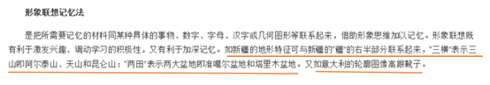

# 单定义-要件对照（选非题）

考点：[[20-考点/判断推理/定义判断/单定义-要件对照（选非题）|定义判断 / 单定义-要件对照（选非题）]]

**问法模型**：问法为'下列没有运用形象联想记忆法的是'（选非）→ 先拆解定义核心要件，再逐项对照找出要件缺失的一项

## 推理链
1. 第1步：提取定义两要件：①把需记忆的材料'同具体的事物、数字、字母、汉字或几何图形等联系起来'；②'借助形象思维加以记忆'
2. 第2步：明确本题为选非题，需找出不符合要件（尤其是要件①的'具体形象载体'缺失）的选项
3. 第3步：A项'三山夹两盆'与汉字'疆'右半部分联系（三横表三山、两田表两盆），有汉字形象载体，符合①②
4. 第4步：B项意大利轮廓'就像一只高跟靴子'，借助几何/事物形象记忆国家轮廓，符合①②
5. 第5步：C项海参'长得就像黄瓜''长在海里'，借助具体事物形象记忆英文sea cucumber，符合①②
6. 第6步：D项只是归纳'这些牛人都叫迈克尔'这一名称共性，未与任何具体事物、数字、字母、汉字或几何图形建立形象联系，缺要件①，当选

**最快解法**：⚡ 关键词法+排除法：紧扣核心要件'同具体的事物/数字/字母/汉字/几何图形联系'，快速确认A（汉字'疆'）、B（靴子轮廓）、C（黄瓜形象）均有形象载体，D项仅是'都叫迈克尔'的共性归纳、无任何形象联想，直接锁定D

## 易错点
- ⚠ 忽略'没有运用'的选非问法，误选符合定义的A/B/C
- ⚠ 误以为D项'迈克尔'属于'字母/汉字'联系——实际只是人名共同点的机械归纳，未借助形象思维加工记忆材料
- ⚠ 在B项纠结'轮廓像靴子'是否属于'几何图形'——定义用'等'字兜底，具体事物/形象轮廓均可，不必苛求严格几何图形

## 母题抽象
> 🧩 当题干为'下列没有运用/不符合某定义的是'时，先把定义拆成'手段要件+效果要件'，再逐项检查哪个选项缺失手段要件（如本题缺'与具体形象载体联系'），缺失者即答案

**同类特征**：形象联想记忆法定义、同具体的事物、数字、字母、汉字或几何图形联系、借助形象思维加以记忆、选非题（'没有运用…的是'）、记忆材料+形象载体

## 相关题
- [[10-真题/判断推理/定义判断/10297336 单定义-要件对照（选非题）|10297336]]（浙江 2025，相关度2）
- [[10-真题/判断推理/定义判断/10297346 单定义-要件对照（选非题）|10297346]]（浙江 2025，相关度2）
- [[10-真题/判断推理/定义判断/16592937 单定义-要件对照（选非题）|16592937]]（青海 2024，相关度2）
- [[10-真题/判断推理/定义判断/1789684 单定义-要件对照（选非题）|1789684]]（江苏 2016，相关度2）
- [[10-真题/判断推理/定义判断/1791846 单定义-要件对照（选非题）|1791846]]（江苏 2016，相关度2）

---

### 题干
形象联想记忆法是把所需要记忆的材料同某些具体的事物、数字、字母、汉字或几何图形等联系起来，借助形象思维加以记忆。形象联想既有利于激发兴趣，调动学习的积极性，又有利于加深记忆。
根据上述定义，下列没有运用形象联想记忆法的是：

### 选项
- A. 新疆的地形特征“三山夹两盆”可与“疆”的右半部分联系起来：“三横”表示三山，“两田”表示两大盆地
- B. 号称“时尚女鞋之国”的意大利，它的轮廓就像一只高跟靴子
- C. 海参，长得就像黄瓜（cucumber），又长在海里（sea），所以它叫“sea cucumber”
- D. 篮球界的迈克尔·乔丹、音乐界的迈克尔·杰克逊、赛车界的迈克尔·舒马赫······记住，这些牛人都叫“迈克尔”　✅

### 官方解析

第一步：找出定义关键词。

“需要记忆的材料同具体的事物、数字、字母、汉字或几何图形等联系起来”、“借助形象思维加以记忆”。

第二步：逐一分析选项。

A项：新疆的地形特征“三山夹两盆”是需要记忆的材料，与“疆”的右半部分联系起来记忆，符合“同具体的汉字联系起来”、“借助形象思维加以记忆”，符合定义，排除；

B项：意大利为“时尚女鞋之国”是需要记忆的材料，轮廓像“高跟鞋”，符合“同具体的几何图形联系起来”、“借助形象思维加以记忆”，符合定义，排除；

C项：“海参”的英文表述（sea cucumber）是需要记忆的材料，长得像黄瓜（cucumber），符合“同具体的事物联系起来”、“借助形象思维加以记忆”，符合定义，排除；

D项：篮球界、音乐界、赛车界······的这些牛人都叫“迈克尔”是需要记忆的材料，但没有体现“同具体的事物、数字、字母、汉字或几何图形等联系起来”，不符合定义，当选。

本题为选非题，故正确答案为D。

### 给定材料
（无）
