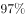
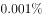
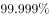

# 单定义-要件对照（选非题：找不符合定义项）

考点：[[20-考点/判断推理/定义判断/单定义-要件对照（选非题：找不符合定义项）|定义判断 / 单定义-要件对照（选非题：找不符合定义项）]]

**问法模型**：“最不可能存在框架效应”的选非问法 → 先拆定义要件，逐项验证是否符合，不符合者即答案

## 推理链
1. 第1步：提取定义要件：①针对相同的事实信息；②采用不同的表达方式；③使人产生不同的判断决策；④人们更倾向关注损失。
2. 第2步：本题要求选“最不可能存在框架效应”，即找不同时满足要件①②③的选项。
3. 第3步：A项同一面包事实，“你吃了半个面包了，还吃吗”与“还有半个面包，你吃吗”是两种表述，小明决策从“不吃”变为“吃完”，且体现怕损失心理，符合定义，排除。
4. 第4步：C项同一脂肪含量事实，“含脂量5%”换成“脱脂量95%”的表述，消费者购买决策改变致销量上涨，符合定义，排除。
5. 第5步：D项同一安全事实，“车祸概率仅为1%”与“平安送达率99%”是同一信息的两种表述，小坤因此选乙站，符合定义，排除。
6. 第6步：B项中A产品是确定获利、B产品是有机会获利，两者是获利事实本身不同的两个方案，并非同一事实的两种表达；小红选择B是对不同方案的选择，不满足“相同的事实信息，采用不同的表达方式”，不符合定义，当选。

**最快解法**：⚡ 排除法+关键词定位：抓核心要件“相同事实+换个说法”，A/C/D均存在“同一数字/信息的两种说法”（吃了半个vs还有半个、含脂量vs脱脂量、车祸率vs平安率），只有B是两个获利方案本身不同，直接锁定B。

## 易错点
- ⚠ 忽略“最不可能”的选非问法，误选表述最典型、最像框架效应的A/C/D。
- ⚠ 把B项误判为类似D项的概率表述差异，未发现两方案获利事实不同（确定获利vs机会获利），并非同一事实的不同表达。
- ⚠ 只盯“人们更倾向关注损失”这一补充句，漏看核心要件“相同的事实信息、不同的表达方式”。

## 母题抽象
> 🧩 当定义是“同一事实＋不同表述→不同决策”（框架效应类）且为选非题时，逐项找“同一信息的两种说法”确认符合者，凡只是两种本质不同的方案被比较而无“换说法”的，即为不符合项。

**同类特征**：选非题（最不可能）、相同的事实信息、不同的表达方式、产生不同的判断决策、更倾向关注损失、同一数字换口径表述

## 相关题
（暂无）

---

### 题干
框架效应是指对于相同的事实信息，采用不同的表达方式，会使人产生不同的判断决策。一般来讲，在损失和收益方面，人们更倾向关注损失。
根据上述定义，下列情形描述最不可能存在框架效应的是：

### 选项
- A. 
小明每天能得到一个面包，当被问“你吃了半个面包了，还吃吗”时，他选择不吃；而要是问“还有半个面包，你吃吗”，他会选择吃完

- B. 
小红看到A理财产品能地让自己获利，而B产品能让自己有的机会获利时，毅然选择了投资B产品
　✅
- C. 
鉴于消费者对脂肪的抵触情绪，某牛奶公司把所产牛奶产品相关描述从“含脂量”变为“脱脂量”，为此该公司销售业绩迅速上涨

- D. 
“甲汽车客运站的客车发生车祸的概率仅为，而乙汽车客运站的客车平安送达率为”看到这，乘客小坤选择乘坐乙汽车客运站的车

### 官方解析

第一步：找出定义关键词。

“对于相同的事实信息，采用不同的表达方式，会使人产生不同的判断决断”、“在损失和收益面前，人们更倾向于关注损失”。

第二步：逐一分析选项。

A项：问的都是关于小明吃不吃面包的事，并且小明做出不同决断，符合“对于相同的事实信息，采用不同的表达方式，会使人产生不同的判断决断”，当被问“你吃了半个面包了，还吃吗”时，他选择不吃，被问“还有半个面包，你吃吗”，他选择吃完，体现了小明怕受损失的心理，符合“在损失和收益面前，人们更倾向于关注损失”，符合定义，排除；

B项：此选项是小红关于理财产品的选择，A产品能获利，B产品有的机会获利，两个产品获利不同，不符合“对于相同的事实信息，采用不同的表达方式，会使人产生不同的判断决断”，不符合定义，当选；

C项：牛奶公司对于牛奶脂肪含量的不同表述，影响人们购买，符合“对于相同的事实信息，采用不同的表达方式，会使人产生不同的判断决断”，把“含脂量”改为“脱脂量”，销量上涨，抓住了人们怕摄入脂肪的心理，符合“在损失和收益面前，人们更倾向于关注损失”，符合定义，排除；

D项：甲乙两客车站对于车祸概率的不同表述，影响人们的选择，符合“对于相同的事实信息，采用不同的表达方式，会使人产生不同的判断决断”，甲发生车祸率为，乙平安送达率，人们更多选择乙，体现了人们怕生命财产遭受损失的心理，符合“在损失和收益面前，人们更倾向于关注损失”，符合定义，排除。

本题为选非题，故正确答案为B。

### 给定材料
（无）
