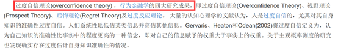
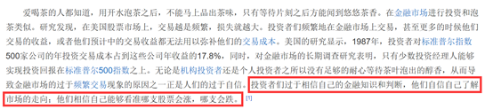

# 单定义-多要点比对择优（细节限定二级辨析）

考点：[[20-考点/判断推理/定义判断/单定义-多要点比对择优（细节限定二级辨析）|定义判断 / 单定义-多要点比对择优（细节限定二级辨析）]]

**问法模型**：'根据定义，下列属于过度自信的是'→'属于'型定义题：先用定义要点逐项排除，再对多个近似项按定义中的限定细节择优

## 推理链
1. 第1步：提取定义要点：主体'个体'；'基于事物未来发展过高地估计自身判断的精确度'；'进而偏离校准'；校准依据'信心与相关目标事件发生的相对频率的匹配程度'
2. 第2步：方法：关键词逐项比对——先核主体，再核'高估精确度+偏离校准'，最后核'相对频率'这一细节限定
3. 第3步：A项主体是'某公司'而非'个体'，不符合主体要点，排除；D项评论员称甲队获胜可能性为80%（图中第一式），历史准确率仅30%（图中第二式），但本次比赛结果并未揭晓，'偏离校准'未被证实，排除
4. 第4步：B项'预测股票指数会上涨，结果股票却下跌'、C项'认为能考90分以上，结果只考了70分'，均满足'高估自身判断精确度且实际结果反向偏离'
5. 第5步：二级辨析：定义要求校准依赖'目标事件发生的相对频率'——B项股指涨跌每日重复发生，属高频可重复事件，分析师的信心与实际频率系统性错配；C项期末考试一学期一次，属单次事件，无'相对频率'可匹配
6. 第6步：B项同时满足全部要点，C项缺'相对频率'要点，择优选B

**最快解法**：⚡ 两级排除+细节择优：先用'个体'排A，再用'结果未知→偏离校准无法验证'排D，最后用'相对频率'细节比较B（股指每日重复发生）与C（期末考单次事件），择优选B

## 易错点
- ⚠ 只比对'高估判断+结果偏差'就误选C，漏掉定义中'相关目标事件发生的相对频率'这一限定细节
- ⚠ 误认为D中80%预测概率与30%历史准确率的落差即构成'偏离校准'，忽略本次比赛结果未知、偏离未被证实
- ⚠ 忽略A项主体'某公司'不符合定义主体'个体'的限定

## 母题抽象
> 🧩 当定义判断多个选项均'大致符合'核心含义时，回到定义尾部或限定从句中的细节条件（如'相对频率''重复发生'），用细节做二级择优，选限定条件全部满足者

**同类特征**：单定义判断、'属于'型问法、心理学/行为金融概念（过度自信、校准）、定义尾部带限定从句（信心与相对频率的匹配）、两个以上近似选项需择优、选项含图表公式数据

## 相关题
- [[10-真题/判断推理/定义判断/18643897 单定义-要件比对（动态因果过程定义）|18643897]]（四川 2026，相关度2）
- [[10-真题/判断推理/定义判断/10297114 单定义-要素对应（主体+目的+对象）|10297114]]（天津 2025，相关度1）
- [[10-真题/判断推理/定义判断/10297337 单定义-要件对照（条件+结果双要件匹配）|10297337]]（浙江 2025，相关度1）
- [[10-真题/判断推理/定义判断/10297431 单定义-要件对应排除（心理学概念：过程要件+结果要件）|10297431]]（四川 2025，相关度1）
- [[10-真题/判断推理/定义判断/11367802 单定义-关键词要件比对（灰度认知）|11367802]]（江苏 2025，相关度1）

---

### 题干
过度自信是指个体基于事物未来发展过高地估计自身判断的精确度，进而偏离校准的一种形式。这里的校准程度取决于信心与相关目标事件发生的相对频率的匹配程度。
根据上述定义，下列属于过度自信的是:

### 选项
- A. 
某公司根据相关统计数据调高了上季度的营收增长率

- B. 
某股票分析师预测股票指数会上涨，结果股票却下跌了
　✅
- C. 
小张认为自己期末考试能考90分以上，结果却只考了70分

- D. 
某足球评论员说明天的比赛甲队获胜的可能性是，然而以往数据显示，该评论员的预测准确率仅为

### 官方解析

第一步：找出定义关键词。

“个体”、“过高地估计自身判断的精确度”、“偏离校准”、“相关目标事件发生的相对频率”。

第二步：逐一分析选项。

A项：某公司不符合关键词“个体”，不符合定义，排除；

B项：某股票分析师预测股票指数会上涨，结果却下跌，符合关键词“个体基于事物未来发展过高地估计自身判断的精确度，进而偏离校准”，保留；

C项：小张认为自己期末考试能考90分，结果却只考了70分，符合关键词“个体基于事物未来发展过高地估计自身判断的精确度，进而偏离校准”，保留；

D项：某足球评论员预测甲队获胜的可能性是80%，虽然该评论员以往的预测准确率为30%，但本次比赛甲队最后是否获胜并不明确，不符合关键词“偏离校准”，不符合定义，排除；

对比B项和C项，B项股票指数的上涨或下跌每天都在发生，而且股票分析师预测失败的原因是投资者对股票指数上涨发生频率的错误估计，符合“这里的校准程度取决于信心与相关目标事件发生的相对频率的匹配程度”，但C项一学期一次的期末考试，是单次的，不符合关键词“相关目标事件发生的相对频率”，比较来看，B项比C项更贴近定义关键词，择优选B。

故正确答案为B。

注：如下图所示，在“过度自信”的原文中，多次拿“股票投资者过度自信预测股票走向”为典型案例，所以此题无论是从定义关键词对比择优，还是从原文的角度，粉笔都倾向于选择B。

### 给定材料
（无）

> [!note] 复核版本状态
> 原题不可计分（source_data_missing；来源记录的答案键/竞争项：B）；仅当前明确标注的编辑版按答案D计分。
> 详细原题疑点、修订题面、解析和证据见下方独立复核记录。

<!-- CODEX-ANSWER-REVIEW:BEGIN -->
### 本次独立复核

**复核结论：** `resolved`（答案与解析已核定）

**原题计分状态：** 不计分（`source_data_missing`：原题缺少必要数据/图表）。来源中记录的答案键/竞争项：B；这些记录不代表原题已核准答案。

**原题疑点与处理：**

原题D只提供该评论员历史预测总体准确率约30%，没有说明这些数据是否来自同类“预测概率为80%”的事件组，不能由此判定校准偏差。编辑版在D中明确增加100场同类预测的样本条件（80%预测、实际30场胜出），使目标概率与观察频率可直接比较；这些数字是编辑版情境设定，不是对原卷数据的恢复。

**当前计分版本：** 明确标注的编辑版；未列出的题干、材料或选项沿用固定题源。答案不回填为原题答案。

**计分答案：** D（可计分）

**复核解析：**

修订版定义要求比较同类事件的预测概率与同类事件的长期实际频率。D把情境数据明确为100场相似比赛中预测80%、实际30场胜出，观察命中率为30/100=30%，与80%的预测概率明显不匹配；所以它直接证明校准偏差。B、C各只描述一次预测失败，不能据此推断长期频率偏离；A主体是公司。选D。D中的样本数字是编辑版新设的题面条件，不是原题已有统计。

**修订题干：**

【定义修订版】将“过度自信”具体限定为：同一人对一类相似事件给出的预测概率与该类事件的长期实际发生频率明显不匹配。以下哪个例子能直接证明这种校准偏差？

**修订/采用选项：**

A. 某公司根据相关统计数据调高了上季度的营收增长率
B. 某股票分析师预测股票指数会上涨，结果股票却下跌了
C. 小张认为自己期末考试能考90分以上，结果却只考了70分
D. 【编辑修订；构造的教学情境】在过去100场相似比赛中，某足球评论员每场都预测甲队获胜概率为80%，实际仅30场胜出；在下一场相似比赛中，他仍称甲队胜率为80%。

**相关信息：**

定义判断—概率校准比较同类事件中预测概率与相对频率；单次预测失败不能证明校准偏差。原题未给出80%预测组的分母和命中数；编辑版明确增加100次同类样本，答案D仅适用于该编辑情境。

**核对依据与来源边界：**

- 固定题源：[原题文件](https://github.com/Mentat-Uran/kaogongzhentizhengliu/blob/84ab93d4b64b61d897bece8a1c0a5bab06b4feb2/10-%E7%9C%9F%E9%A2%98/%E5%88%A4%E6%96%AD%E6%8E%A8%E7%90%86/%E5%AE%9A%E4%B9%89%E5%88%A4%E6%96%AD/2377314%20%E5%8D%95%E5%AE%9A%E4%B9%89-%E5%A4%9A%E8%A6%81%E7%82%B9%E6%AF%94%E5%AF%B9%E6%8B%A9%E4%BC%98%EF%BC%88%E7%BB%86%E8%8A%82%E9%99%90%E5%AE%9A%E4%BA%8C%E7%BA%A7%E8%BE%A8%E6%9E%90%EF%BC%89.md)；内容版本 `84ab93d4b64b61d897bece8a1c0a5bab06b4feb2`，源 Markdown blob `1558bf850eb4f081f50d49208d404aea8bee37f6`.
- **核心依据：** 原题D仅称评论员过往预测总体准确率约30%，未说明是否为其所有80%置信预测的同类样本，故不能直接对照定义中的校准。编辑版D新设100次相似比赛预测，预测概率均为80%、实际30次胜出，使样本频率可直接比较；这些数值是新题面条件，不是恢复的原卷统计。
- 固定题图/公式图：`90-图片/公式图/formula-b08870e307ffeee4.png`, `90-图片/公式图/formula-2f29ab37e5278826.png`, `90-图片/题目图/16a4320cd25b7e9.png`, `90-图片/题目图/16a4320df6d4521.png`.

<!-- CODEX-ANSWER-REVIEW:END -->
