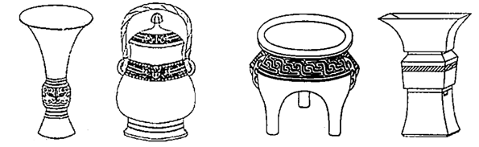

# 多定义-特征匹配（图形与定义要点对应）

考点：[[20-考点/判断推理/定义判断/多定义-特征匹配（图形与定义要点对应）|定义判断 / 多定义-特征匹配（图形与定义要点对应）]]

**问法模型**：给出多个并列器物定义+四幅实物图形问依次对应 → 提取各定义的形状关键词，逐一与图形特征比对匹配

## 推理链
1. 第1步：提取定义关键词——鬲：'侈口（口沿外倾）、三个中空的足'；觚：'圈足、敞口、长身，口部和底部都呈现为喇叭状'；卣：'口椭圆形，圈足，有盖和提梁，腹深'；尊：'圈足，圆腹或方腹，长颈，敞口，口径较大'
2. 第2步：找出各定义的排他性特征：'三个中空的足'仅鬲有，'有盖和提梁'仅卣有，'口部和底部都呈喇叭状'仅觚有，'长颈、口径较大'是尊的核心特征
3. 第3步：观察图1——器身细长、口部外撇呈喇叭状、底部亦外撇呈喇叭状、下有圈足，与觚'长身、口底均喇叭状'完全吻合
4. 第4步：观察图2——顶部有盖、盖上连有环形提梁、口呈椭圆形、腹部较深，与卣'有盖和提梁、口椭圆形、腹深'吻合
5. 第5步：观察图3——口沿外倾（侈口）、腹部下有三个袋状足，与鬲'侈口、三个中空的足'吻合
6. 第6步：观察图4——颈部长、口大而敞、腹部近方形、下有圈足，与尊'长颈、敞口、口径较大、圈足'吻合
7. 第7步：四图依次为觚、卣、鬲、尊，对照选项仅C符合

**最快解法**：⚡ 特征排除法：先抓最独特特征——'有盖和提梁'唯卣所有，锁定图2为卣，排除A、D；再抓'三个中空的足'唯鬲所有，锁定图3为鬲，排除B，秒选C

## 易错点
- ⚠ 觚与尊混淆：二者均有'圈足、敞口'，需靠'口底均喇叭状+长身'（觚）与'长颈+口径较大'（尊）作二级辨析
- ⚠ 图3三足器易凭直觉误判为'鼎'而忽略题干中'三个中空的足'正是鬲的独有特征
- ⚠ 只看整体轮廓不看细节（提梁、盖、圈足），漏掉卣的'提梁'这一最强排他线索

## 母题抽象
> 🧩 当题干给出多个并列定义并要求与图形/实物一一对应时，先提取各定义的独有特征（排他性关键词），用最强排他特征先锁定一两个对象排除选项，再用其余特征验证

**同类特征**：多定义并列+图形匹配、形状关键词：侈口/圈足/提梁/喇叭状/长颈、排他性特征排除法、三个中空的足（鬲）、有盖和提梁（卣）、逐一分析选项式官方解析

## 相关题
（暂无）

---

### 题干

鬲（lì）是古代一种煮饭用的炊器，有陶制鬲和青铜鬲，其形状一般为侈口（口沿外倾），有三个中空的足，便于炊煮加热。觚（gū）是古代一种用于饮酒的容器，也用作礼器，圈足、敞口、长身，口部和底部都呈现为喇叭状。卣（yǒu）是古代的一种酒器，口椭圆形，圈足，有盖和提梁，腹深。尊（zūn）是古代的一种大中型盛酒器，圈足，圆腹或方腹，长颈，敞口，口径较大。

下列4个图形依次为

### 选项
- A. 觚、尊、鬲、卣
- B. 尊、鬲、觚、卣
- C. 觚、卣、鬲、尊　✅
- D. 鬲、卣、尊、觚

### 官方解析
第一步：找出定义关键词。
“鬲”：侈口（口沿外倾）、三个中空的足；
“觚”：圈足、敞口、长身，口部和底部都呈现为喇叭状；
“卣”：口椭圆形，圈足，有盖和提梁，腹深；
“尊”：圈足，圆腹或方腹，长颈，敞口，口径较大。
第二步：逐一分析选项。
题干四个图片从左到右依次是：觚、卣、鬲、尊，只有C项符合。
故正确答案为C。

### 给定材料
（无）
