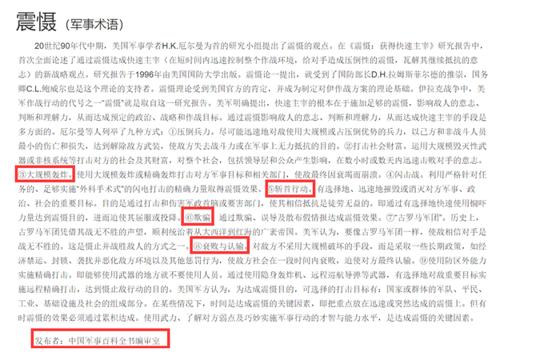

# 单定义-关键词定位（选非题：手段要件+结果要件比对）

考点：[[20-考点/判断推理/定义判断/单定义-关键词定位（选非题：手段要件+结果要件比对）|定义判断 / 单定义-关键词定位（选非题：手段要件+结果要件比对）]]

**问法模型**：'下列军事行动不属于震慑的是'→选非题：先拆定义关键词，逐一验证选项，排除符合定义的三项，锁定要件缺失项

## 推理链
1. 第1步：拆解定义两个核心要件——①'利用各种手段造成足够强大的胁迫和强制力量'（手段/力量要件），②'使对手慑于巨大的压力而丧失继续抵抗意志'（心理结果要件），二者缺一不可
2. 第2步：本题为选非题，需逐项核对'手段'与'结果'是否同时对应，重点盯结果要件是否被偷换
3. 第3步：A项'大规模毁灭性武器打击重要设施'对应要件①，'数天内即瓦解敌国的抵抗意志'直接对应要件②，符合定义，排除
4. 第4步：C项'经济禁运、骚扰等恶化敌人生存环境'构成胁迫强制力量（要件①），'胁迫使敌人崩溃'对应要件②，符合定义，排除
5. 第5步：D项'欺骗、误导、散布假情报'属'各种手段'（要件①），'相信自己不堪一击从而放弃抵抗'即慑于压力丧失抵抗意志（要件②），符合定义，排除
6. 第6步：B项'斩首行动'虽可对应要件①，但结果是'使敌国主战派丧失主心骨'——这是失去领导核心、组织指挥瘫痪，并非'慑于巨大压力而丧失抵抗意志'的心理威慑结果，要件②不满足，当选

**最快解法**：⚡ 关键词比对法+选非排除：紧扣结果关键词'慑于压力→丧失抵抗意志'，快速扫描四项的结果表述——A'瓦解抵抗意志'、C'使敌人崩溃'、D'放弃抵抗'均落点在'意志/心理'，唯独B落点在'丧失主心骨'（去核心化、打瘫指挥），直接锁定B

## 易错点
- ⚠ 把'丧失主心骨'误等同于'丧失抵抗意志'：前者是领导中枢被斩断（组织能力受损），后者是心理威慑下主动放弃抵抗（意志受损），二者性质不同
- ⚠ 被'斩首行动'的强冲击字面迷惑，只验证手段要件①就认定符合，漏查结果要件②
- ⚠ 忽略'不属于'的选非问法，按'属于'方向作答误选A/C/D

## 母题抽象
> 🧩 当定义由'手段要件+心理结果要件'构成且问'不属于'时，逐项核对结果落点——凡结果表述被偷换（如'丧失核心'≠'丧失意志'、'被迫撤退'≠'丧失斗志'），该选项即为答案

**同类特征**：军事战略形式定义、胁迫和强制力量、慑于巨大压力、丧失继续抵抗意志、选非题、手段与心理结果的区分

## 相关题
- [[10-真题/资料分析/综合/250219 综合分析选非题（图表数据可推断性判断）|250219]]（深圳市考 2008，相关度1）
- [[10-真题/资料分析/综合/10297333 综合分析选非题（同比增速逐年比较+年均增长量+比重百分点还原）|10297333]]（浙江 2025，相关度1）
- [[10-真题/资料分析/综合/14355349 综合分析-选非题（增长率计算比较+人均值计算）|14355349]]（浙江 2024，相关度1）
- [[10-真题/资料分析/综合/17097816 综合判断·选非题（增长率与增长量偷换）|17097816]]（山西 2024，相关度1）
- [[10-真题/资料分析/综合/2052088 综合分析-选非题（趋势判断+增速排序+增长量比较+增长率计算逐项核对）|2052088]]（吉林 2017，相关度1）

---

### 题干
震慑是指利用各种手段造成足够强大的胁迫和强制力量，从而使对手慑于巨大的压力而丧失继续抵抗意志的一种军事战略形式。
根据上述定义，下列军事行动不属于震慑的是：

### 选项
- A. 运用大规模毁灭性武器打击敌国重要设施，数天内即瓦解敌国的抵抗意志
- B. 对敌国主战派进行有选择的、迅速的斩首行动，使敌国主战派丧失主心骨　✅
- C. 长时间使用经济禁运、骚扰等恶化敌人生存环境的手段胁迫使敌人崩溃
- D. 通过欺骗、误导、散布假情报等方式，使敌人相信自己不堪一击从而放弃抵抗

### 官方解析

第一步：找出定义关键词。

“利用各种手段造成足够强大的胁迫和强制力量”、“使对手慑于巨大的压力而丧失继续抵抗意志”。

第二步：逐一分析选项。

A项：运用大规模毁灭性武器打击敌国重要设施，符合“利用各种手段造成足够强大的胁迫和强制力量”，数天内即瓦解敌国的抵抗意志，也符合“使对手慑于巨大的压力而丧失继续抵抗意志”，符合定义，排除；

B项：对敌国主战派进行有选择的、迅速的斩首行动，符合“利用各种手段造成足够强大的胁迫和强制力量”，使敌国主战派丧失主心骨，不等同于丧失抵抗意志，不符合“使对手慑于巨大的压力而丧失继续抵抗意志”，不符合定义，当选； 

C项：长时间使用经济禁运、骚扰等恶化敌人生存环境，符合“利用各种手段造成足够强大的胁迫和强制力量”，胁迫使敌人崩溃，也符合“使对手慑于巨大的压力而丧失继续抵抗意志”，符合定义，排除； 

D项：欺骗、误导、散布假情报等方式，使敌人相信自己不堪一击从而放弃抵抗，符合“利用各种手段造成足够强大的胁迫和强制力量”，也符合“使对手慑于巨大的压力而丧失继续抵抗意志”，符合定义，排除。

本题为选非题，故正确答案为B。

备注：通过查询相关文献发现，其实ABCD项均在原文有所体现，但是出题人明显改动了B项的斩首行动，将原文中的目的进行了删减，从而使B项跟其他三项相比，关键词并不完全对应，本题问“不属于”，故小粉笔更倾向把答案给到B项。

### 给定材料
（无）

> [!warning] 疑点（官方解析可能有误，待人工复核）
> 官方解析备注自述ABCD均出自原文，B项系出题人删减原文本项目的描述后形成差异，并使用'更倾向把答案给到B'的表述，题目设计存在争议；但就给定定义而言，'丧失主心骨'与'慑于压力丧失抵抗意志'确实不对应，维持B为答案
