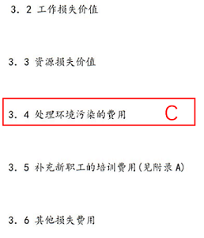

# 单定义-并列子定义归类（直接经济损失vs间接经济损失）

考点：[[20-考点/判断推理/定义判断/单定义-并列子定义归类（直接经济损失vs间接经济损失）|定义判断 / 单定义-并列子定义归类（直接经济损失vs间接经济损失）]]

**问法模型**：问法为'下列说法错误的是'（选非题）→ 将每个选项描述的费用逐一归入'直接/间接经济损失'两个子定义，归类表述错误的即为答案

## 推理链
1. 第1步：提取定义要点——直接经济损失='因事故造成人身伤亡及善后处理支出的费用和毁坏财产的价值'；间接经济损失='因事故导致产值减少、资源破坏和受事故影响而造成其他损失的价值'
2. 第2步：确定方法——选非题，以'善后处理支出/毁坏财产→直接'与'产值减少/资源破坏/其他损失→间接'为归类抓手，逐项判断选项表述与归类是否一致
3. 第3步：A项'现场抢救花费10万元'属于善后处理支出的费用，归入直接经济损失，选项说法正确，排除
4. 第4步：B项'因爆炸被罚款50万元'属于对事故的善后处理支出费用，归入直接经济损失，选项说法正确，排除
5. 第5步：C项'处理相关污染的费用'对应'资源破坏、受事故影响而造成其他损失'，归入间接经济损失，选项说法正确，排除
6. 第6步：D项'工人歇工时的工资'是因人身伤害（吸入毒气被送医）而支出的费用，应归入直接经济损失，选项却称其'属于间接经济损失'，说法错误，当选

**最快解法**：⚡ 关键词归类法+选非排除：抓住'善后处理支出费用→直接'这一抓手，A抢救费、B罚款、D歇工工资均属事故善后/人身伤亡支出费用，皆归直接经济损失，唯一称其为'间接'的D即为说法错误项

## 易错点
- ⚠ D项歇工工资易被'影响生产、停产歇工'表象误导为间接经济损失，实际它是因人身伤亡而支出的费用，属直接经济损失
- ⚠ B项罚款易被误认为'行政处罚不属于事故损失'，忽略罚款也是善后处理支出的费用
- ⚠ 选非题易漏看'错误'二字，误将说法正确的A/B/C当选

## 母题抽象
> 🧩 当题干出现'一个总定义下含两个并列子定义（如直接/间接）+选非问法'的特征时，用子定义关键词归类法，验证每个选项表述与归类是否一致，不一致者即答案

**同类特征**：总定义下含两个并列子定义、选非题（说法错误的是）、经济损失费用归类、善后处理支出费用、产值减少/资源破坏、人身伤亡相关费用

## 相关题
- [[10-真题/资料分析/综合/10718179 综合分析-选非题（同比双口径比较、跨场加总、极值定位、地区去重计数）|10718179]]（深圳市考 2024，相关度1）
- [[10-真题/资料分析/综合/2377014 综合判断（选非题）——倍数表述辨析＋比重判断＋负增长读数|2377014]]（选调 2019，相关度1）
- [[10-真题/判断推理/科学推理/1758874 物理-做功条件、受力分析与平衡状态、重力势能|1758874]]（上海 2016，相关度1）
- [[10-真题/判断推理/定义判断/18643711 多定义辨析-选非题（数量公式型定义+等式变形推理）|18643711]]（天津 2026，相关度1）
- [[10-真题/判断推理/逻辑判断/2376921 分析推理-信息匹配（排除法+确定信息优先）|2376921]]（选调 2019，相关度1）

---

### 题干
伤亡事故经济损失指企业职工在劳动生产过程中发生伤亡事故所引起的一切经济损失，包括直接经济损失和间接经济损失。其中，直接经济损失指因事故造成人身伤亡及善后处理支出的费用和毁坏财产的价值；间接经济损失指因事故导致产值减少、资源破坏和受事故影响而造成其他损失的价值。
根据上述定义，下列说法错误的是：

### 选项
- A. 某制衣厂发生火灾，现场抢救花费了10万元，这属于直接经济损失
- B. 某公司私自使用废弃车间导致爆炸，被罚款50万元，这属于直接经济损失
- C. 某供气公司的爆炸事故造成了有害物质泄漏，处理相关污染的费用属于间接经济损失
- D. 某化纤公司工人在生产过程中吸入有毒气体被送医，此工人歇工时的工资属于间接经济损失　✅

### 官方解析

第一步：找出定义关键词。

伤亡事故经济损失：“企业职工”、“在劳动生产过程中”、“发生伤亡事故所引起的一切经济损失”；

直接经济损失：“因事故造成人身伤亡及善后处理支出的费用和毁坏财产的价值”；

间接经济损失：“因事故导致产值减少、资源破坏和受事故影响而造成其他损失的价值”。

第二步：逐一分析选项。

A项：某制衣厂发生火灾，现场抢救的花费属于对事故的善后处理而支出的费用，符合“因事故造成人身伤亡及善后处理支出的费用和毁坏财产的价值”，符合直接经济损失的定义，该项说法正确，排除；

B项：某公司因私自使用废弃车间导致爆炸而被处罚，罚款属于对事故的善后处理而支出的费用，符合“因事故造成人身伤亡及善后处理支出的费用和毁坏财产的价值”，符合直接经济损失的定义，该项说法正确，排除；

C项：某供气公司的爆炸事故造成了有害物质泄漏，处理相关污染，即处理因有害物质泄漏导致的环境污染，此费用属于受事故影响而造成其他损失的支出，符合“因事故导致产值减少、资源破坏和受事故影响而造成其他损失的价值”，符合间接经济损失的定义，该项说法正确，排除；

D项：某化纤公司工人因吸入毒气被送医后，工人歇工时的工资属于对人身伤亡而支出的费用，符合“因事故造成人身伤亡及善后处理支出的费用和毁坏财产的价值”，符合直接经济损失的定义，不符合间接经济损失的定义，该项说法错误，当选。

本题为选非题，故正确答案为D。

各选项对应如下图：

### 给定材料
（无）
