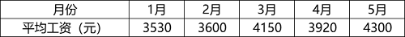
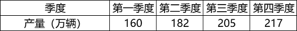

# 单定义-要件比对（时期数列vs时点数列辨析）

考点：[[20-考点/判断推理/定义判断/单定义-要件比对（时期数列vs时点数列辨析）|定义判断 / 单定义-要件比对（时期数列vs时点数列辨析）]]

**问法模型**：'根据定义，下列属于时点数列的是'→提取时点数列三要件（时点数量/不能相加/定期间断登记），逐项比对排除

## 推理链
1. 第1步：提取定义要点——时期数列是'一定时期内发展过程的总量'，指标值'可以相加'，数值大小'与时期长短有直接关系'；时点数列是'某一时点（时刻）上的数量'，指标值'不能相加'，与'时点间隔'长短无关，'定期（间断）登记取得'
2. 第2步：方法——将每个选项的指标判断为'时期总量（流量）'还是'某时刻数量（存量）'，对照两类定义要件逐一比对
3. 第3步：A项税收情况是每一年度的税收总额，属于'一定时期内发展过程的总量'，符合时期数列，排除
4. 第4步：B项员工人数统计的是'年末'数据，'年末'是时点，人数不能相加且与时间长短无直接关系，每年间断登记，三个要件全符合
5. 第5步：C项'月均工资'是一整月工资的平均值而非某时刻的量，不符合'某一时点上的数量'，排除
6. 第6步：D项各季度生产产量是季度内的总量，属于时期数列，排除，故选B

**最快解法**：⚡ 关键词法+排除法：先记口诀'流量可加是时期，存量时点是时点'——A税收、D产量均为时期总量直接排除；C'月均工资'是平均量不是时点量排除；只剩B'年末人数'为某时点的存量，当选

## 易错点
- ⚠ 把'月均工资'误判为时点数据：平均值反映一段时期的水平，不是某一时刻的量
- ⚠ 只看'按时间排列'就认定符合时点数列，忽略'指标值不能相加'这一区别性要件
- ⚠ 对'年末人数'中的'年末'这一时点标志词不敏感，误将人数当成时期总量

## 母题抽象
> 🧩 当定义题干出现'某一时点上的数量/不能相加/定期间断登记'等区别性要件时，用'流量vs存量'判别法：可加总的时期总量（税收、产量、销售额）为时期数列，某时刻的存量（人数、库存、人口数、储蓄余额）为时点数列

**同类特征**：一定时期内发展过程的总量、各指标值可以相加、某一时点（时刻）上的数量、各指标值不能相加、定期（间断）登记取得、总量指标按时间先后顺序排列

## 相关题
（暂无）

---

### 题干
总量指标动态数列是将反映某种社会经济现象的一系列总量指标按时间先后顺序排列形成的数列，可分为两类：（1）时期数列：每个指标都表示社会经济现象在一定时期内发展过程的总量，各指标值可以相加，指标数值的大小与时期长短有直接关系；（2）时点数列：每个指标都表示社会经济现象在某一时点（时刻）上的数量，各指标值不能相加，指标数值大小和“时点间隔”长短没有直接关系，每个指标通常都是定期（间断）登记取得的。
根据上述定义，下列属于时点数列的是：

### 选项
- A. 
2016~2020年某市税收情况

- B. 
2017~2020年某公司员工人数情况

　✅
- C. 
2021年1~5月某地区城镇私营单位就业人员月均工资

- D. 
2020年某地区各季度电动汽车生产产量

### 官方解析
第一步：找出定义关键词。
总量指标动态数列：“将反映某种社会经济现象的一系列总量指标按时间先后顺序排列”；
时期数列：“每个指标都表示社会经济现象在一定时期内发展过程的总量”、“各指标值可以相加”、“指标数值的大小与时期长短有直接关系”；
时点数列：“每个指标都表示社会经济现象在某一时点（时刻）上的数量”、“各指标值不能相加”、“指标数值大小和‘时点间隔’长短没有直接关系，每个指标通常都是定期（间断）登记取得的”。
第二步：逐一分析选项。
A项：选项中每项指标表示的是每一年的税收情况，属于一定时期内的总量，符合“每个指标都表示社会经济现象在一定时期内发展过程的总量”，符合“时期数列”定义，不符合“时点数列”定义，排除；
B项：选项中每项指标表示的是每一年的年末员工人数，“年末”是个时点，符合“每个指标都表示社会经济现象在某一时点（时刻）上的数量”，指标是年末的人数，不能相加，符合“各指标值不能相加”，且和时间长短没有直接关系，统计每年的年末数据，说明其是间断取得的，符合“指标数值大小和‘时点间隔’长短没有直接关系，每个指标通常都是定期（间断）登记取得的”，符合“时点数列”定义，当选； 
C项：选项中每项指标表示的是每月的平均工资，是一整月的工资平均值，不是某一时点（时刻）上的数量，不符合“每个指标都表示社会经济现象在某一时点（时刻）上的数量”，不符合“时点数列”定义，排除；
D项：选项中每项指标表示的是每一季度的生产产量，属于一定时期内的总量，符合“每个指标都表示社会经济现象在一定时期内发展过程的总量”，符合“时期数列”定义，不符合“时点数列”定义，排除。
故正确答案为B。

### 给定材料
（无）
