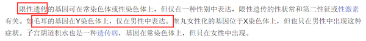
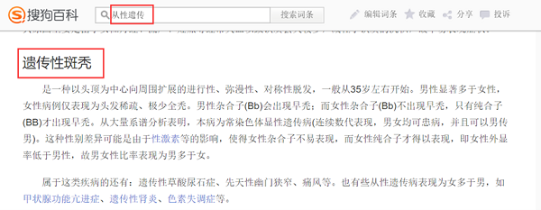

# 多定义辨析-伴性-限性-从性遗传三定义区分

考点：[[20-考点/判断推理/定义判断/多定义辨析-伴性-限性-从性遗传三定义区分|定义判断 / 多定义辨析-伴性/限性/从性遗传三定义区分]]

**问法模型**：并列给出三个相近定义，问'属于限性遗传的是'→先锁定目标定义的硬性要件（基因位置+表现范围），再逐项匹配并用另两个定义反排除

## 推理链
1. 第1步：提取限性遗传两个要件：①控制性状的基因位于性染色体上；②性状只在一种性别上得以表现，而在另一性别上完全不能表现
2. 第2步：备好参照定义作排除依据：伴性遗传=性染色体+不同性别'概率不同'；从性遗传=常染色体+性激素致不同性别表达不同
3. 第3步：A项抗维生素D佝偻病'女性发病率高'，仅是概率差异，女性之外性别仍可表现，不符合'完全不能表现'，属伴性遗传
4. 第4步：B项外耳道多毛症为伴Y染色体遗传，Y染色体只存在于男性，女性完全无该性状表现，同时满足要件①②，符合限性遗传
5. 第5步：C项遗传性斑秃为'常染色体显性遗传病'，直接违反要件①'基因位于性染色体上'，且受性激素影响男女表达不同，属从性遗传
6. 第6步：D项红绿色盲'男性发病率高'，同为概率差异而非单一性别完全表现，属伴性遗传；仅有B项符合

**最快解法**：⚡ 要件排除法：限性遗传=性染色体+单一性别完全表现。先用'常染色体'秒杀C（属从性遗传），再用'概率不同≠完全不能表现'排除A、D（属伴性遗传），锁定B

## 易错点
- ⚠ C项'男性早秃、女性不出现'表面像'只在一种性别表现'，但基因在常染色体上，是从性遗传的典型陷阱——须先查基因位置再查表现范围
- ⚠ A、D的'发病率高/概率不同'易被误当成'只在一种性别表现'，概率低≠另一性别'完全不能表现'
- ⚠ 忽略限性遗传定义中'基因位于性染色体上'这一前置要件，只凭单性别表现就误选C

## 母题抽象
> 🧩 当题干并列多个相似定义且问'属于X的是'时，先拆出X定义的硬性要件组合（本题：基因位置+性别表现方式），逐项用要件排除，并用邻近定义（伴性/从性）反验证

**同类特征**：多定义辨析、伴性遗传、限性遗传、从性遗传、性染色体vs常染色体、概率不同vs完全不能表现

## 相关题
- [[10-真题/判断推理/定义判断/10204626 多定义辨析-概念同化三类型（上位-下位-并列组合）|10204626]]（黑龙江 2024，相关度1）
- [[10-真题/判断推理/定义判断/10297352 多定义辨析-要件匹配（第三-第四航权）|10297352]]（浙江 2025，相关度1）
- [[10-真题/判断推理/定义判断/15833791 多定义-对比辨析（认知决策vs直觉决策）|15833791]]（黑龙江 2026，相关度1）
- [[10-真题/判断推理/定义判断/1752910 多定义-子类型辨析（互补品之普通互补品与完全互补品）|1752910]]（北京 2016，相关度1）
- [[10-真题/判断推理/定义判断/1752936 多定义辨析-并列子定义（兼并三种类型的分类比对）|1752936]]（北京 2016，相关度1）

---

### 题干
伴性遗传是指控制性状的基因位于性染色体上，遗传总是与性别相关联，不同性别出现某一性状的概率不同的遗传。限性遗传是指控制性状的基因位于性染色体上，性状只在一种性别上得以表现，而在另一性别上完全不能表现的遗传。从性遗传是指控制性状的基因位于常染色体上，但由于受到性激素的作用，基因在不同性别中表达不同的遗传。
根据上述定义，下列属于限性遗传的是：

### 选项
- A. 抗维生素D佝偻病是伴X染色体显性遗传病，女性发病率高，常表现为世代遗传
- B. 人类外耳道多毛症为伴Y染色体遗传病，在家族男性亲属中代代遗传　✅
- C. 遗传性斑秃为常染色体显性遗传病，男性会出现早秃，而女性则不会出现
- D. 红绿色盲症是伴X染色体隐性遗传病，男性发病率高，表现出交叉遗传和隔代遗传

### 官方解析

第一步：找出定义关键词。

伴性遗传：“控制性状的基因位于性染色体上”、“不同性别出现某一性状的概率不同”；

限性遗传：“控制性状的基因位于性染色体上”、“只在一种性别上得以表现，而在另一性别上完全不能表现”；

从性遗传：“控制性状的基因位于常染色体上”、“由于受到性激素的作用，基因在不同性别中表达不同”。

第二步：逐一分析选项。

A项：抗维生素D佝偻病在女性中的发病率高，说明在女性中出现的概率高，符合“不同性别出现某一性状的概率不同”，符合伴性遗传定义，不符合“性状只在一种性别上得以表现，而在另一性别上完全不能表现”，不符合限性遗传定义，排除；

B项：人类外耳道多毛症为伴Y染色体遗传病，在家族男性亲属中代代遗传，说明该病仅在家族男性中遗传，符合“性状只在一种性别上得以表现，而在另一性别上完全不能表现”，符合限性遗传定义，当选；

C项：遗传性斑秃为常染色体显性遗传病，说明其控制性状的基因位于常染色体上，不符合“控制性状的基因位于性染色体上”，不符合限性遗传定义，下面资料显示，遗传性斑秃属于从性遗传，排除； 

D项：红绿色盲症在男性中发病率高，说明在男性中出现的概率高，符合“不同性别出现某一性状的概率不同”，符合伴性遗传定义，不符合“性状只在一种性别上得以表现，而在另一性别上完全不能表现”，不符合限性遗传定义，排除。

故正确答案为B。

### 给定材料
（无）
