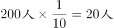

# 单定义-要件量化应用（分层比例抽样的比例计算）

考点：[[20-考点/判断推理/定义判断/单定义-要件量化应用（分层比例抽样的比例计算）|定义判断 / 单定义-要件量化应用（分层比例抽样的比例计算）]]

**问法模型**：问'正确应用了该方法的是'→ 提取定义核心要件（按各层级人数占总体人数的比例分配样本量），用比例计算逐项验证选项

## 推理链
1. 第1步：从定义提取要件：'按各个层级的单位数量占调查总体单位数量的比例分配各层的样本数量'，即各层样本数之比须等于各层人数之比
2. 第2步：提取题干数据：总体20000人、抽样200人；本科及以上2000人、高中6000人、初中及以下12000人
3. 第3步：计算各层占总体比例：本科及以上2000/20000=10%，高中6000/20000=30%，初中及以下12000/20000=60%
4. 第4步：按比例分配200个样本：200×10%=20人，200×30%=60人，200×60%=120人
5. 第5步：对照选项：B项20、60、120与计算结果一致；A项(10,30,160)对应5%/15%/80%，C项(30,80,110)对应15%/40%/55%，D项(40,60,100)对应20%/30%/50%，均与总体比例不符

**最快解法**：⚡ 抽样比法：抽样比=样本量÷总体量=200/20000=1/100，各层人数直接÷100（或×1/100）：2000→20、6000→60、12000→120，秒锁B

## 易错点
- ⚠ 用错分母：计算比例时误以抽样数200为分母，而非总体20000
- ⚠ 误以为各层样本数应与各层人数的绝对差或数量级挂钩，误选D（其高中层60人恰与正确答案相同，产生部分干扰）
- ⚠ 忽略'样本比例须等于总体比例'这一要件，凭直觉挑各项加和为200的选项（四个选项总和均为200，需靠比例排除）

## 母题抽象
> 🧩 当定义给出'按比例分配/抽样'类规则并提供总体量、样本量和各层数量时，先求抽样比（样本量÷总体量），再逐层相乘，对照选项找出比例一致的答案

**同类特征**：分层比例抽样、按各层级单位数量占总体比例分配样本、总体20000人、抽取200人、各层人数2000/6000/12000、正确应用该方法的是

## 相关题
（暂无）

---

### 题干
分层比例抽样是指按各个层级的单位数量占调查总体单位数量的比例分配各层的样本数量的方法。某社区有居民20000人，从中抽取200人进行阅读状况调查。该社区居民中本科及以上学历者2000人，高中学历者6000人，初中及以下学历者12000人，用分层比例抽样法确定各层的样本数目。
根据上述定义，如果对该社区居民不同学历者采用分层比例抽样法进行调查，下列正确应用了该方法的是：

### 选项
- A. 从不同学历者中分别抽取10人、30人、160人
- B. 从不同学历者中分别抽取20人、60人、120人　✅
- C. 从不同学历者中分别抽取30人、80人、110人
- D. 从不同学历者中分别抽取40人、60人、100人

### 官方解析

第一步：找出定义关键词。

“按各个层级的单位数量占调查总体单位数量的比例分配各层的样本数量”、“某社区有居民20000人，从中抽取200人进行阅读状况调查”、“该社区居民中本科及以上学历者2000人，高中学历者6000人，初中及以下学历者12000人”。

第二步：分析选项。

提问要求“对该社区居民不同学历者采用分层比例抽样法进行调查”，即按各学历的人数占该社区居民总数的比例分配各学历的样本数量，因此需先计算各学历人数所占比例，再结合抽样总数，计算各学历样本数量。

（1）根据题干“某社区有居民20000人”与“该社区居民中本科及以上学历者2000人，高中学历者6000人，初中及以下学历者12000人”可知，各学历占社区居民总数的比例如下：

本科及以上：；

高中：；

初中及以下：。

（2）题干要求从该社区中抽取200人进行阅读状况调查，结合各学历所占比例可知：

本科及以上：；

高中：；

初中及以下：。

综上，应从不同学历者中分别抽取20人、60人、120人，只有B项符合。

故正确答案为B。

### 给定材料
（无）
