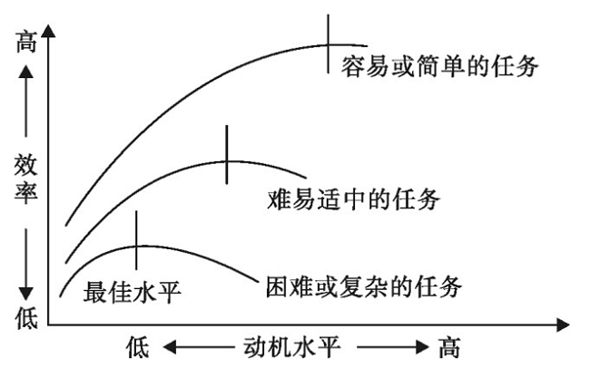

# 单定义-图形化定义（倒U形曲线）要点符合性判断（选非题）

考点：[[20-考点/判断推理/定义判断/单定义-图形化定义（倒U形曲线）要点符合性判断（选非题）|定义判断 / 单定义-图形化定义（倒U形曲线）要点符合性判断（选非题）]]

**问法模型**：“下列说法错误的是”选非问法→以题干图形规律为标准，逐项对照找出与曲线规律相悖的一项

## 推理链
1. 第1步：提取定义要点——动机水平与工作效率“不是正比例关系”，而是“倒U形曲线”，即存在一个最佳动机水平使效率最高
2. 第2步：读图提取附加规律——横轴为动机水平（左低右高），纵轴为效率；三条曲线分别对应“容易或简单的任务”“难易适中的任务”“困难或复杂的任务”，每条曲线峰值处标注“最佳水平”竖线
3. 第3步：比较三条曲线峰值位置——容易任务峰值竖线最靠右（最佳动机水平最高），困难任务峰值竖线最靠左（最佳动机水平最低），故任务难度越大，动机的最佳水平越低
4. 第4步：A项对照——曲线峰值处即“达到一定强度时效率最高”，符合图形，排除
5. 第5步：B项对照——倒U形曲线上升段“效率随动机提高而上升”，即“一定范围内”成立，符合图形，排除
6. 第6步：C项对照——图形显示难度增加时最佳动机水平“逐渐下降”，与C项“逐渐上升”方向相反，不符合，当选
7. 第7步：D项对照——曲线右段（动机过强）三条曲线效率均下降，学习效率降低的说法符合图形，排除

**最快解法**：⚡ 图形峰值定位法：直接对比三条曲线峰值竖线的横坐标——容易任务最靠右、困难任务最靠左，得出“难度↑→最佳动机水平↓”，与C项“上升”矛盾，秒选C

## 易错点
- ⚠ 只关注曲线的倒U形状，忽略三条曲线峰值横向位置的差异（即最佳动机水平随难度左移），导致误判C项方向
- ⚠ 选非题思维惯性，错选表述正确的A、B或D
- ⚠ 把横轴“动机水平”的左右方向看反，导致最佳水平升降判断颠倒

## 母题抽象
> 🧩 当定义以函数曲线/图形呈现时，先读坐标轴含义，再读曲线形状（升、降、峰值）及多条曲线间的位置关系（峰值左移/右移），最后将选项中“升/降/最高”等方向性描述与图形逐一对照，选非题锁定方向相悖项

**同类特征**：动机-效率定律、倒U形曲线、不是正比例关系、三条不同难度任务曲线、峰值处标注最佳水平、选非问法“说法错误的是”

## 相关题
（暂无）

---

### 题干

动机-效率定律是心理学家提出的反映动机水平与工作效率关系的定律。心理学家认为动机水平的强度和工作效率之间的关系不是一种正比例关系，而是形成一种倒U形曲线，如下图所示。

根据上述定义，下列说法错误的是：

### 选项
- A. 动机水平在达到一定强度的时候，工作效率最高
- B. 在一定范围内，工作效率随着动机的提高而上升
- C. 随着任务难度的增加，动机的最佳水平逐渐上升　✅
- D. 对学习来说，如果动机过强，会使学习效率降低

### 官方解析
第一步：找出定义关键词。
根据题干倒U形曲线图可知：“相同任务难度下，随着动机增强，效率先上升后下降”、“不同任务难度下，随着任务难度降低，效率最佳水平逐渐升高”。
第二步：逐一分析选项。
A项：根据题干倒U形曲线可知，前期随着“动力水平”的升高，“工作效率”也在升高，并达到“效率最佳水平”，因此，动机水平在达到一定强度的时候，工作效率最高，符合定义，排除；
B项：根据题干倒U形曲线可知，前期随着“动力水平”的升高，“工作效率”也在升高，后期随着“动力水平”的升高，“工作效率”开始下降，因此在“一定范围内”即倒U形曲线前期，工作效率随动机提高而上升，符合定义，排除；
C项：根据题干三条倒U形曲线可知，任务难度越大，“动机的最佳水平”逐渐下降，不符合定义，当选；
D项：根据题干倒U形曲线后期走向可知，无论学习属于哪一类难度的任务，“动机过强”均会出现效率降低的情况，符合定义，排除。
本题为选非题，故正确答案为C。

### 给定材料
（无）
