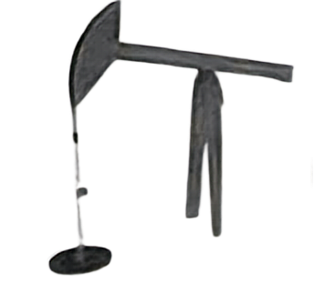
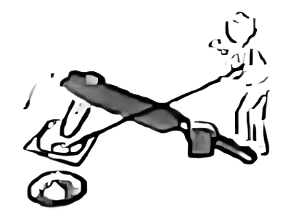

# 单定义-要素对应（图示型定义匹配）

考点：[[20-考点/判断推理/定义判断/单定义-要素对应（图示型定义匹配）|定义判断 / 单定义-要素对应（图示型定义匹配）]]

**问法模型**：题干给出桔槔的结构描述并配四个图片选项，问'下列属于桔槔的是'→拆解定义关键要素，逐图核对结构特征，缺任一要素即排除

## 推理链
1. 第1步：从定义提取三个关键要素：①'从井里往外打水的工具'（功能）；②'横杆的中间由竖柱支撑或悬吊'（中间支撑位置）；③'横杆的一端用竖杆连接水桶，另一端悬绑重物'（两端部件配置）
2. 第2步：方法为要素逐项对照法——功能要素+结构位置要素+两端配置要素，三要素须同时满足
3. 第3步：A项人物用井绳从井中打水，符合功能要素，但横杆两端由竖柱支撑而非中间支撑，且中间由井绳连水桶、未悬绑重物，缺要素②③，排除；C项横杆一端未悬绑重物、另一端是否连水桶不明，缺要素③，排除；D项横杆一端未连水桶、另一端未悬绑重物，缺要素③，排除
4. 第4步：B项横杆中间由竖柱支撑（符合要素②），右侧一端用竖杆连接水桶、左侧一端悬绑重物（符合要素③），且从井中打水（符合要素①），三要素齐全，当选

**最快解法**：⚡ 关键要素排除法：锁定'中间支撑＋一端竖杆连水桶＋另一端悬重物'三个硬性结构特征，逐图快速核对，任一特征缺失即排除

## 易错点
- ⚠ 仅凭'从井里往外打水'这一功能要素就认定A项符合，忽视结构要素（横杆中间支撑、两端配置）的硬性约束
- ⚠ 混淆'中间支撑'与'两端支撑'的位置区别，把井绳滑轮类/辘轳类结构误判为桔槔
- ⚠ 图片信息识别不细，漏看一端是否'悬绑重物'或一端是否'竖杆连接水桶'，误选C或D

## 母题抽象
> 🧩 当题干为'器物名称＋结构部件描述'的定义且选项为图片时，把定义拆为功能、部件位置（中间/两端）、部件配置三组关键词，逐图核对，三要素缺一即排除

**同类特征**：从井里往外打水的工具、横杆的中间由竖柱支撑或悬吊、一端用竖杆连接水桶、另一端悬绑重物、图示型定义判断、杠杆结构

## 相关题
（暂无）

---

### 题干
桔槔：指一种从井里往外打水的工具。其结构相当于普通的杠杆，横杆的中间由竖柱支撑或悬吊，横杆的一端用竖杆连接水桶，另一端悬绑重物。汲水时， 压竖杆则水桶向下灌水，灌满后压另一头，水桶就提升到井外。
下列属于桔槔的是：

### 选项
- A. 

- B. 

　✅
- C. 

- D. 

### 官方解析
第一步：找出定义关键词。
“从井里往外打水的工具”、“横杆的中间由竖柱支撑或悬吊”、“横杆的一端用竖杆连接水桶，另一端悬绑重物”。
第二步：逐一分析选项。
A项：该图中的人物通过捯井绳从井中打水，符合“从井里往外打水的工具”，但该工具中横杆的两端由竖柱支撑，不符合“横杆的中间由竖柱支撑或悬吊”，且横杆的中间由井绳连接水桶，也未悬绑重物，不符合“横杆的一端用竖杆连接水桶，另一端悬绑重物”，不符合定义，排除； 
B项：该图中的人物通过工具从井中打水，符合“从井里往外打水的工具”，且该工具中横杆的中间由竖柱支撑，符合“横杆的中间由竖柱支撑或悬吊”，该工具右侧的一端用竖杆连接水桶，左侧的一端悬绑重物，符合“横杆的一端用竖杆连接水桶，另一端悬绑重物”，符合定义，当选；
C项：该图工具中横杆的一端并未悬绑重物，也不明确另一端是否连接水桶，不符合“横杆的一端用竖杆连接水桶，另一端悬绑重物”，不符合定义，排除；
D项：该图工具中横杆的一端并未连接水桶，另一端也并未悬绑重物，不符合“横杆的一端用竖杆连接水桶，另一端悬绑重物”，不符合定义，排除。
故正确答案为B。

### 给定材料
（无）
