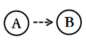

# 单定义-要素对应（符号图形型定义：实线-虚线-箭头方向的转译）

考点：[[20-考点/判断推理/定义判断/单定义-要素对应（符号图形型定义：实线-虚线-箭头方向的转译）|定义判断 / 单定义-要素对应（符号图形型定义：实线/虚线/箭头方向的转译）]]

**问法模型**：'根据上述定义，对下图的判断正确的是'→先把定义中的符号规则（线型×箭头方向）转译成关系命题，再逐项对照图形验证。

## 推理链
1. 第1步：从定义提取符号规则——实线表示吸引关系、虚线表示排斥关系、箭头表示方向，且'被实线箭头指向最多的人，就是处于团体中心位置的人'
2. 第2步：方法：符号转译+逐项排除，把每条连线按'线型×箭头指向'翻译为'谁吸引/排斥谁'；凡'相互X'类表述必须存在双向同型箭头
3. 第3步：A项——图中虚线箭头均为单向，不存在双向虚线箭头，按'虚线表示排斥关系'可知无相互排斥的人，正确；B项——数入箭头：B被A、C、D、E、G共5条实线箭头指向，C只被4条实线箭头指向，按'指向最多'可知中心是B而非C，错误；C项——F发出的虚线箭头指向他人，F本身没有被虚线箭头指向，即F未受排斥，错误；D项——H与B之间没有直接的双向实线关系，不构成相互吸引，错误
4. 第4步：与选项对照，仅A项与图形及定义完全相符，故选A

**最快解法**：⚡ 符号口诀法+'相互'双向验证：口诀'实吸虚斥、箭头指向谁谁就是被指向者'；扫图先看虚线是否成双——全图无双向虚线箭头，直接锁定A；再数B的实线入箭头（5条＞C的4条）复核排除B项。

## 易错点
- ⚠ 箭头方向理解反了：误把'箭头发出者'当作被吸引/被排斥者，应以定义'被实线箭头指向最多=中心'为转译基准
- ⚠ 数箭头漏数或错数：B与C的实线入箭头数接近（5条vs4条），漏掉D、E指向B的箭头会误认为C是中心
- ⚠ '相互排斥/相互吸引'误判：单向虚线≠相互排斥，无直接连线或单向实线≠相互吸引，必须双向同型箭头才成立；另注意F发出虚线箭头不等于F受排斥

## 母题抽象
> 🧩 当定义以'符号系统+图形'呈现（线型区分关系性质、箭头区分方向）时，先背熟符号规则，再将每条线转译为关系命题：凡'相互/彼此'类选项必须验证双向符号，凡'最多/中心'类选项必须数入箭头数量。

**同类特征**：人际关系图（符号图形型定义）、实线=吸引、虚线=排斥、箭头表示方向、被实线箭头指向最多=团体中心、判断正确的是（图形对照式定义判断）、双向与单向箭头辨析

## 相关题
（暂无）

---

### 题干

人际关系图，是用一套特定的符号来表示团体内成员之间各种关系的图形。依据前期的调查，将团体成员的关系分为“吸引”“排斥”“无关”三类。图中圆圈内的字母是团体内每一成员的代号。实线与虚线表示相互关系，其中实线表示吸引关系，虚线表示排斥关系，箭头表示方向（例如：表示A受B吸引，表示A排斥B），其中被实线箭头指向最多的人，就是处于团体中心位置的人。

根据上述定义，对下图的判断正确的是：

### 选项
- A. 该团体中没有相互排斥的人　✅
- B. C是处于团体中心位置的人
- C. F是该团体中受排斥最多的人
- D. H和B是相互吸引的人

### 官方解析

第一步：找出定义关键词。

实线：“表示吸引关系”；

虚线：“表示排斥关系”；

：“表示A受B吸引”；

：“表示A排斥B”；

团体中心位置的人：“被实线箭头指向最多的人”。

第二步：逐一分析选项。

A项：题干图示中没有双向虚线箭头，根据“虚线表示排斥关系”可知，该团体中没有相互排斥的人，表述正确，当选；

B项：题干图示中C被四个实线箭头指向，而B被五个实线箭头指向，根据“被实线箭头指向最多的人”可知，B是处于团体中心位置的人，而不是C，表述错误，排除；

C项：题干图示中F没有被虚线箭头指向，根据“虚线表示排斥关系”可知，F没有受到排斥，表述错误，排除；

D项：题干图示中H和B没有直接的双向实线关系，根据“实线表示吸引关系”可知，H和B不是相互吸引的人，表述错误，排除。

故正确答案为A。

### 给定材料
（无）
