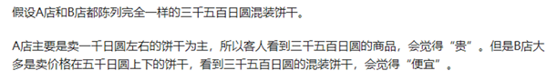
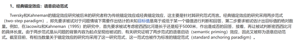

# 单定义-要素对应（锚定效应：起始值锚定+判断偏差）

考点：[[20-考点/判断推理/定义判断/单定义-要素对应（锚定效应：起始值锚定+判断偏差）|定义判断 / 单定义-要素对应（锚定效应：起始值锚定+判断偏差）]]

**问法模型**：“下列不涉及锚定效应的是”为选非题 → 提取定义全部要件后逐项比对，找出缺失关键要件（尤其是“判断与现实有偏差”）的选项

## 推理链
1. 第1步：提取定义四要件——①定量估测时将先前获得的特定数值作为起始值；②起始值像锚一样制约估测值；③决策时过度利用起始值快速判断；④判断往往是与现实有偏差的
2. 第2步：选非题，以要件④“判断与现实有偏差”为最强筛子，逐一核查各选项是否同时满足“有锚”与“有偏差”
3. 第3步：A项——小李原6点下班调整为5点下班，下班后的可支配时间客观上确实增加了1小时，他感觉“时间变得很长”与现实一致，缺失“偏差”要件，不符合定义
4. 第4步：B项——同款百元包在奢侈品店显得便宜、在地摊显得贵，是以场景内其他商品价格（奢侈品高价/地摊低价）为起始值作锚，包价未变而判断改变且偏离其实际价值，符合定义
5. 第5步：C项——小王以听闻的原价200元为起始值作锚，判断促销价100元“太便宜”并一次性买5瓶，决策过度受锚制约，符合定义
6. 第6步：D项——先问“是否长于/短于5000km”即先给定锚，两组参与者随后估计的具体长度随锚的方向整体偏移，判断受起始值过度影响且存在偏差，符合定义
7. 第7步：只有A项不符合定义，选非题故正确答案为A

**最快解法**：⚡ 关键词法+排除法：抓住定义末句收尾要件“判断往往是与现实有偏差的”，A项下班提前1小时是客观事实、感知与之相符（无偏差），直接锁定A；其余三项均有“先前数值作锚→估测偏离”结构，快速排除

## 易错点
- ⚠ 忽略收尾要件“判断与现实有偏差”，误以为A项“觉得时间长”也是主观偏差而错选
- ⚠ B项易被误判为‘对比效应’而非锚定效应，需注意场景内其他价格同样可充当起始值锚，且判断偏离包的实际价值
- ⚠ 选非题看错问法，或因D项是经典锚定实验反而误以为它'不涉及'而错选

## 母题抽象
> 🧩 当定义判断题干出现“先前数值/信息作为参照→制约后续估测或决策”结构且为选非题时，用要件逐一比对法，重点验证“判断是否偏离现实”等隐性收尾要件，缺失者即为答案

**同类特征**：定量估测、先前特定数值作为起始值、起始值像锚一样制约估测值、过度利用起始值快速决策、判断与现实有偏差、选非提问

## 相关题
（暂无）

---

### 题干
锚定效应是指当人们需要对某个事件做定量估测时，会将先前获得的某些特定数值作为起始值，起始值像锚一样制约着估测值。在做决策时，倾向于过度利用这一起始值，快速做出判断，但这种判断往往是与现实有偏差的。
根据上述定义，下列不涉及锚定效应的是：

### 选项
- A. 小李原本6点下班，最近调整为5点下班，他觉得下班后的时间变得很长　✅
- B. 在奢侈品店看到一款百元包会觉得便宜，在地摊上看到同款百元包会觉得贵
- C. 小王听说某护肤品卖200元，但他去超市后发现，该护肤品在搞促销，只卖100元，他非常惊喜，觉得“太便宜了”，于是一次性买了5瓶
- D. 先让两组参与者判断尼罗河的长度是否长于5000km/短于5000km，再让两组参与者分别估计尼罗河的具体长度，结果发现，被询问“是否长于5000km”的参与者比被询问“是否短于5000km”的参与者报告的尼罗河具体长度更长

### 官方解析

第一步：找出定义关键词。

“将先前获得的某些特定数值作为起始值”、“起始值像锚一样制约着估测值”、“做决策时，倾向于过度利用这一起始值”、“判断往往是与现实有偏差的”。

第二步：逐一分析选项。

A项：小李原本6点下班，最近调整为5点下班，他觉得下班后的时间变得很长，提早下班后时间确实比以前长了，他的判断没有偏差，不符合“判断往往是与现实有偏差的”，不符合定义，当选；

B项：奢侈品店看到一款百元包会觉得便宜，是因为以奢侈品高昂的价格为起始值，对比店里的百元包，会觉得便宜；在地摊上看到同款百元包会觉得贵，是因为以地摊上的其他商品为起始值，来判断地摊同款百元包，会觉得贵，但包是同款，且价格没变，改变的是对其的判断，符合“将先前获得的某些特定数值作为起始值”、“起始值像锚一样制约着估测值”、“做决策时，倾向于过度利用这一起始值”、“判断往往是与现实有偏差的”，符合定义，排除；

C项：某护肤品卖200元，但超市搞促销只卖100元，小王觉得“太便宜了”，于是一次性买了5瓶，是以过去的价格200元为起始值，来确定现在100元是便宜的，小王认为这个价格很划算，于是决定购买很多，符合“将先前获得的某些特定数值作为起始值”、“起始值像锚一样制约着估测值”、“做决策时，倾向于过度利用这一起始值”、“判断往往是与现实有偏差的”，符合定义，排除；

D项：先让两组参与者判断尼罗河的长度是否长于5000km/短于5000km，即给定一个起始值，符合“将先前获得的某些特定数值作为起始值”，再让两组参与者分别估计尼罗河的具体长度，结果发现，被询问“是否长于5000km”的参与者比被询问“是否短于5000km”的参与者报告的尼罗河具体长度更长，这是在锚（长于5000km/短于5000km）的暗示下，人们在判断具体长度时会不自觉地给予起始值过多的重视，导致两组参与者的判断存在偏差，符合“起始值像锚一样制约着估测值”、“做决策时，倾向于过度利用这一起始值”、“判断往往是与现实有偏差的”，符合定义，排除。

注：有同学可能会纠结A项的“很长”也是一种偏差，只多了一小时，是“长”而不是“很长”，但具体的感受因人而异，不好说清。经过多方查证，锚定效应又叫沉锚效应，B、C、D三项均能找到类似案例，具体如下所示：

B项案例：

C项案例：

D项案例：

因此综合来看，A项最优。

本题为选非题，故正确答案为A。

### 给定材料
（无）
