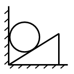
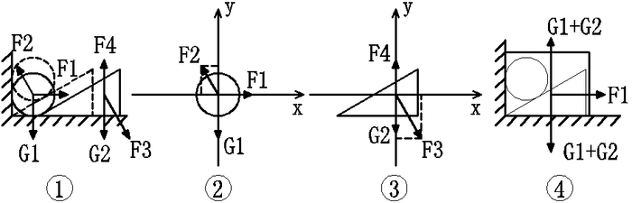

# 物理-功和机械能（弹力做功正负判断与系统机械能守恒）

考点：[[20-考点/判断推理/科学推理/物理-功和机械能（弹力做功正负判断与系统机械能守恒）|科学推理 / 物理-功和机械能（弹力做功正负判断与系统机械能守恒）]]

**问法模型**：‘从释放到落至地面过程中，下列说法正确的是’→ 先分物体做受力与做功分析，再用系统机械能守恒配平逐项排除

## 推理链
1. 第1步：题干条件'不考虑任何摩擦力'，铁球被夹在竖直水泥墙与木块斜面之间，释放后铁球贴墙竖直下落（位移竖直向下），斜面弹力把木块推离墙壁，木块沿水平地面向右滑动（位移水平向右）
2. 第2步：对铁球受力：重力＋木块斜面弹力F2，F2垂直斜面指向左上方，含竖直向上的分量，与铁球竖直向下的位移夹钝角，由功的定义F2对铁球做负功，A错误
3. 第3步：对木块受力：F2的反作用力F3指向右下方，其水平分量与木块水平向右的位移同向，F3对木块做正功；且木块'静置在水平地面'上势能不变、由静止开始动能增加，故木块机械能不守恒，B错误
4. 第4步：对木块和铁球整体：墙对球的弹力水平、与球竖直位移垂直不做功，地面支持力竖直、与木块水平位移垂直不做功，内部弹力F2与F3做功代数和为零，系统'只有重力做功'，系统机械能守恒
5. 第5步：由系统机械能守恒：铁球机械能减少量＝木块机械能增加量，而木块势能不变，其机械能增加量即动能增加量，C正确
6. 第6步：C正确，故'以上说法均不正确'的D错误，锁定答案C

**最快解法**：⚡ 系统守恒＋做功正负判断：整体只受重力做功⇒系统机械能守恒；木块水平滑动势能不变、动能增加，立即得'球机械能减少量＝木块动能增大量'，直接选C，无需计算具体力或速度

## 易错点
- ⚠ 误以为'弹力总不做功'：弹力是否做功取决于力与物体实际位移的夹角，斜面弹力对竖直下落的铁球做负功、对水平右移的木块做正功
- ⚠ 误以为木块被墙'顶住'就不动：球下落时把木块推离墙壁向右滑，木块动能增大是本题关键图像
- ⚠ 混淆单个物体与系统的机械能守恒：木块因弹力做正功机械能不守恒（B错），但'木块＋铁球'系统机械能守恒（C对）

## 母题抽象
> 🧩 当题干出现'光滑无摩擦＋两物体以弹力相互作用＋各自沿不同约束方向运动'时，先对系统判断是否只有重力做功（系统机械能守恒），再对单个物体看除重力外弹力做功正负判断其机械能增减，用'一物体机械能减少量＝另一物体机械能增加量'配平作答

**同类特征**：无摩擦/光滑接触、斜面弹力方向与物体位移不垂直、一物体竖直下落、另一物体水平滑动、墙和地面的约束力与位移垂直不做功、弹力做功正负判断、系统机械能守恒与单物体机械能不守恒的区分

## 相关题
（暂无）

---

### 题干

如图，三角形木块顶住水泥墙壁后静置在水平地面上，现将小铁球从图中位置无初速度地放开，假设不考虑任何摩擦力，那么小球从释放到落至地面的过程中，下列说法正确的是（  ）。

### 选项
- A. 木块对小铁球的弹力不做功
- B. 木块的机械能守恒
- C. 小铁球的机械能的减少量等于木块动能的增大量　✅
- D. 以上说法均不正确

### 官方解析

先对整个系统相对运动情况分析如图①。

A.对铁球受力分析如图②，F2即为木块对铁球弹力，方向垂直于木块斜面，由于铁球位移方向竖直向下，F2可分解为沿x轴和沿y轴方向，由功的定义F2这个外力对铁球做功，A错误。

B.对木块受力分析如图③，图②F2与图③F3为作用力与反作用力，木块位移水平向右，F3可分解为沿x轴和沿y轴方向，由功的定义F3这个外力对木块做功，所以机械能不守恒；或者可以从机械能的角度出发，木块由静止向右运动，可知木块势能不变动能增加，所以机械能不守恒，B错误。

C.对木块和铁球整体分析，两者只有重力做功，所以木块和铁球整体机械能守恒，铁球势能的减少量与动能增加量之和等于木块动能的增加量，C正确。

故正确答案为C。

### 给定材料
（无）
