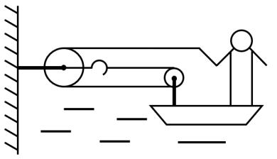

# 物理-滑轮组受力分析（动滑轮绳段数×张力）+ 牛顿第三定律 + 二力平衡

考点：[[20-考点/判断推理/科学推理/物理-滑轮组受力分析（动滑轮绳段数×张力）+ 牛顿第三定律 + 二力平衡|科学推理 / 物理-滑轮组受力分析（动滑轮绳段数×张力）+ 牛顿第三定律 + 二力平衡]]

**问法模型**：题干问'匀速移动时船受到的阻力'→ 识别匀速=平衡状态，以船为研究对象做水平方向受力分析，由合力为零求阻力

## 推理链
1. 第1步：从题干提取'小李用60N的拉力拉绳子（质量忽略不计）'→ 轻绳上张力处处相等，均为60N；'船体向前匀速移动'→ 船处于平衡状态
2. 第2步：隔离人分析——绳对人施加60N向前的拉力，人相对船静止不动，故船对人施加60N向后的摩擦力；由牛顿第三定律，人给船60N向前的摩擦力
3. 第3步：分析图中滑轮组——定滑轮固定在树上，动滑轮装在船上，绕过船上动滑轮的绳子有2段连着船，每段张力60N，故绳对船向前拉力为2×60=120N
4. 第4步：船受到向前总拉力=120N（绳）+60N（人的摩擦）=180N，方向指向岸上的树
5. 第5步：由匀速运动的平衡条件，水平方向水阻力=总拉力=180N；船重3000N、人质量65kg属竖直方向数据，为干扰量不参与计算
6. 第6步：对照选项，A.39、B.60、C.120均为部分受力，只有D.180对应总拉力，故选D

**最快解法**：⚡ 隔离受力法+二力平衡口诀：一看'匀速'知合力为零；二数绳——连着船的绳有2段（动滑轮在船上），绳拉力=2×60=120N；三算人——人拉绳60N经静摩擦等值反向传给船（人对船60N向前）；阻力=120+60=180N，秒选D

## 易错点
- ⚠ 只算滑轮组对船的120N拉力，漏掉人通过摩擦传给船的60N，误选C.120
- ⚠ 绳段数错乱：把人手握的那段绳重复计入动滑轮（其实该段作用已通过人体摩擦力体现，不能重复相加），或只按1段计算误选B.60
- ⚠ 被船重3000N、人质量65kg等竖直方向数据干扰，试图用重力/摩擦系数求阻力（此为命题人设置的无关干扰量）

## 母题抽象
> 🧩 当题干出现'人站在船/车上通过滑轮组拉绳且整体匀速运动'时，用隔离法分别对人、船做水平受力分析：人拉绳的力经静摩擦等值传给船，绳对船拉力=连船绳段数×张力，匀速时阻力=两者之和，题中重力类数据多为干扰量

**同类特征**：人站在船上拉绳、树与船之间滑轮组（树固定滑轮+船载动滑轮）、匀速移动→平衡状态、已知拉力60N、求水对船的阻力、船重3000N与人质量65kg为干扰数据

## 相关题
（暂无）

---

### 题干

如图，质量为65kg的小李站在重为3000N的铁皮船上，船体与陆地上的树木之间用滑轮组连接，小李用60N的拉力拉绳子（质量忽略不计）时，船体向前匀速移动，那么船在水中受到的阻力为（  ）N。

### 选项
- A. 39
- B. 60
- C. 120
- D. 180　✅

### 官方解析

绳子对人有60N的拉力，人没动，是因为船给人向后60N的摩擦力，故人给船60N向前的摩擦力。另外，由于滑轮组有两条绳子连着船上，故船受到绳子的拉力为120N。因此船受到的总拉力为N。

故正确答案为D。

### 给定材料
（无）

> [!warning] 疑点（官方解析可能有误，待人工复核）
> 官方解析末句'因此船受到的总拉力为N'漏印数值，按其思路应为60N+120N=180N；逻辑链条与答案D完全一致，不影响解题结论

<!-- CODEX-ANSWER-REVIEW:BEGIN -->
### 本次独立复核

**复核状态：** `resolved`（答案与解析已核定）

**计分答案：** D（可计分）

**复核解析：**

船向前匀速，故水阻力等于向前合力。人受绳向后的60 N拉力而静止，人给船向前的静摩擦力为60 N。题图显示连接船的活动滑轮由两段绳支承，绳张力各为60 N，绳对船合计向前120 N。因此阻力=60+120=180 N，选D。

**相关信息：**

需查看滑轮组图中绳索绕法、定滑轮/动滑轮和船体连接点。

**题源依据：** [固定版本原题](https://github.com/Mentat-Uran/kaogongzhentizhengliu/blob/84ab93d4b64b61d897bece8a1c0a5bab06b4feb2/10-%E7%9C%9F%E9%A2%98/%E5%88%A4%E6%96%AD%E6%8E%A8%E7%90%86/%E7%A7%91%E5%AD%A6%E6%8E%A8%E7%90%86/1758876%20%E7%89%A9%E7%90%86-%E6%BB%91%E8%BD%AE%E7%BB%84%E5%8F%97%E5%8A%9B%E5%88%86%E6%9E%90%EF%BC%88%E5%8A%A8%E6%BB%91%E8%BD%AE%E7%BB%B3%E6%AE%B5%E6%95%B0%C3%97%E5%BC%A0%E5%8A%9B%EF%BC%89%2B%20%E7%89%9B%E9%A1%BF%E7%AC%AC%E4%B8%89%E5%AE%9A%E5%BE%8B%20%2B%20%E4%BA%8C%E5%8A%9B%E5%B9%B3%E8%A1%A1.md)；固定内容 commit `84ab93d4b64b61d897bece8a1c0a5bab06b4feb2`，Markdown blob `f0cfa4d7b891c928bd875166b2a8f01c35f116dc`。
<!-- CODEX-ANSWER-REVIEW:END -->
