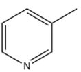

# 化学-有机物亲疏水性判断（极性-氢键与基团作用强弱比较）

考点：[[20-考点/判断推理/科学推理/化学-有机物亲疏水性判断（极性-氢键与基团作用强弱比较）|科学推理 / 化学-有机物亲疏水性判断（极性/氢键与基团作用强弱比较）]]

**问法模型**：题干给出'基团→亲/疏水性'规则并附分子结构图，问具体有机物的亲疏水性 → 拆解结构逐基团定性，再比较亲水与疏水作用的强弱定整体性质

## 推理链
1. 第1步：从题干提取规则——'非极性基团（烷基、苯环）表现疏水性'，'极性基团或可形成氢键的基团（如羟基）表现亲水性'
2. 第2步：由结构图可知3-甲基吡啶=吡啶环+甲基，吡啶环可视为苯环上一个碳原子被氮原子替代
3. 第3步：分析氮原子——氮最外层5个电子，3个与相邻碳形成共价键后'仍剩余2个电子，形成孤对电子'，孤对电子使吡啶环容易与水形成氢键→亲水
4. 第4步：分析甲基——烷基非极性→疏水；两种作用并存，需比较强弱
5. 第5步：官方解析明确'单个甲基的疏水作用远小于氢键的亲水作用'，故3-甲基吡啶整体表现为亲水性
6. 第6步：逐项对照——A正确指出氮原子孤对电子形成氢键而亲水；B只据环结构与苯类似判疏水，漏掉氮的作用；C只看甲基以局部代整体；D归因于'电负性较高'，未落在'孤对电子形成氢键'这一题干逻辑链条上

**最快解法**：⚡ 关键词法：抓题干规则'能形成氢键→亲水'，看结构图锁定氮原子，按解析中'5电子-3成键-余2个孤对电子'直接推出吡啶环亲水，锁定A；B、C均只谈局部疏水基团，D归因错误，快速排除

## 易错点
- ⚠ 只看吡啶环与苯环结构类似就判疏水（B的陷阱），忽略氮原子孤对电子可与水形成氢键
- ⚠ 只看含甲基就判疏水（C的陷阱），以局部基团代替分子整体性质，忽略亲疏水作用强弱比较
- ⚠ D的迷惑：'电负性高'与亲水之间缺少'孤对电子形成氢键'这一桥梁，归因不对应题干规则

## 母题抽象
> 🧩 当题干给出'基团性质→亲疏水'规则并附分子结构图时，先拆分分子逐基团定性（非极性→疏水，极性/可成氢键→亲水），再比较各基团作用的强弱，分子整体性质由主导作用决定

**同类特征**：亲水/疏水性判断、基团规则：非极性疏水、极性/氢键亲水、结构图中含氮杂环（吡啶）、氮原子孤对电子、多基团作用强弱比较定整体、化学结构图+化学知识推理

## 相关题
（暂无）

---

### 题干

疏水是指物质表面或分子与水之间的相互排斥作用，这种作用导致物质表面或分子不易与水接触或溶解。以下是几种基团对疏水性的影响：

烷基（如）：由于其非极性特性，烷基通常增加分子的疏水性。

苯环：非极性基团，同时苯环的大键结构，使电子分布更加均匀，导致苯环表现出疏水性。

羟基（）：极性基团，容易与水形成氢键，表现出亲水性。

现在，考虑一个有机物：3-甲基吡啶，根据上述信息和化学知识，关于3-甲基吡啶的亲/疏水性描述正确的是：

### 选项
- A. 氮原子有孤对电子，容易形成氢键，具有亲水性　✅
- B. 吡啶环的结构与苯环类似，具有疏水性
- C. 分子中含有甲基基团，具有疏水性
- D. 氮原子的电负性较高，具有亲水性

### 官方解析
根据题意可知，非极性基团会表现出疏水性，极性基团或可以形成氢键的基团会表现出亲水性；由图可知，3-甲基吡啶是由一个吡啶环和一个甲基构成，吡啶环结构上与苯环类似，可视为苯环上的一个碳原子被一个氮原子代替，但由于氮原子最外层电子比碳原子多1个，为5电子结构，所以在吡啶环中氮原子最外层的3个电子与相邻碳原子的电子形成共价键后，仍剩余2个电子，形成孤对电子，所以吡啶环容易与水形成氢键，因而表现出亲水性。虽然甲基（烷基）具有疏水性，但在3-甲基吡啶中单个甲基的疏水作用远小于氢键的亲水作用，所以3-甲基吡啶具有亲水性，A项正确，B、C、D三项均错误。
故正确答案为A。

### 给定材料
（无）
