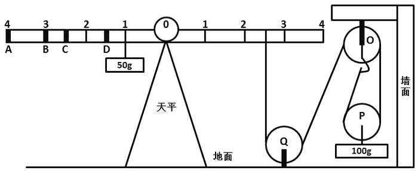
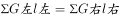
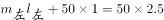

# 物理-滑轮组受力分析与杠杆（力矩）平衡

考点：[[20-考点/判断推理/科学推理/物理-滑轮组受力分析与杠杆（力矩）平衡|科学推理 / 物理-滑轮组受力分析与杠杆（力矩）平衡]]

**问法模型**：给出'天平+滑轮组'装置图问如何配重才能平衡 → 先把滑轮组按'物重÷承重绳段数'等效为绳端拉力，再对支点列力矩平衡方程逐项验证选项

## 推理链
1. 第1步：从图形提取结构信息：支点O在横梁'0'刻度处；左臂50g物体挂在距支点1格处，挂钩A、B、C、D分别位于4、3、2.5、1.5格处；右臂吊绳系于距支点2.5格处。
2. 第2步：化简滑轮组：P为动滑轮、下挂100g物体，承担重物的有效绳段数为2，绳中拉力处处相等，故绳端拉力=100g÷2=50g（力），即右臂绳等效于在2.5格处挂50g物体。
3. 第3步：列杠杆力矩平衡方程：左力矩=右力矩，即 50×1 + m×d = 50×2.5 = 125，故需在左臂补充力矩 125−50=75 g·格。
4. 第4步：逐项代入验证：A项15g×4格=60≠75；B项25g×3格=75 ✓；C项50g×2.5格=125≠75；D项75g×1.5格=112.5≠75。
5. 第5步：只有B项使左力矩（50+75=125）等于右力矩（125），天平平衡，故选B。

**最快解法**：⚡ 等效替代+缺口法：动滑轮两段承重绳→右端绳拉力等效50g，右力矩=50×2.5=125；左臂已有50×1=50，力矩缺口75，一眼锁定25g×3格（B处）=75，直接选B。

## 易错点
- ⚠ 忽略动滑轮省力特点，误把绳端拉力当成100g，实际应除以有效绳段数2得50g
- ⚠ 力臂读数错误：C在2.5格、D在1.5格（非整数刻度），若把D误读为1格会错算成75×1=75而误选D
- ⚠ 只比较物重不看力臂，忘记平衡条件是'力×力臂'两侧相等而非质量直接相等

## 母题抽象
> 🧩 当题干出现'天平/杠杆+定滑轮与动滑轮组合'装置图时，先按'物重÷承重绳段数'把滑轮组等效为绳端拉力，再对支点列力矩平衡方程，将各选项按'质量×力臂'代入验证缺口力矩。

**同类特征**：天平力矩平衡、定滑轮O、Q+动滑轮P组合、动滑轮下挂100g、有效绳段数为2、横梁刻度即力臂、配重四选一

## 相关题
（暂无）

---

### 题干

如图所示，地面上有一架天平，天平左端系有一个50g的物体，右端通过绳子连接一组滑轮。滑轮组合中，O、Q为定滑轮，P为动滑轮，下端系有一个100g的物体。要使天平两端平衡，需要的操作是（  ）。

### 选项
- A. 在A处挂上重15g的物体
- B. 在B处挂上重25g的物体　✅
- C. 在C处挂上重50g的物体
- D. 在D处挂上重75g的物体

### 官方解析

问题求解：右方滑轮组有效的绳子段数为2，若要保持滑轮组的平衡，等同于天平右端对应绳的位置放入质量为50g物体。若保持系统左端天平的平衡，则天平两端需满足力矩平衡原理：。图中数据代入公式可知：，选项中数值代入得，ACD项不满足等式，故B项正确。

故正确答案为B。

### 给定材料
（无）
