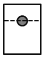

# 物理-物体的浮沉条件与阿基米德原理（漂浮-悬浮时F浮=G，沉底时F浮=ρ液gV排）

考点：[[20-考点/判断推理/科学推理/物理-物体的浮沉条件与阿基米德原理（漂浮-悬浮时F浮=G，沉底时F浮=ρ液gV排）|科学推理 / 物理-物体的浮沉条件与阿基米德原理（漂浮/悬浮时F浮=G，沉底时F浮=ρ液gV排）]]

**问法模型**：选非题（问'不可能出现的情况'）→ 用浮沉条件对'加酒精使混合液密度逐渐减小'的全过程分段讨论，逐项核对浮力与重力的关系

## 推理链
1. 第1步：题干前提：实心蜡球漂浮在水面，且ρ水>ρ蜡>ρ酒精；不断加入酒精后水与酒精混合，混合液体密度从ρ水开始逐渐减小
2. 第2步：所用规则：漂浮或悬浮（平衡）时二力平衡F浮=G；浸没后F浮=ρ液gV排，随ρ液减小而减小
3. 第3步：阶段一（混合液密度仍大于ρ蜡）：蜡球仍漂浮但下陷一些、V排增大，由漂浮平衡知F浮仍等于G不变——对应B，可能出现
4. 第4步：阶段二（混合液密度减到恰好等于ρ蜡）：蜡球完全浸没且F浮=ρ液gV球=G，可悬浮于液体中——对应C，可能出现
5. 第5步：阶段三（混合液密度小于ρ蜡）：完全浸没时F浮=ρ液gV球<G，蜡球沉到杯底，且F浮比原先漂浮时的G小、随密度继续减小而变小——对应D，可能出现
6. 第6步：只要蜡球漂浮或悬浮，F浮恒等于重力G，不可能出现'向下沉一些且所受浮力增大'——A违背二力平衡，不可能

**最快解法**：⚡ 规律口诀法：抓住'漂浮/悬浮⇒F浮=G恒不变，浮力只在沉底后随ρ液减小才变小'；A项'下沉一些还浮力增大'直接违背漂浮平衡条件，秒选A

## 易错点
- ⚠ 误以为'物体下沉一些排开液体变多、浮力就增大'，混淆了'漂浮平衡态'与'强迫下压'的情形（漂浮时增大V排的根源是液体密度减小，浮力仍被重力锁定）
- ⚠ 忽略本题是选非题，把描述'可能出现'的B、C、D当成答案
- ⚠ 忽视混合液密度是持续减小的动态过程，漏判悬浮临界态（ρ液=ρ蜡）和沉底后浮力继续变小的阶段

## 母题抽象
> 🧩 当题干出现'漂浮物体+向液体中加入另一种液体使密度连续变化'的特征时，用浮沉条件分段讨论：漂浮/悬浮段F浮=G不变，沉底段F浮=ρ液gV排随密度减小而变小；凡断言'漂浮下陷且浮力变化'的选项即违背平衡条件

**同类特征**：实心蜡球漂浮水面、不断慢慢加入酒精、混合液体密度逐渐减小、ρ水>ρ蜡>ρ酒精、选非题（问不可能）、判断浮力变化

## 相关题
- [[10-真题/判断推理/逻辑判断/4637344 分析推理-位置排列（代入排除法+间隔约束）|4637344]]（国考 2022，相关度1）

---

### 题干

如图所示，实心蜡球漂浮在杯中的水面上，当向杯中不断慢慢加入酒精时，以下不可能出现的情况是（   ）。（已知：水的密度蜡球的密度酒精的密度）

### 选项
- A. 蜡球向下沉一些，所受浮力增大　✅
- B. 蜡球向下沉一些，所受浮力不变
- C. 蜡球悬浮于液体中，所受浮力不变
- D. 蜡球沉到杯底，所受浮力变小

### 官方解析
当酒精缓慢加入水中，水和酒精混合，混合液体的密度小于水的密度，则随着酒精的注入，将发生如下现象：首先，蜡球向下沉一下，增大排开液体的体积，此时蜡球所受浮力仍不变，等于蜡球所受重力；然后，随着加入酒精的增多，蜡球完全浸没进液体中，所受浮力仍等于蜡球所受重力；最后，液体密度小于蜡球密度，蜡球完全浸没液体中，所受浮力小于蜡球所受重力，蜡球将沉入杯底。即A项错误，故选A项。
本题为选非题，故正确答案为A。

### 给定材料
（无）
