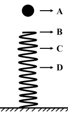

# 物理-机械能守恒与竖直弹簧动态分析（合力为零点定最大速度）

考点：[[20-考点/判断推理/科学推理/物理-机械能守恒与竖直弹簧动态分析（合力为零点定最大速度）|科学推理 / 物理-机械能守恒与竖直弹簧动态分析（合力为零点定最大速度）]]

**问法模型**：给出下落过程B（接触弹簧）、C（弹力=重力）、D（速度为零）三个关键位置→先做受力分析定速度极值位置，再用全程/分段机械能守恒逐项核对能量转化

## 推理链
1. 第1步：从题干提取三个关键位置——'在B位置接触弹簧的上端'（弹力刚从零开始增大）、'在C位置小球所受弹力大小等于重力'（合力为零）、'在D位置小球速度减小到零'（动能为零）。
2. 第2步：受力-运动动态分析：A→B自由下落加速；B→C重力>弹力，合力向下仍加速；C点弹力=重力、加速度为零、速度最大；C→D弹力>重力，合力向上减速至D为零。
3. 第3步：据此排除A、B：动能最大在C点而非B点（A错），动能最小在A、D处而非C点（B错）。
4. 第4步：A→D全程动能由0到0，系统只有重力与弹力做功、机械能守恒，故重力势能减少量=弹性势能增加量，C项'减少小于增加'错误。
5. 第5步：A→C分段列能量账：重力势能减少量=动能增加量+弹性势能增加量（B→C弹簧已压缩），弹性势能增加量>0，故重力势能减少量必大于动能增加量。
6. 第6步：与选项对照，仅D项成立，结合官方给定答案确认为D。

**最快解法**：⚡ 口诀法+'能量账本'：记住竖直弹簧模型'弹力=重力处速度最大、动能最大'直接毙掉A、B；全程动能0到0，机械能守恒得两势能变化相等毙掉C；A→C段'重力势能减少=动能增加+弹性势能增加'，右边两项均非负，锁定D

## 易错点
- ⚠ 误把刚接触弹簧的B点当速度最大点，实际上B点弹力为零、小球仍继续加速
- ⚠ 误把弹力等于重力的C点当速度最小点，实际C点恰是速度（动能）最大点
- ⚠ C项漏用'全程动能从0到0'这一隐含条件，未意识到重力势能减少量与弹性势能增加量应相等

## 母题抽象
> 🧩 当题干出现'竖直下落+接触弹簧+弹力=重力+速度减为零'四个特征点时，先用合力为零点（弹力=重力）定位最大速度位置，再用全程与分段机械能守恒逐项验算能量增减关系

**同类特征**：轻弹簧下端固定、小球从静止下落、B位置接触弹簧、C位置弹力等于重力、D位置速度为零、比较重力势能/动能/弹性势能变化

## 相关题
（暂无）

---

### 题干

如图，一轻弹簧下端固定，竖立在水平面上，其正上方A位置有一只小球，小球从静止开始下降，在B位置接触弹簧的上端，在C位置小球所受弹力大小等于重力，在D位置小球速度减小到零。下列对于小球下降阶段的说法中，正确的是（  ）。

### 选项
- A. 在B位置小球动能最大
- B. 在C位置小球动能最小
- C. 从A→D位置小球重力势能的减少小于弹簧弹性势能的增加
- D. 从A→C位置小球重力势能的减少大于小球动能的增加　✅

### 官方解析
逐项分析：C点速度最大，那么C点动能最大，A、B两项错误；A到D整个过程是动能从0到0，重力势能越来越小，弹簧弹性势能越来越大，两者相互转化，机械能守恒，两者相等，C项错误；D项，从A到C的位置，小球重力势能的减少等于小球动能的增加和弹簧弹性势能的增加之和，所以重力势能的减少大于任意一个的增加，D项正确。
故正确答案为D。

### 给定材料
（无）
