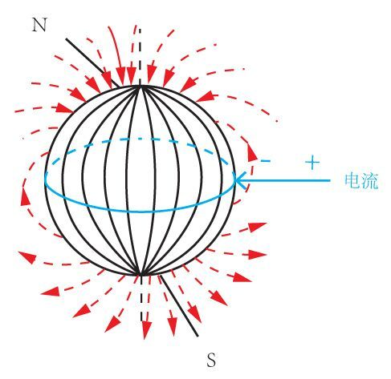

# 物理-左手定则判断安培力（磁场对电流的作用力）方向

考点：[[20-考点/判断推理/科学推理/物理-左手定则判断安培力（磁场对电流的作用力）方向|科学推理 / 物理-左手定则判断安培力（磁场对电流的作用力）方向]]

**问法模型**：问地磁场对放电避雷针（等效通电导体）的作用力方向 → 先定电流方向与磁场方向，再用左手定则定受力方向

## 推理链
1. 第1步：题干给出地球带负电荷、乌云带正电荷，放电时电流方向规定为正电荷流向负电荷，故电流自乌云沿避雷针指向地心（竖直向下）
2. 第2步：题干/常识给出地磁场方向由地理南极指向地理北极，在赤道处磁场呈水平由南指北
3. 第3步：使用左手定则——让磁感线穿入手心（掌心朝南），四指指向电流方向（指向地心/向下）
4. 第4步：此时大拇指所指方向即为安培力方向，判断得大拇指指向正东
5. 第5步：对照选项，正东为A项，故地磁场对避雷针的作用力方向为正东

**最快解法**：⚡ 左手定则法：两步锁定方向——①电流方向=正电荷流动方向，正电荷乌云放电入负电地球，电流向下；②地磁场在赤道由南向北；伸左手让磁感线穿掌心、四指向下，拇指即指正东，选A

## 易错点
- ⚠ 电流方向误判：误以为电流从地面流向乌云；实际上电流方向按正电荷移动方向规定，应由云指向地心
- ⚠ 地磁场方向误判：误记为'由北指南'，实为由地理南极指向地理北极
- ⚠ 定则用错：把左手定则与右手定则（或右手螺旋定则）混淆，导致东西方向判反

## 母题抽象
> 🧩 当题干出现'通电导体/放电导体在磁场中受力方向'的特征时，先按正电荷流动方向定电流、再确认磁场方向，最后用左手定则（磁感线穿掌心、四指指电流、拇指指受力）验证选项方向

**同类特征**：地球带负电荷、乌云放电、竖直避雷针、赤道上方、地磁场对避雷针的作用力、方向判断（东西南北）

## 相关题
（暂无）

---

### 题干
我们知道地球带的是负电荷，如果在赤道上方有一竖直的避雷针，当有带正电荷的乌云经过避雷针上方时开始放电，那么地磁场对避雷针的作用力方向为      。

### 选项
- A. 正东　✅
- B. 正南
- C. 正西
- D. 正北

### 官方解析

题干要求判断地磁场对避雷针的作用力方向，则要使用左手定则来判断受力方向。当乌云经过避雷针上方开始放电时会产生电流，电流方向由正电荷流向负电荷，也就是指向地心；而地磁场的方向是由地理南极指向地理北极。使用左手定则，让磁感线穿入手心，四指指向电流方向，那么大拇指的方向就是受力方向，由图中可知，大拇指所指方向为正东，所以地磁场对避雷针的作用力方向为正东。

故正确答案为A。

### 给定材料
（无）
