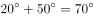

# 物理-光的反射定律（法线平分入射-反射光线夹角，入射角=反射角，镜面⊥法线）

考点：[[20-考点/判断推理/科学推理/物理-光的反射定律（法线平分入射-反射光线夹角，入射角=反射角，镜面⊥法线）|科学推理 / 物理-光的反射定律（法线平分入射/反射光线夹角，入射角=反射角，镜面⊥法线）]]

**问法模型**：已知入射光线与地面夹角、要求反射光竖直向下射入井中 → 用反射定律+几何角度换算确定镜面倾角

## 推理链
1. 第1步：由图，入射光线AO与水平地面成50°（O为入射点），反射光线OB需沿竖直向下方向射入井中照到B处
2. 第2步：反射定律要求法线平分入射光线与反射光线的夹角，且入射角=反射角
3. 第3步：计算两光线夹角∠AOB：入射线在水平线上方50°，反射线竖直向下（与水平线成90°），故∠AOB=90°+50°=140°，入射角=反射角=140°÷2=70°
4. 第4步：法线与镜面垂直，反射线（竖直）与法线成70°，则反射线与镜面夹角=90°−70°=20°，即镜面与竖直方向成20°
5. 第5步：与竖直成20°即与水平方向成90°−20°=70°
6. 第6步：逐项对照：A（与竖直50°）、B（与水平50°，误把入射角当镜面角）、D（与水平25°，误取50°的一半）均不符合，C（与水平成70°）正确

**最快解法**：⚡ 夹角平分法+口诀：镜面与水平夹角=(反射光与水平夹角+入射光与水平夹角)÷2=(90°+50°)÷2=70°，一步到位选C；验证：光线偏折角40°，镜面转角为偏折角一半方向一致

## 易错点
- ⚠ 把题干50°直接当成入射角（入射角是入射光线与法线的夹角，图中50°是入射光线与地面的夹角），误选B
- ⚠ 求出法线角度后忘记'镜面⊥法线'的换算，把入射角70°误当镜面与竖直/水平的夹角
- ⚠ 混淆互补关系：与水平成70°等价于与竖直成20°，勿误选与竖直成50°或与水平成25°的干扰项

## 母题抽象
> 🧩 当题干出现'光线以某角度射向平面镜、反射后需沿指定方向（如竖直向下）射出'时，先求入射/反射两光线的总夹角，用法线平分该角得入射角，再借'镜面⊥法线'换算出镜面与给定基准方向的夹角

**同类特征**：太阳光与水平地面成50°角入射、平面镜反射、反射光沿井竖直向下照亮、入射角等于反射角、法线与镜面垂直、求镜面放置角度

## 相关题
- [[10-真题/判断推理/科学推理/2395203 物理-光的反射定律（入射角=反射角、法线平分入射与反射光线夹角）结合几何角度计算镜面倾角|2395203]]（上海 2018，相关度1）

---

### 题干

如图所示，太阳光与水平地面成50°角入射，利用平面镜反射的原理可使太阳光沿井照亮下水道，则下列关于平面镜放置正确的是<u>      </u>。

### 选项
- A. 与竖直方向成50°
- B. 与水平方向成50°
- C. 与水平方向成70°　✅
- D. 与水平方向成25°

### 官方解析

如图所示，法线（虚线）和镜子垂直，入射角和反射角相等，则镜面与水平方向成，ABD三项错误，C项正确。

故正确答案为C。

### 给定材料
（无）

> [!warning] 疑点（官方解析可能有误，待人工复核）
> 官方解析文字表述不完整（'镜面与水平方向成'后角度数值缺失），但所给定律依据（法线垂直镜面、入射角=反射角）与结论C的推理链条一致，不影响答案正确性

<!-- CODEX-ANSWER-REVIEW:BEGIN -->
### 本次独立复核

**复核状态：** `confirmed`（独立复算确认答案）

**计分答案：** C（可计分）

**复核解析：**

入射光线与水平地面成50°，反射光应竖直向下进入下水道。镜面所在直线平分入射光线与反射光线的夹角（按无向直线取锐角），故镜面与水平方向夹角为(50°+90°)/2=70°，选C。

**相关信息：**

平面镜反射中，法线平分入射光和反射光的夹角，镜面垂直法线。

**题源依据：** [固定版本原题](https://github.com/Mentat-Uran/kaogongzhentizhengliu/blob/84ab93d4b64b61d897bece8a1c0a5bab06b4feb2/10-%E7%9C%9F%E9%A2%98/%E5%88%A4%E6%96%AD%E6%8E%A8%E7%90%86/%E7%A7%91%E5%AD%A6%E6%8E%A8%E7%90%86/2137378%20%E7%89%A9%E7%90%86-%E5%85%89%E7%9A%84%E5%8F%8D%E5%B0%84%E5%AE%9A%E5%BE%8B%EF%BC%88%E6%B3%95%E7%BA%BF%E5%B9%B3%E5%88%86%E5%85%A5%E5%B0%84-%E5%8F%8D%E5%B0%84%E5%85%89%E7%BA%BF%E5%A4%B9%E8%A7%92%EF%BC%8C%E5%85%A5%E5%B0%84%E8%A7%92%3D%E5%8F%8D%E5%B0%84%E8%A7%92%EF%BC%8C%E9%95%9C%E9%9D%A2%E2%8A%A5%E6%B3%95%E7%BA%BF%EF%BC%89.md)；固定内容 commit `84ab93d4b64b61d897bece8a1c0a5bab06b4feb2`，Markdown blob `218343ebf873843530fa296fc2f33b923c9e519b`。
<!-- CODEX-ANSWER-REVIEW:END -->
