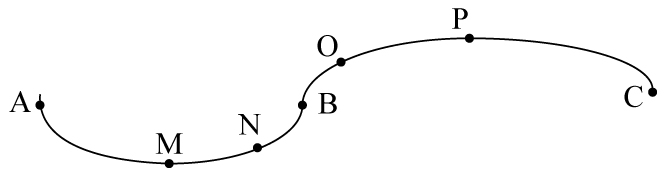
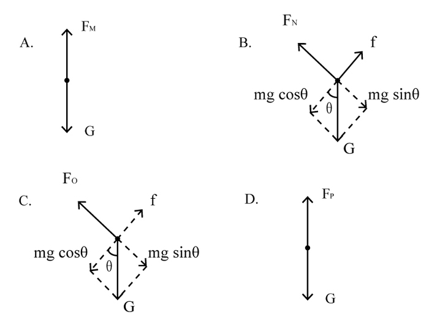

# 物理-圆周运动·向心力来源分析（凹凸路面超重失重）

考点：[[20-考点/判断推理/科学推理/物理-圆周运动·向心力来源分析（凹凸路面超重失重）|科学推理 / 物理-圆周运动·向心力来源分析（凹凸路面超重失重）]]

**问法模型**：题干给出'下凹+上凸路面、匀速行驶、比较四点压力与重力'的问法 → 对每点沿指向圆心的法线方向列牛顿第二定律方程（合力=mv²/r），逐点比较压力与重力

## 推理链
1. 第1步：提取图形信息——AB段为下凹路段（圆心在路面上方），BC段为上凸路段（圆心在路面下方），题干注明'速率保持不变'，M为凹段最低点、P为凸段最高点，N、O为两段上的斜坡点
2. 第2步：明确规则——匀速圆周运动仍需向心力，各点沿半径指向圆心方向的合力等于mv²/r（＞0）；对路面的压力由牛顿第三定律等于路面对车的支持力
3. 第3步：M点（凹段最低点，向心加速度竖直向上）：FM－G=mv²/r＞0 ⇒ 恒有FM＞G，但取不到等号，A项'FM≥G'因含等号与精确关系不符
4. 第4步：N点（凹段斜坡，法线斜向上指圆心）：沿法线分解重力，FN－Gsinθ=mv²/r ⇒ 仅得FN＞Gsinθ；因sinθ＜1，FN与G的大小无法确定，B项不'一定成立'
5. 第5步：O点（凸段斜坡，圆心在斜面下方）：Gsinθ－FO=mv²/r ⇒ Gsinθ＞FO，又G＞Gsinθ，故G＞FO恒成立，即FO＜G一定成立
6. 第6步：P点（凸段最高点，向心加速度竖直向下）：G－FP=mv²/r＞0 ⇒ G＞FP，D项'FP＞G'方向恰好相反，错误
7. 第7步：结论——只有C项'FO＜G'在任意速率、坡角下均严格成立，选C

**最快解法**：⚡ 口诀'凹超凸失'+法线分解：凹段（圆心在上）支持力被'放大'、凸段（圆心在下）支持力被'缩小'；凸段上任一点沿法线均有Gsinθ－FN=mv²/r＞0 ⇒ FN＜Gsinθ＜G，O点必满足FO＜G，直接锁定C；凹段斜坡N点关系不定、凹底取不到等号、凸顶FP＜G，排除A/B/D

## 易错点
- ⚠ 误认为'匀速=无加速度=向心力为零'，得出M点FM=G或P点FP=G的错误结论
- ⚠ N点把FN＞Gsinθ误推为FN＞G——忽略sinθ＜1（法线分量小于全重力），实际FN与G关系不确定
- ⚠ A项'≥'含等号而FM实际取不到G，选项关系式不精确时不能选；压力与支持力勿混淆，需经牛顿第三定律转换

## 母题抽象
> 🧩 当题干出现'拱桥/凹凸路面+匀速行驶+比较某点对路面压力'特征时，沿法线对每点列'合力=mv²/r'：凹段（圆心在上方）支持力大于重力法线分量、凸段（圆心在下方）支持力小于重力法线分量，最低/最高点关系最确定，斜坡点须与重力分量比较而非与全重力比较

**同类特征**：下凹路段AB/上凸路段BC、速率保持不变（匀速）、M为最低点、P为最高点、对路面的压力FM/FN/FO/FP、向心力提供、一定成立的是

## 相关题
（暂无）

---

### 题干

某司机驾车在如下图所示的路面上前行，已知AB段为下凹路段，BC段是上凸路段，当汽车依次经过M、N、O、P（M为最低点，P为最高点）四点时对路面的压力分别为FM、FN、FO、FP，汽车重力为G，前进过程中速率保持不变，那么下列关系式一定成立的是<u>       </u>。

### 选项
- A. FM≥G
- B. FN＞G
- C. FO＜G　✅
- D. FP＞G

### 官方解析

本题考查向心力的相关知识

本题小车在弧形路面行走，故在受力分析时一定要考虑指向圆心的向心力。

A项，如果车在M点，则车受向下的重力以及向上的支持力，两者合力提供向心力。由于小车速率保持不变的运动，向心力不为0，则支持力FM必须大于重力从而提供向心力，即FM＞G，取不到相等的情况，错误。

B项，在N点，汽车受重力，斜向上指向圆心的支持力FN，将重力分解，沿着支持力反方向Gsinθ和与之垂直的斜向下方向Gcosθ（由于汽车匀速，Gcosθ与摩擦力平衡在此不作考虑）。FN与Gsinθ的合力提供向心力，FN＞Gsinθ，但由于向心力未知，FN与G的大小关系未知，错误。

C项，同理，汽车在O点时，重力分力Gsinθ与FO提供向心力，此情况圆心在斜面下方，故Gsinθ＞FO，则G＞FO，正确。

D项，汽车在P点，由重力G和支持力FP提供向心力，则G＞FP，错误。

故正确答案为C。

备注：各选项的受力分析图如图所示：

### 给定材料
（无）

> [!warning] 疑点（官方解析可能有误，待人工复核）
> 严格形式逻辑上FM＞G蕴含FM≥G，A项似乎也'一定成立'；官方以'取不到等号'排除A，属于'选项须给出精确关系式'的命题约定，存在轻微逻辑瑕疵。按官方答案仍以C为准。
