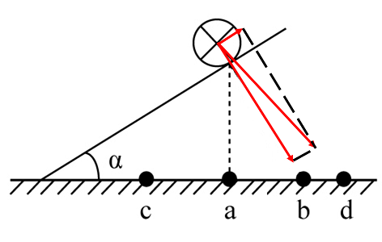

# 物理-磁场对电流的作用（平行同向电流相互吸引-安培力方向）结合斜面共点力平衡分解

考点：[[20-考点/判断推理/科学推理/物理-磁场对电流的作用（平行同向电流相互吸引-安培力方向）结合斜面共点力平衡分解|科学推理 / 物理-磁场对电流的作用（平行同向电流相互吸引/安培力方向）结合斜面共点力平衡分解]]

**问法模型**：『欲使导线静止在光滑斜面上，下列措施可行的是』→ 受力分解平衡模型：同向电流相互吸引且引力沿连线，须验证该引力是否有沿斜面向上的分量以平衡重力下滑分量

## 推理链
1. 第1步：提取题干条件——斜面光滑（无摩擦）、斜面上导线电流垂直纸面向里、a在导线正下方、b与导线连线垂直斜面、c在a左侧（下坡侧）、d在b右侧（法线外侧），静止要求沿斜面方向合力为零
2. 第2步：所用规则——右手螺旋+左手定则判定：两根电流方向相同（均垂直纸面向里）的平行直导线相互吸引，吸引力方向沿两导线连线指向对方
3. 第3步：重力沿斜面分量指向下坡（左下），故所加引力必须有沿斜面向上（右上沿斜面）的分量；逐项检验连线方位——吸向a的力竖直向下，沿斜面分力向下，A排除；吸向c的力指向左下（下坡一侧），沿斜面分力向下，C排除；吸向b的力恰好垂直斜面，沿斜面分力为零，无法平衡重力下滑分量，B排除
4. 第4步：d位于b右侧，即连线越过斜面法线偏向爬坡方向一侧，吸向d的力与垂直斜面方向成夹角，分解后存在沿斜面向上的分力，可与重力下滑分量平衡（垂直斜面分量由支持力调节，N≥0可满足），故D可行，与官方解析一致

**最快解法**：⚡ 连线方位法（排除法）：同向电流相吸、引力沿连线；只需画斜面法线（导线→b方向）作分界——a、c的连线在法线下坡侧使引力沿斜面分量向下，b连线即法线本身沿斜面分量为零，只有d在法线上坡侧外使引力有沿斜面向上分量，直接锁定D

## 易错点
- ⚠ 误以为只要存在吸引力和支持力即可平衡，忽略必须沿斜面方向分解，垂直斜面的力对平衡下滑分量无贡献
- ⚠ 误选B：把'垂直斜面压紧'当成'静止'，实际光滑斜面上垂直斜面方向的力与沿斜面下滑力正交、无法抵消
- ⚠ 忽略'斜面光滑'条件，误以为存在摩擦力辅助平衡；本题沿斜面方向只能依靠安培力的分量

## 母题抽象
> 🧩 当题干出现'光滑斜面上的通电导线+在其他位置再放一根同向电流导线使其静止'时，用'同向电流相吸、引力沿连线、沿斜面分解'模型，验证目标点位是否位于斜面法线偏上坡一侧（保证引力有沿斜面向上的分量）

**同类特征**：光滑斜面（无摩擦）、垂直纸面向里的直导线电流、再放置一根同向电流直导线、平行电流相互吸引、沿斜面方向合力为零、点位方位：正下方/垂直斜面连线/法线左右侧

## 相关题
（暂无）

---

### 题干

如图所示，在水平台面上放置有一光滑斜面，倾角为α，在斜面上某处放了一根垂直于纸面的直导线，在导线中通有垂直纸面向里的电流，图中a点在导线正下方，b点与导线的连线与斜面垂直，c点在a点左侧，d点在b点右侧。现欲使导线静止在斜面上，下列措施可行的是<u>      </u>。

### 选项
- A. 在a处放置一电流方向垂直纸面向里的直导线
- B. 在b处放置一电流方向垂直纸面向里的直导线
- C. 在c处放置一电流方向垂直纸面向里的直导线
- D. 在d处放置一电流方向垂直纸面向里的直导线　✅

### 官方解析

根据右手定则和左手定则，在a、b、c、d四处放置电流方向垂直纸面向里的直导线，两根导线会在电流产生的磁场影响下，相互吸引。

若在a、b、c处放置导线，则斜面上导线在斜面方向不受向上的力，不可能静止，故ABC三项错误；

若在d处放置导线，则斜面上导线受磁场对导线向d的力，存在斜面方向向上的分力，可能静止，D项正确。

故正确答案为D。

### 给定材料
（无）
