# 物理-串并联电路与电功率（额定电流I=P-U计算、变阻器耗能比较）

考点：[[20-考点/判断推理/科学推理/物理-串并联电路与电功率（额定电流I=P-U计算、变阻器耗能比较）|科学推理 / 物理-串并联电路与电功率（额定电流I=P/U计算、变阻器耗能比较）]]

**问法模型**：'哪种电路能三灯均正常发光且最省电'→先用I=P/U算出各灯额定电流，逐图验证串并联结构下电压电流分配能否成立（排除无法正常发光的图），再在'R两端电压相同'的前提下比较通过R的电流，取最小者

## 推理链
1. 第1步：三灯额定电压均为110V，由I=P/U得正常发光时的固定电流：I1=100/110≈0.91A、I2=40/110≈0.36A、I3=25/110≈0.23A；电源220V=2×110V，各图正常发光时滑动变阻器R两端电压均为110V
2. 第2步：三灯正常发光时其耗电量固定，'电路最省电'⇔变阻器R耗电最小；由P=UI，四种电路中R两端电压都是110V，故只需比较通过R的电流大小
3. 第3步：A图为L1、L2、L3并联后与R串联，通过R的干路电流I_R=I1+I2+I3≈1.5A（四图中最大）
4. 第4步：B图为（L1∥L2∥R）与L3串联，干路电流被L3限制为I3≈0.23A，但L1、L2正常发光共需0.91A+0.36A≈1.27A，电流关系矛盾，三灯不可能都正常发光，B直接排除
5. 第5步：C图为（L2∥L3∥R）与L1串联，干路电流=I1≈0.91A，则I_R=I1-I2-I3≈0.32A；D图为（L1∥L2）与（L3∥R）串联，干路电流=I1+I2≈1.27A，则I_R=I1+I2-I3≈1.05A
6. 第6步：A、C、D均能使三灯正常发光，比较I_R：C（约0.32A）＜D（约1.05A）＜A（约1.5A），C中R消耗功率最小，电路总耗电最少，故正确答案为C

**最快解法**：⚡ 电流加减比较法：正常发光时各灯电流被I=P/U锁定，R两端恒占110V，无需计算电阻，直接按各图串并联结构写出I_R的加减式并比大小——C图中R与两盏小功率灯（L2、L3）并联、再与最大功率灯（L1）串联，I_R=I1-I2-I3天然最小，秒选C

## 易错点
- ⚠ 漏掉'先判断能否正常发光'这一前置步骤：B图干路电流被L3锁死在约0.23A，无法满足L1、L2共约1.27A的需求，若不验证电流矛盾易误选B
- ⚠ 误以为变阻器R可任意调节、四个图都'能'正常发光，忽略串并联结构对电压电流分配的硬约束（串联电流处处相等、并联电压相同）
- ⚠ 干路与支路电流关系搞混：错把R上的电流当成干路总电流，或忘记并联分流后R的电流应为干路电流减去各灯电流

## 母题抽象
> 🧩 当题干出现'多个额定电压相同的用电器+电源电压恰为其两倍+串入可调电阻要求均正常工作且最省电'时，先用I=P/U算出各支路额定电流，再按每个电路图的串并联结构写出变阻器电流的加减组合，先排除电流等式无法成立的图，再选使变阻器电流最小的图

**同类特征**：三灯泡额定电压均为110V、电源电压220V为额定值的两倍、调节变阻器使灯泡正常发光、要求电路最省电（附加电阻耗电最小）、四个串并联结构图对比、正常发光时各灯电流I=P/U固定

## 相关题
（暂无）

---

### 题干

三盏灯泡L1（110V、100W）、L2（110V、40W）和L3（110V、25W），电源所能提供的电压为220V，在图示的四个电路中，能通过调节变阻器R使电路中各灯泡均能够正常发光且最省电的一种电路是<u>      </u>。

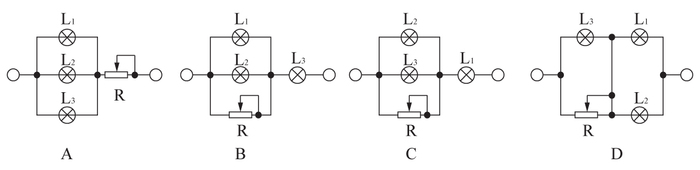

### 选项
- A. A
- B. B
- C. C　✅
- D. D

### 官方解析

假使三盏灯泡均正常发光，则三盏灯泡耗电量固定，若想电路最省电，则需滑动变阻器R耗电最小。根据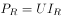，电压相等时，电流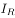越小，滑动变阻器R耗电越小。正常发光时，通过三盏灯泡的电流分别表示为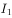 、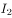、和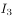。

对于A，三盏灯泡并联，若正常发光，三盏灯泡两端电压均为110V，滑动变阻器两端电压为110V。干路电流，即通过滑动变阻器电流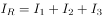。

对于B，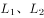和滑动变阻器R并联，若正常发光，灯泡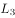两端电压为110V。干路电流，即通过灯泡的电流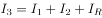，而由于P=UI，三个灯泡额定电压相等，额定功率最小，所以正常工作时，电流最小，故等式不可能成立，B电路图无法让三盏灯都正常发光。

对于C，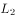、和滑动变阻器R并联，若正常发光，三盏灯泡两端电压均为110V，滑动变阻器两端电压为110V。干路电流，即通过灯泡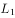的电流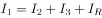，可得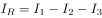。

对于D，电路相当于和滑动变阻器R、和分别并联后再串联，若正常发光，三盏灯泡两端电压均为110V，滑动变阻器R两端电压为110V。干路电流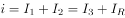，可得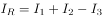。

A、C、D三个电路图中，滑动变阻器R两端电压均为110V，C中最小，滑动变阻器消耗功率最小，电路总耗电最小，A、D两项错误，C项正确。

故正确答案为C。

### 给定材料
（无）
