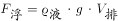
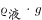

# 物理-浮力（阿基米德原理与漂浮条件）

考点：[[20-考点/判断推理/科学推理/物理-浮力（阿基米德原理与漂浮条件）|科学推理 / 物理-浮力（阿基米德原理与漂浮条件）]]

**问法模型**：缓慢倒水问'谁先漂浮'→以相同水位为比较基准，比较两物体排水体积达到漂浮所需V排的先后

## 推理链
1. 第1步：漂浮条件为浮力等于重力；题干'圆球的质量和直径，与正方体的质量、边长相同'→两物体重力相同，漂浮所需浮力相等
2. 第2步：由阿基米德原理F浮=ρ水gV排，ρ水与g固定，故两物体达到漂浮所需的排水体积V需=m/ρ水相同
3. 第3步：同一水位h下比较V排：正方体平放杯底，V排=边长²×h=d²h，随水位线性增长；圆球与杯底为点接触，浸入部分为球冠，V排=πh²(d/2−h/3)，随水位增长慢于正方体，且任意相同水位下正方体V排更大（球体积πd³/6本身小于正方体体积d³）
4. 第4步：'缓慢倒入水'意味着水位连续同步上升，正方体的V排先达到V需
5. 第5步：正方体先满足漂浮条件先浮起，对应选项B

**最快解法**：⚡ 控制变量法（同水位比排水体积）：所需V排相同→只看谁在同水位下排开的水多；正方体柱状浸入体积恒大于圆球球冠体积，直接锁定B

## 易错点
- ⚠ 误认为直径=边长则两物体体积相同、浸入快慢相同而选C'二者同时'（忽略球体积πd³/6<d³且球底为点接触）
- ⚠ 忽略'缓慢倒水'隐含的'同一水位'比较基准，试图用最终浮起状态或总浮力判断
- ⚠ 忽视圆球初始浸入体积按水位的平方增长（球冠）、慢于正方体的线性增长，误判圆球先浮

## 母题抽象
> 🧩 当题干出现'两物质量相同+缓慢倒入液体+问谁先浮起'时，用'漂浮所需V排相同→同水位下排水体积大者先浮'模型，逐水位比较浸入体积增速即可

**同类特征**：质量相同、直径与边长相等、空心（石蜡密度小于水）、缓慢倒入水、先漂浮起来、浮力等于重力

## 相关题
- [[10-真题/判断推理/科学推理/1796514 物理-阿基米德原理与漂浮条件（浮力=重力、排水体积分析）|1796514]]（广东 2016，相关度1）

---

### 题干

如图所示，一个杯中放有石蜡做的空心圆球和正方体，圆球的质量和直径，与正方体的质量、边长相同，如果在杯中缓慢倒入纯净水，则先漂浮起来的是（  ）。

### 选项
- A. 圆球
- B. 正方体　✅
- C. 二者同时
- D. 无法判断

### 官方解析

杯中的空心圆和空心正方体要想漂浮起来，浮力必须等于重力。由于两个物体质量相同，所以重力相同，因此漂浮所需要的浮力就相等。根据浮力公式，，对于不同物体，其中为固定不变，故两个物体想要漂浮起来所需的也相等。

观察图形可知，由于圆球的直径和正方形的边长相等，因此缓慢倒入水时，在水位相同的情况下，正方体排水体积要大于圆球，故正方体会先达到漂浮所需的，即正方形会先漂浮起来。

故正确答案为B。

### 给定材料
（无）
