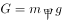
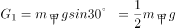
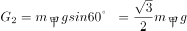
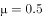
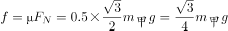
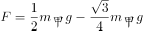
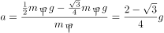

# 物理-斜面受力分解与滑动条件（tanθ与μ比较、加速度与质量无关）

考点：[[20-考点/判断推理/科学推理/物理-斜面受力分解与滑动条件（tanθ与μ比较、加速度与质量无关）|科学推理 / 物理-斜面受力分解与滑动条件（tanθ与μ比较、加速度与质量无关）]]

**问法模型**：给出斜面倾角、摩擦系数和两个质量不同的物体，问之后运动状态 → 先受力分解判断是否下滑，再用牛顿第二定律判断加速度是否与质量有关

## 推理链
1. 第1步：题干给出斜坡30度、摩擦系数0.5，甲乙冲到同一位置且甲比乙重，无外力扶持
2. 第2步：对任一人做受力分析：重力沿斜面分力为mgsin30°，垂直斜面分力为mgcos30°，故斜面提供最大动摩擦f=μmgcos30°=0.5×mg×(√3/2)≈0.433mg
3. 第3步：比较mgsin30°=0.5mg与f≈0.433mg（等价于比较tan30°≈0.577>μ=0.5），沿斜面向下分力大于摩擦力，两人均必下滑，排除D
4. 第4步：下滑时沿斜面合力F=mgsin30°−μmgcos30°，由牛顿第二定律得加速度a=g(sin30°−μcos30°)≈0.067g
5. 第5步：加速度表达式中质量m被约去，与质量无关，甲乙加速度相同
6. 第6步：两人从同一位置同时开始下滑、加速度相同，任意时刻速度相同，排除B、C，选A

**最快解法**：⚡ 口诀法：tanθ>μ必下滑——tan30°≈0.577>0.5，两人均下滑，排除D；滑动加速度a=g(sinθ−μcosθ)中m约去，与质量无关，甲乙速度一样，秒选A

## 易错点
- ⚠ 受'重的下滑快'的亚里士多德式直觉误导，误选B
- ⚠ 把正压力误当作mg（应为mgcos30°），从而算错摩擦力
- ⚠ 忘记先用mgsin30°与μmgcos30°比较判断是否下滑，直接讨论速度

## 母题抽象
> 🧩 当题干出现'斜面+摩擦系数+不同质量物体谁滑得快'的特征时，先比较tanθ与μ判断是否下滑，再由a=g(sinθ−μcosθ)与质量无关判断快慢，验证选项

**同类特征**：30度斜坡、摩擦系数0.5、甲比乙重、无外力扶持、同一位置、问之后可能发生的情况

## 相关题
（暂无）

---

### 题干
已知一个30度的斜坡，摩擦系数为0.5。甲乙两人一起冲到斜坡上同一位置，甲比乙重。如果没有任何外力扶持，之后可能发生的情况是（  ）。

### 选项
- A. 两人均开始下滑，两人下滑速度一样　✅
- B. 两人均开始下滑，甲下滑速度比乙快
- C. 两人均开始下滑，甲下滑速度比乙慢
- D. 两人可以在斜坡上保持静止

### 官方解析

做受力分析，先单独分析甲，斜面上的甲受到竖直向下的重力，将重力沿着斜面方向和垂直于斜面方向分解，沿着斜面方向的分力，垂直于斜面方向的分力，因此给斜面的压力为。由于摩擦系数，所以斜面能提供的动摩擦力为，小于沿斜面向下的分力，所以甲会沿斜面下滑。

下滑时，斜面方向甲受到沿斜面向下的和沿斜面方向向上的，斜面方向合力，所以加速度。

由于加速度与质量无关，所以两人下滑加速度相同，下滑速度相同。

故正确答案为A。

### 给定材料
（无）
