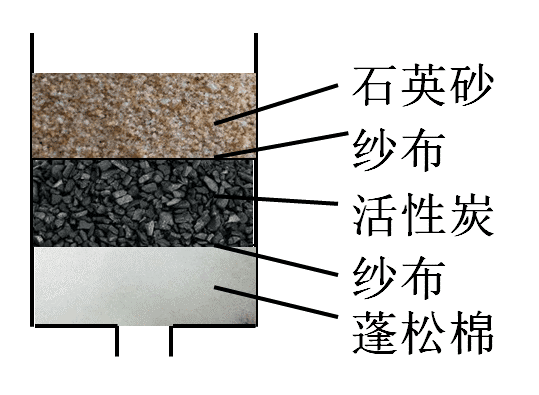

# 化学-水的净化（过滤与吸附原理及装置层序）

考点：[[20-考点/判断推理/科学推理/化学-水的净化（过滤与吸附原理及装置层序）|科学推理 / 化学-水的净化（过滤与吸附原理及装置层序）]]

**问法模型**：给出简易净水器的材料清单，问哪种说法正确 → 采用'除杂能力分层判断法'：先界定过滤/吸附能除什么、除不掉什么，再逐项排查；涉及装置排布的按水流方向验证层序

## 推理链
1. 第1步：从题干提取前提——净水器仅由石英砂、活性炭、蓬松棉和纱布构成，这四种材料的作用只能是物理过滤或吸附，不含蒸馏、煮沸或化学沉降手段
2. 第2步：明确各材料功能分工——纱布与石英砂过滤较大颗粒不溶性物质，活性炭吸附有色有味的物质，蓬松棉吸附颗粒很小的不溶性物质；据此确立核心判据：该装置只能除不溶性杂质和色素异味，除不掉溶解在水中的金属离子
3. 第3步：逐项对照——A项'有效去除重金属元素'：重金属以溶解态离子存在，过滤/吸附无法去除，排除；B项'变为纯净水'：纯净水需去除全部溶解杂质，该装置净化后的水仍是混合物，排除；C项'降低硬度'：硬度由溶解的钙、镁离子决定，装置无法去除，排除
4. 第4步：验证D项'蓬松棉应置于离出水口最近的地方'——蓬松棉拦截颗粒最小的不溶性物质，按'大颗粒先拦、细颗粒后拦'的过滤顺序，蓬松棉应作为最后一级防线置于出水口处，防止细小杂质漏出，说法正确
5. 第5步：结论——A、B、C均违背'除不掉溶解离子'的核心判据，只有D符合装置原理与排布顺序，故选D

**最快解法**：⚡ 除杂能力排除法——抓住'过滤+吸附除不掉溶解的离子'这一核心：A（重金属离子）、C（硬度=钙镁离子）同属溶解离子直接秒排，B（纯净水）需除尽所有溶解物亦排除，剩余D无需细算直接锁定

## 易错点
- ⚠ 误认为活性炭吸附能力强大到能吸附重金属离子或钙镁离子，从而错选A或C——活性炭只吸附色素异味等，不除溶解态离子
- ⚠ 混淆'净化水'与'纯净水'——经过滤吸附的水仍含可溶性杂质，是混合物，不等于纯净水
- ⚠ 忽略装置层序逻辑，误以为蓬松棉应放在进水口先粗拦——实际蓬松棉拦的是最小颗粒，须置于出水口最近处作最后拦截

## 母题抽象
> 🧩 当题干出现'简易净水器+材料清单（石英砂/活性炭/蓬松棉/纱布）'特征时，用'除杂能力分层判断法'：先确立'过滤吸附只除不溶性杂质和色素异味、除不掉溶解离子'的判据排除软化/除重金属/纯净水类选项，再按'大颗粒先拦、细颗粒后拦'的水流方向验证层序类选项

**同类特征**：简易净水器、石英砂、活性炭、蓬松棉、纱布、说法正确的是

## 相关题
- [[10-真题/资料分析/综合/2377191 综合判断题——两期平均单价（总销售额÷总销售量）比较与逐项排除|2377191]]（海南 2019，相关度1）
- [[10-真题/判断推理/定义判断/19283906 多定义辨析-并列定义（薪酬水平策略vs薪酬结构策略）|19283906]]（国考 2025，相关度1）
- [[10-真题/判断推理/定义判断/10204592 单定义-要件对应（数学命题的逆命题-否命题-逆否命题变形规则）|10204592]]（黑龙江 2024，相关度1）
- [[10-真题/判断推理/科学推理/5701925 化学-活性炭的多孔结构与吸附性应用辨析|5701925]]（上海 2016，相关度1）

---

### 题干
某人利用石英砂、活性炭、蓬松棉和纱布制作了一个简易净水器。下列说法正确的是（  ）。

### 选项
- A. 该净水器可以有效去除重金属元素
- B. 该净水器可以将自来水变为纯净水
- C. 该净水器可以降低自来水的硬度
- D. 蓬松棉应置于离出水口最近的地方　✅

### 官方解析

简易净水器的原理是利用纱布与石英砂过滤较大颗粒的不溶性物质，活性炭吸附有色有味的物质，蓬松棉吸附颗粒很小的不溶性物质的性质来净化水源。因此不能去除溶解在水中的金属离子，故不能降低水的硬度，不能将自来水变为纯净水，A、B、C三项说法有误。

简易净水器一般示意图如下，蓬松棉位于出水口最近的地方，D项正确。

故正确答案为D。

### 给定材料
（无）
