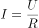
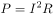
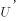
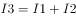

# 物理-电路动态分析（混联电路欧姆定律、电功率与亮度判断）

考点：[[20-考点/判断推理/科学推理/物理-电路动态分析（混联电路欧姆定律、电功率与亮度判断）|科学推理 / 物理-电路动态分析（混联电路欧姆定律、电功率与亮度判断）]]

**问法模型**：滑动变阻器阻值变化引起各灯亮度变化 → 采用'局部电阻→总电阻→干路电流→分压分流'的链式动态电路分析模型逐灯判定

## 推理链
1. 第1步：从图中识别电路结构：L1与'滑动变阻器P+L2'支路并联，该并联部分再与L3串联接在恒定电压两端
2. 第2步：P向左移动阻值变大→L2所在支路电阻变大→并联部分总电阻变大→外电路总电阻变大
3. 第3步：电路两端电压U不变，由I=U/R总，干路电流变小；L3在干路中且电阻不变，P=I²R_L3随电流减小而减小→L3变暗
4. 第4步：L3分压U3=I·R3变小，并联部分分压U并=U−U3变大；L1两端电压变大，由I1=U并/R1，通过L1电流变大→L1变亮
5. 第5步：由并联电路电流规律I总=I1+I2，I总变小而I1变大，则I2=I总−I1必然变小→L2变暗
6. 第6步：对照选项，'L1变亮、L2变暗、L3变暗'与B项完全一致

**最快解法**：⚡ '串反并同'口诀+干路优先：变阻器阻值增大时，与它串联的L2及干路上的L3均'反向'变化（电流减小变暗），与它所在支路并联的L1'同向'变化（分压增大变亮），一步锁定B

## 易错点
- ⚠ 误认为干路电流变小则并联部分所有灯都变暗，忽略并联部分分压U并=U−U3反而变大
- ⚠ 判断L2时只看到并联电压变大就误判其变亮，忽略L2与变阻器串联、须用I2=I总−I1分流规律分析
- ⚠ 混淆电路结构：把L3误认为在并联部分，或误把'电路两端电压不变'当成'各灯两端电压不变'

## 母题抽象
> 🧩 当题干出现'滑动变阻器阻值变化+串并联混联多灯电路+判断亮度变化'时，用'局部R变化→总R变化→干路I变化→逐级分压分流'链式分析（或'串反并同'口诀）逐灯验证

**同类特征**：电路两端电压保持不变、滑动变阻器触头移动、电阻变大、并联部分再与另一灯串联的混联结构、判断灯泡亮度（电功率）变化、灯泡电阻视为不变

## 相关题
（暂无）

---

### 题干

如图所示，电路两端的电压保持不变，当滑动变阻器的滑动触头P向左移动，电阻变大时，三个灯泡亮度的变化情况是（  ）。

### 选项
- A. L1变亮，L2变亮，L3变暗
- B. L1变亮，L2变暗，L3变暗　✅
- C. L1变暗，L2变暗，L3变暗
- D. L1变暗，L2变暗，L3变亮

### 官方解析

本题考虑灯泡亮度，考虑电功率P。分析电路，滑动变阻器向左滑动阻值变大，故整个电路阻值变大。根据，整个电路（干路）电流变小，L3在干路中，通过L3电流为干路电流，根据，L3电流变小则变暗。

又因为整个电路电流变小，L3的电流变小而自身电阻不变，分到的电压U3变小。由于电路两端电压保持不变，则L2与滑动变阻器和L1组成的并联电路分到的电压变大。L1电压变大，自身电阻不变则电流变大，L1变亮。

L3电流变小，L1分到的电流变大，则根据并联电路电流规律，L2电流变小，故L2变暗。

故正确答案为B。

### 给定材料
（无）
