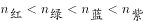

# 物理-光的折射与色散（折射率随频率增大而增大，偏折程度随折射率增大而增大）

考点：[[20-考点/判断推理/科学推理/物理-光的折射与色散（折射率随频率增大而增大，偏折程度随折射率增大而增大）|科学推理 / 物理-光的折射与色散（折射率随频率增大而增大，偏折程度随折射率增大而增大）]]

**问法模型**：四条折射光线a、b、c、d依次是什么颜色 → 按'频率→折射率→偏折程度'排序，再与图中光线偏折大小逐一对应

## 推理链
1. 第1步：从图形提取光路特征——太阳光从空气斜射入竖直玻璃面，法线为水平方向，折射光线a、b、c、d自上而下呈扇形分布，a最靠近法线（偏离原入射方向最多），d最偏离法线（偏离原方向最少）
2. 第2步：所用规律——可见光频率由低到高为红＜绿＜蓝＜紫，玻璃对频率越高的色光折射率越大；光发生折射时，折射率越大则偏折程度越大
3. 第3步：排序——四种色光的折射率与偏折程度均为紫＞蓝＞绿＞红
4. 第4步：与图形对照——a、b、c、d自上而下偏折程度递减，故a为紫光、b为蓝光、c为绿光、d为红光
5. 第5步：对照选项，仅C项'紫光、蓝光、绿光、红光'与推导一致，C项正确

**最快解法**：⚡ 口诀法：'紫偏最大、红偏最小'——图中a偏离原入射方向最多（最靠近水平法线）即为紫光，d偏折最小即为红光，b、c依次为蓝、绿，直接锁定C

## 易错点
- ⚠ 偏折方向看反：把向下倾斜最厉害的d误认为偏折最大，实际偏折是相对原入射方向朝法线弯折，a的偏折才最大
- ⚠ 频率与波长顺序记混：误以为红光频率最高，导致折射率排序整体颠倒
- ⚠ 被'玻璃体实心无色'干扰：误认为无色透明介质不会发生色散，其实无色玻璃对各色光折射率不同，仍会色散分光

## 母题抽象
> 🧩 当图形出现'复色光斜射入透明介质后扇形分成多条光线'时，用'频率越高→折射率越大→偏折越大'排序，把偏折从大到小的光线依次对应紫、蓝、绿、红再验证选项

**同类特征**：太阳光（复色光）从空气斜射入玻璃、a、b、c、d四条扇形折射光线、界面竖直、法线水平的光路图、折射率与偏折程度正相关、红绿蓝紫频率递增顺序、问四条光线颜色的依次对应

## 相关题
（暂无）

---

### 题干

如图所示，一束太阳光从空气中倾斜射入玻璃体，玻璃体实心无色，a、b、c、d代表四条不同颜色的光线，则它们可能依次是（  ）。

### 选项
- A. 红光、紫光、蓝光、绿光
- B. 绿光、红光、蓝光、紫光
- C. 紫光、蓝光、绿光、红光　✅
- D. 绿光、紫光、红光、蓝光

### 官方解析

供选答案中，四种光线红、绿、蓝、紫的频率为红绿蓝紫，故其折射率，而光在折射时，折射率越大则偏折程度越大，结合传播图可知折射光线从上到下的顺序为紫光、蓝光、绿光和红光，C项正确。

故正确答案为C。

### 给定材料
（无）
