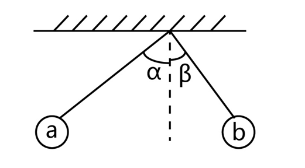
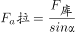
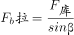
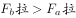
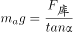
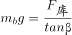
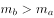

# 物理-共点力平衡与库仑定律（牛顿第三定律、力的分解）

考点：[[20-考点/判断推理/科学推理/物理-共点力平衡与库仑定律（牛顿第三定律、力的分解）|科学推理 / 物理-共点力平衡与库仑定律（牛顿第三定律、力的分解）]]

**问法模型**：由两球张角大小关系（α>β）反推质量/拉力/电荷量关系 → 隔离法受力分析，利用'库仑力等大'列平衡方程比较

## 推理链
1. 第1步：两球带同种电荷且静止时处于同一水平面，故彼此间的库仑斥力沿水平方向；由牛顿第三定律，a、b所受库仑力大小相等（F相等），且与各自带电量多少无直接对应关系
2. 第2步：对每球受力分析（重力mg、水平库仑力F、沿绳拉力T），由共点力平衡得 tanθ = F/(mg)、T = F/sinθ（θ为绳与竖直方向夹角），即 m = F/(g·tanθ)
3. 第3步：由 α>β 得 tanα>tanβ，故 m_a = F/(g·tanα) < m_b = F/(g·tanβ)，即b球质量大；同时 T_a = F/sinα < T_b = F/sinβ，b球拉力更大，B项'拉力小'不成立
4. 第4步：A项中库仑力由两电荷量共同决定且相互作用力等大，无法比较a、b单个电荷量多少，排除
5. 第5步：D项中剪断细线后，两球竖直方向均只受重力做自由落体（水平库仑力不影响竖直分运动），同高、初速为零、加速度均为g，任一时刻速度相同，同时落地，排除
6. 第6步：综上只有C'小球b的质量比小球a大'正确

**最快解法**：⚡ 结论公式法（正切比质量）：同高同种电荷悬球平衡时满足 tanθ=F/(mg)，即 m 与 tanθ 成反比——'角大质量小'，由α>β直接得 m_a<m_b，秒选C

## 易错点
- ⚠ 误认为受库仑力大（张角大）的一球带电量多，忽略牛顿第三定律：作用力与反作用力总是等大反向，与单个电荷量无必然对应
- ⚠ 比较拉力时误用 T=mgcosθ 或凭直觉认为质量大拉力大，错选B；正确关系是 T=F/sinθ，β小则T_b更大
- ⚠ 判断D项时忽略运动的独立性：剪断后水平方向的库仑力不影响竖直方向的自由落体，误认为质量小/受力不同会先落地

## 母题抽象
> 🧩 当题干出现'同种电荷小球悬于绝缘细线、处于同一水平面、张角α与β'特征时，用'库仑力等大+tanθ=F/(mg)'模型，直接由 tanθ 反比定质量（角大者质量小）、由 F/sinθ 定拉力（角小者拉力大）

**同类特征**：带有同种电荷、两球处于同一水平面、细线与竖直方向夹角α、β、α大于β、静止平衡、同时剪断细线

## 相关题
（暂无）

---

### 题干

如图所示，两根绝缘细线悬挂着带有同种电荷的小球a和b。因静电力，两根绝缘细线张开，分别与垂直方向成夹角α和β，且静止时两球处于同一水平面。如果夹角α大于夹角β，则下列结论正确的是（  ）。

### 选项
- A. 小球a带电荷量比小球b多
- B. 小球b受到拉力比小球a小
- C. 小球b的质量比小球a大　✅
- D. 同时剪断两根细线，小球a先落地

### 官方解析

A项：力的作用是相互的，两小球对彼此的库仑力大小相等，方向相反，但a球的电荷量和b球的电荷量大小无法判断，错误；

B项：根据平衡条件有： ， ，由于β&lt;α，所以，错误；

C项：对小球受力分析，小球受到重力、库仑力与拉力，两小球的库仑力大小相等，方向相反，根据平衡条件有：⁡ ，⁡ ，由于β&lt;α，所以，小球b的质量比小球a大，正确；

D项：同时剪断后，两小球竖直方向上均作自由落体运动，且最初两球处于同一水平面，初速度均为0加速度相同，则任一时刻的速度也相同，故同时落地，错误。

故正确答案为C。

### 给定材料
（无）
