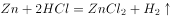

# 化学-金属活动性顺序与反应产生气体逸出对天平平衡的影响

考点：[[20-考点/判断推理/科学推理/化学-金属活动性顺序与反应产生气体逸出对天平平衡的影响|科学推理 / 化学-金属活动性顺序与反应产生气体逸出对天平平衡的影响]]

**问法模型**：天平两端等量酸中加入等质量金属后哪端下沉→分析两端质量变化（是否反应、是否有气体逸出）逐项排除

## 推理链
1. 第1步：由题干和图形可知，天平初始平衡，左右烧杯中为等量稀盐酸，左侧加入锌块、右侧加入铜块，且两金属质量相同
2. 第2步：天平平衡只取决于两端总质量的相对变化，加入相同质量的金属本身不改变平衡，需看金属是否与盐酸反应并产生逸出的气体
3. 第3步：右侧铜的金属活动性排在氢之后，不能与稀盐酸反应，右侧烧杯总质量不变
4. 第4步：左侧锌排在氢之前，与稀盐酸反应生成氢气（Zn+2HCl=ZnCl₂+H₂↑），氢气逸散到空气中，左侧烧杯总质量减少
5. 第5步：左边变轻、右边不变，天平右端缓缓下降，与题干现象一致，故选C

**最快解法**：⚡ 活动性顺序口诀'氢前金属置换氢、氢后金属不反应'+质量差分析：锌在氢前放氢气跑掉→左边变轻右边下沉，直接锁定C

## 易错点
- ⚠ 误以为加入相同质量的金属仍保持平衡，忽略化学反应中气体逸出导致的质量损失
- ⚠ 误选B，认为铜能与稀盐酸反应生成氯化铜，忽略铜排在氢后不与稀盐酸反应
- ⚠ 误选D，把反应放热引起的水蒸发（物理变化）当作化学反应产物，且水蒸气逸出量不足以解释现象

## 母题抽象
> 🧩 当天平两端发生化学反应且一侧产生气体逸出时，比较两端质量净变化（反应物留存量与逸出气体量）判断倾斜方向；无气体逸出的反应按质量守恒不影响平衡

**同类特征**：天平两端等量稀盐酸、分别加入相同质量的锌块与铜块、天平右侧缓缓下降、金属活动性顺序、氢气逸出、质量守恒

## 相关题
- [[10-真题/判断推理/科学推理/1796514 物理-阿基米德原理与漂浮条件（浮力=重力、排水体积分析）|1796514]]（广东 2016，相关度1）

---

### 题干

如图所示，天平左右两端的烧杯中有等量稀盐酸，并处于平衡状态。现在天平左右两端的烧杯中，分别加入相同质量的锌块与铜块，结果发现天平右侧缓缓下降，主要的原因是（  ）。

### 选项
- A. 相同质量的铜块与锌块大小不同
- B. 铜块与稀盐酸反应产生了氯化铜
- C. 锌块与稀盐酸反应产生了氢气　✅
- D. 化学反应产生了大量水蒸气

### 官方解析

A项：铜块与锌块质量相同，产生的重力相同，放在天平两端，不影响平衡，错误；

B项：根据金属活泼性可知，锌在氢前，氢在铜前，铜的活泼性在氢之后，不能够与稀盐酸反应，错误；

C项：锌块与稀盐酸反应会产生氢气，其反应化学方程式为：，生成气体进入空气，导致天平左侧质量减少，正确；

D项：锌块与稀盐酸的化学反应中只产生了氢气。水蒸气是由于化学反应放热，导致水蒸发形成的，而蒸发属于物理变化，说法错误。

故正确答案为C。

### 给定材料
（无）
