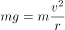
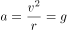
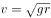

# 物理-竖直面内圆周运动最高点临界条件（向心力来源分析）

考点：[[20-考点/判断推理/科学推理/物理-竖直面内圆周运动最高点临界条件（向心力来源分析）|科学推理 / 物理-竖直面内圆周运动最高点临界条件（向心力来源分析）]]

**问法模型**：竖直圆周运动'恰好不脱离'临界问题 → 先翻译临界条件（轨道弹力为零），再用牛顿第二定律确定向心力来源并逐项检验各物理量

## 推理链
1. 第1步：提取题干关键条件——小球在竖直平面内光滑圆环轨道上做圆周运动，经最高点时'刚好不脱离圆环'
2. 第2步：翻译临界条件'刚好不脱离'：轨道对小球的压力（弹力）恰好为零，此时重力全部充当向心力
3. 第3步：对最高点列牛顿第二定律：mg + N = mv²/r，令N=0，得mg = mv²/r，即向心力等于重力，可解出v=√(gr)、a=v²/r=g
4. 第4步：逐项对照——A错：向心力存在且由重力提供；B对：向心力等于重力；C错：向心加速度a=g≠0；D错：线速度v=√(gr)≠0
5. 第5步：结论——只有B符合临界条件下的物理事实

**最快解法**：⚡ 临界条件法：见'刚好不脱离'立即反应'轨道弹力N=0'，最高点仅受重力，重力即向心力，直接锁定B，无需完整计算

## 易错点
- ⚠ 误以为'刚好不脱离'意味着小球即将停止或速度为零，错选D；实际上不脱离恰恰要求速度达到临界值v=√(gr)
- ⚠ 误以为弹力为零就没有向心力，错选A；向心力是效果力，由重力单独提供时依然存在
- ⚠ 忽略'有向心力必有向心加速度'，误选C；圆周运动中二者始终存在且同时为零才意味着脱离圆周运动

## 母题抽象
> 🧩 当题干出现'竖直圆周运动最高点恰好/刚好不脱离（或恰好通过）'特征时，用临界条件法：弹力取零，验证'向心力=重力、v=√(gr)、a=g'这一组临界结论

**同类特征**：竖直平面内圆周运动、光滑圆环轨道、最高点、刚好不脱离、临界状态、向心力来源判断

## 相关题
（暂无）

---

### 题干
一个小球在竖直平面内的光滑圆环轨道上做圆周运动，小球经过圆环最高点时刚好不脱离圆环。通过最高点时，小球（  ）。

### 选项
- A. 没有受到向心力
- B. 向心力等于重力　✅
- C. 没有向心加速度
- D. 线速度为0

### 官方解析

根据小球在光滑圆环轨道上做圆周运动在最高点时恰好不脱离，故轨道对小球的压力为零，假设圆环半径为，根据牛顿第二定律得，，小球所受的向心力等于小球的重力，A错误，B正确；向心加速度，C错误；线速度，D错误。

故正确答案为B。

### 给定材料
（无）
